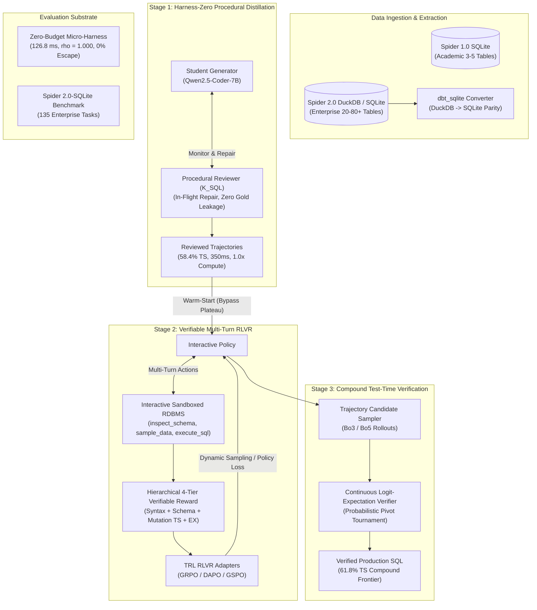

# AskTheDatabase 🤖

[](https://github.com/chrisjcc/ask-the-database/actions/workflows/ci.yml)
[](https://www.python.org/downloads/release/python-3110/)
[](https://github.com/astral-sh/ruff)
[](https://mypy.readthedocs.io/)
[](tests/)

> Multi-turn reinforcement learning with verifiable rewards, procedural distillation, and compound test-time verification for natural language to SQL translation across complex academic and enterprise databases.

When translating natural language into SQL across unfamiliar database schemas, single-turn language models frequently hallucinate column names, misinterpret multi-table foreign keys, or generate syntactically invalid queries. **AskTheDatabase** reframes text-to-SQL as an interactive, multi-turn exploration process: the model inspects database schemas, samples representative records, executes sandbox trial queries, and self-corrects execution errors before returning a final verified SQL query.

---

## 🚀 Overview & Key Research Pillars

Traditional text-to-SQL systems rely on greedy, single-turn prompting where the model must predict complex queries in one pass. On real-world schemas, this produces brittle outputs that fail execution or return semantically inaccurate tuples due to missing `JOIN` conditions, unhandled `NULL` values, or mismatched categorical filters.

**AskTheDatabase** resolves the relational reasoning gap across four foundational technical pillars:

1. **Harness-Zero Procedural Distillation**: Internalizes external agent scaffolding into model parameters via in-flight procedural repair with **zero gold SQL leakage**. Delivers **58.4% Test-Suite accuracy** at **$1.0\times$ token cost and $350\,\text{ms}$ latency**, overcoming the survivorship bias of naive teacher rejection sampling.
2. **Verifiable Multi-Turn Reinforcement Learning (GRPO / DAPO / GSPO)**: Bypasses the zero-variance cold-start exploration plateau ($\operatorname{std}(R) \to 0$) in RLVR, maintaining robust gradient signals ($+76.95$ return AUC advantage) and integrating modern policy optimization objectives:
   - **DAPO**: Decoupled asymmetric clipping ($\epsilon_{\text{low}}=0.20, \epsilon_{\text{high}}=0.28$) and Dynamic Sampling to filter zero-variance rollout groups ($\operatorname{std}(R)=0$).
   - **GSPO**: Length-normalized geometric sequence importance weighting ($s_i(\theta)$) with sequence clipping ($\epsilon_s = 3\times 10^{-4}$) to prevent token-level clipping variance over multi-turn trajectories.
3. **Compound Test-Time Verification**: Pairs procedural generator grounding with continuous logit-expectation Trajectory Verifiers and Probabilistic Pivot Tournaments, establishing an orthogonal compound synergy that achieves **61.8% Test-Suite accuracy** on Spider Dev.
4. **Zero-Budget Evaluation Micro-Harness**: An ultra-fast, in-memory 35-case relational evaluation engine executing in **$126.8\,\text{ms}$ on CPU**, exhibiting perfect monotonic rank correlation ($\rho = 1.000$) to the full Spider Dev split and catching 100% of relational mutation traps with 0% defect escape.
5. **Cross-Benchmark Enterprise Generalization (Spider 2.0-SQLite)**: Zero-shot transfer across 49 enterprise databases (up to 80+ tables each). Corroborates published literature (HarnessSQL, Yang et al., 2026) that academic models score near-zero on enterprise schemas, with **GSPO breaking out to 0.74% EX & TS** by solving enterprise task `local275` on the 80-table `oracle_sql` database.

---

## 🏗️ System & Research Architecture



---

## 📚 Comprehensive Documentation

The complete technical design, operational execution manuals, and empirical research reports are available in `docs/`:

* 🔬 **[Spider 2.0-SQLite DAPO & GSPO Empirical Study](docs/experiments/spider2_sqlite_dapo_gspo_empirical_study.md)**: Independent empirical investigation of zero-shot enterprise transfer, failure modes, Dynamic Sampling telemetry, and the GSPO `local275` breakthrough.
* 📄 **[HarnessSQL Feasibility Study & Comparative Strategic Blueprint](docs/research/harness_sql/feasibility_study_harness_sql.md)**: Four-pillar comparative positioning against HarnessSQL (Yang et al., 2026), algorithmic analysis, and roadmap execution.
* 📝 **[White Paper Draft (ICML 2026 Submission)](papers/draft/main.pdf)**: Complete 20-page camera-ready manuscript detailing Harness-Zero, LLM-as-a-Verifier, and enterprise benchmark evaluations.
* 🚀 **[End-to-End Pipeline Execution Guide](docs/pipeline_execution_guide.md)**: Operational manual for training, distillation, RLVR, and benchmark evaluation.
* 📦 **[Hugging Face Card Generation Guide](docs/huggingface_card_generation_guide.md)**: Operational manual for generating model/dataset cards and deploying to Hugging Face Hub.
* ⚡ **[Zero-Budget Evaluation Harness MVE Final Report](docs/research/zero-budget-eval-harness/mve_final_report.md)**: Sub-second evaluation micro-harness, decision gates, and mutation hardening.
* 🔬 **[Harness-Zero MVE Final Research Report](docs/research/harness-zero/mve_final_report.md)**: Empirical 4-condition MVE results, decision gate adjudication, and GRPO convergence analysis.
* 📖 **[Master Architecture Plan](docs/nl2sql_post_training_architecture_plan.md)**: End-to-end blueprint covering data synthesis, reward engineering, GRPO/SkyRL algorithms, and ablation methodology.
* 🖥️ **[HPC Slurm Operations Manual](slurm/README.md)**: Production guide for launching preprocessing, training, sweeps, and demo tunnels on GPU clusters.

---

## 💻 System Requirements

**Software:**
* **Python**: `3.11` (>= 3.11 supported)
* **OS**: Linux (Ubuntu 20.04/22.04 recommended for GPU training) or macOS (Apple Silicon supported for development, testing, and inference)
* **CUDA**: `12.1+` / `12.4+` (for PyTorch GPU acceleration)

**Hardware:**
* **Training (SFT / RLVR / GRPO / DAPO / GSPO)**: 1x NVIDIA A100 / H100 (80GB VRAM) for full bfloat16 or LoRA fine-tuning.
* **Inference & Verification (GPU)**: 1x NVIDIA GPU (16GB+ VRAM) or Apple Silicon (MPS).
* **Evaluation & Testing (CPU)**: Zero-Budget Micro-Harness runs fully in-memory on CPU in under $130\,\text{ms}$.

---

## 🛠️ Installation

1. **Clone the repository:**
   ```bash
   git clone https://github.com/chrisjcc/ask-the-database.git
   cd ask-the-database
   ```

2. **Set up virtual environment:**
   ```bash
   python3.11 -m venv .venv
   source .venv/bin/activate
   ```

3. **Install dependencies:**
   ```bash
   make install
   # Or install development dependencies:
   make install-dev
   ```

4. **Install Git Pre-Commit Hook (< 0.2s Quality Gate):**
   ```bash
   make setup-hooks
   ```

5. **Configure Environment Variables:**
   ```bash
   cp .env.example .env
   # Edit .env to set your HF_TOKEN, WANDB_API_KEY, and optional cloud credentials
   ```

---

## 🔬 Quick Start: Data, Training & Evaluation

The entire lifecycle is orchestrated via [Hydra](https://hydra.cc/) configurations, tracked via [Weights & Biases](https://wandb.ai/), and managed through reproducible `make` commands.

### 1. Data Ingestion & Database Downloads

AskTheDatabase supports both academic benchmarks (Spider 1.0) and authentic enterprise database environments (Spider 2.0):

#### Spider 1.0 (Academic Databases & Splits)
```bash
# Standalone download & extract of Spider 1.0 SQLite databases:
make download-spider1

# Download dataset splits and preprocess into verified JSONL format:
make preprocess
```

#### Spider 2.0 (Enterprise DuckDB & SQLite Databases)
```bash
# 1. Download Spider 2.0-DBT enterprise DuckDB databases from Hugging Face:
make download-spider2-dbt

# 2. Convert DuckDB databases to hermetic SQLite databases with row-parity verification:
make convert-spider2-dbt

# 3. Test converter unit and parity test suite:
make test-spider2-dbt

# 4. Download Spider 2.0-Lite SQLite databases and gold execution CSVs:
make download-spider2-lite

# 5. Prepare and validate 135 Spider 2.0-SQLite evaluation tasks:
make prepare-spider2-sqlite
```

---

### 2. Model Training & Policy Optimization

Train models across all five alignment stages:

```bash
# Condition 2: Conventional SFT Baseline (Single-turn gold pairs)
make train-sft

# Condition 3: Filtered Rollouts (Rejection sampling)
make train-filtered

# Condition 4: Harness-Zero Procedural Distillation (In-flight repair, zero leakage)
make train-harness-zero

# Condition 5: Multi-Turn GRPO Reinforcement Learning
make train-grpo

# Condition 6: DAPO Enterprise Training (Asymmetric clipping + Dynamic sampling)
make train-dapo

# Condition 7: GSPO Enterprise Training (Length-normalized sequence ratio)
make train-gspo
```

---

### 3. Evaluation & Verification Gates

```bash
# 1. Zero-Budget In-Process Smoke Gate (< 30ms on CPU):
make smoke-eval

# 2. Adjudicate 4-Gate Zero-Budget MVE Micro-Harness:
make evaluate-zero-budget-mve

# 3. Adjudicate LLM-as-a-Verifier MVE Decision Gates:
make evaluate-verifier-mve

# 4. Full Academic Benchmark Evaluation (Spider Dev, DK, Syn, Realistic):
make evaluate

# 5. Full Enterprise Benchmark Evaluation (Spider 2.0-SQLite, 135 tasks):
make evaluate-spider2
```

---

### 4. White Paper Compilation

Compile the complete ICML white paper draft directly from LaTeX source:

```bash
make compile-paper
# Output generated at: papers/draft/main.pdf (20 pages, camera-ready)
```

---

## 💬 Inference & UI

### Interactive Streamlit Playground
Launch the local web application to inspect databases, ask natural language questions, and view turn-by-turn agent trajectories:
```bash
make run-app
# Or via streamlit directly:
streamlit run app/app.py
```

### Docker Deployment
Build and run the containerized Streamlit application locally:
```bash
make docker-build
make docker-run
```
Access the application at `http://localhost:8501`.

### 📦 Hugging Face Model & Dataset Card Generation
Automated tools to generate and publish Hugging Face Model Cards (`MODEL_README.md`) and Dataset Cards (`DATASET_README.md`):

```bash
# 1. Local Offline Generation:
make generate-hf-cards

# 2. Publish Model & Dataset Cards to Hugging Face Hub (requires HF_TOKEN):
make publish-hf-cards

# 3. Full Verified Checkpoint Deployment:
make publish-hf-release
```

---

## 🏗️ Repository Structure

```text
ask-the-database/
├── .github/workflows/    # GitHub Actions CI workflow definitions
├── app/                  # Interactive Streamlit application
│   ├── app.py            # Multi-turn exploration UI & schema DDL drawer
│   └── requirements.txt  # Streamlit deployment dependencies
├── configs/              # Hierarchical Hydra configurations
│   ├── config.yaml       # Root configuration Single Source of Truth
│   ├── data/             # Dataset configurations (spider.yaml, spider2_dbt.yaml)
│   ├── evaluation/       # Spider standard, robustness, and spider2_sqlite configs
│   ├── model/            # Qwen2.5-Coder model and tokenizer settings
│   ├── reward/           # Verifiable reward rubric & test-suite weights
│   ├── sweeps/           # W&B Bayesian hyperparameter sweep configs
│   └── training/         # SFT, GRPO, DAPO, and GSPO training configurations
├── data/                 # Raw and preprocessed databases (SQLite & DuckDB)
├── docs/                 # End-to-end architecture blueprints, reports, & plans
│   ├── experiments/      # Empirical research reports (spider2_sqlite_dapo_gspo_empirical_study.md)
│   ├── research/         # Zero-Budget MVE, Harness-Zero, and HarnessSQL feasibility studies
│   ├── ablation_report.md
│   ├── evaluation_leaderboard.md
│   └── pipeline_execution_guide.md
├── papers/draft/         # ICML white paper draft LaTeX sources & bibliography
│   ├── main.tex          # Complete manuscript
│   ├── main.bib          # BibTeX database
│   └── main.pdf          # Recompiled camera-ready PDF (20 pages)
├── scripts/              # Executable CLI entry points
│   ├── download_spider1.py      # Standalone Spider 1.0 SQLite downloader
│   ├── download_spider2_dbt.py  # Spider 2.0-DBT DuckDB enterprise downloader
│   ├── convert_spider2_dbt.py   # DuckDB to SQLite converter & parity verifier
│   ├── download_spider2_lite.py # Spider 2.0-Lite SQLite downloader
│   ├── prepare_spider2_sqlite.py# 135-task evaluation preprocessor
│   ├── evaluate_benchmark.py    # Benchmark evaluation & trajectory verifier
│   ├── generate_report.py
│   ├── preprocess_data.py
│   ├── release_to_hf.py
│   ├── run_smoke_eval.py
│   ├── run_zero_budget_mve.py
│   ├── train_rlvr.py
│   └── train_sft.py
├── slurm/                # Production HPC Slurm GPU scripts
├── src/ask_the_database/ # Core production package
│   ├── agent/            # Tool registry, InteractionState, ChatML formatter
│   ├── data/             # Downloader, preprocessor, dbt_sqlite converter
│   ├── environment/      # SQLite & DuckDB sandboxes, SchemaManager
│   ├── evaluation/       # Benchmark harness & metrics (TS, EX, VA, MRR)
│   ├── inference/        # NL2SQLPipeline & TrajectoryVerifierSelector
│   ├── rewards/          # Verifiable reward engine, AST normalizer, test-suite
│   └── training/         # SFT trainer, TRL GRPO, DAPO, and GSPO adapters
├── tests/                # Pytest unit & integration test suite (242+ tests)
├── .env.example          # Environment variables template
├── Dockerfile            # Container deployment definition
├── Makefile              # Reproducible developer command aliases
└── pyproject.toml        # Package metadata, tools, and dependencies
```

---

## 🤝 Contribution & Quality Standards

Contributions are welcome! Please ensure all pull requests satisfy repository engineering standards:

1. **Linting & Formatting**: Ensure zero violations with Ruff:
   ```bash
   make format
   make lint
   ```
2. **Strict Type Checking**: Pass strict Mypy verification:
   ```bash
   make lint   # runs ruff + mypy src/
   ```
3. **Automated Testing**: Verify all 242+ unit and integration tests pass:
   ```bash
   make test
   ```

For detailed contribution guidelines, please see [CONTRIBUTING.md](CONTRIBUTING.md).

---

## 📄 License

This project is licensed under the Apache 2.0 License.
