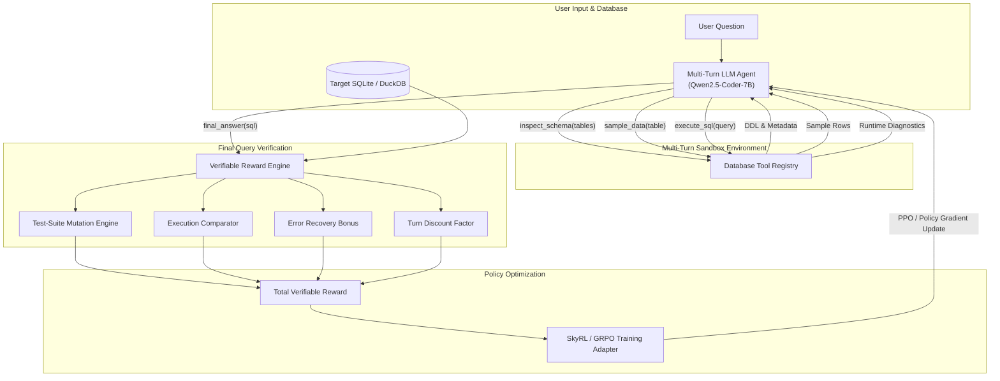

# AskTheDatabase 🤖

[](https://github.com/chrisjcc/ask-the-database/actions/workflows/ci.yml)
[](https://www.python.org/downloads/release/python-3110/)
[](https://github.com/astral-sh/ruff)
[](https://mypy.readthedocs.io/)

> Multi-turn reinforcement learning with verifiable rewards for natural language to SQL translation across complex relational databases.

When translating natural language into SQL across unfamiliar database schemas, single-turn language models frequently hallucinate column names, misinterpret multi-table foreign keys, or generate syntactically invalid queries. **AskTheDatabase** reframes text-to-SQL as an interactive, multi-turn exploration process: the model inspects database schemas, samples representative records, executes sandbox trial queries, and self-corrects execution errors before returning a final verified SQL query.

---

## 🚀 Overview & Motivation

Traditional text-to-SQL systems rely on greedy, single-turn prompting where the model must predict complex queries in one pass. On real-world schemas, this produces brittle outputs that fail execution or return semantically inaccurate tuples due to missing `JOIN` conditions, unhandled `NULL` values, or mismatched categorical filters.

**AskTheDatabase** addresses this challenge via a two-stage post-training architecture:

1. **Supervised Fine-Tuning (SFT) Warm-Up**: Seeds the policy (e.g. Qwen2.5-Coder-7B) with structured ChatML reasoning traces and database tool-calling primitives over the Spider benchmark.
2. **Reinforcement Learning with Verifiable Rewards (RLVR / GRPO / SkyRL)**: Directly optimizes multi-turn exploration policies using deterministic, execution-based ground truth rewards:
   - **Test-Suite Correctness (TS)**: Evaluates candidate SQL against mutated database states to reject false positive execution matches.
   - **Execution Accuracy (EX)**: Measures tuple-level fidelity against gold query execution results.
   - **AST & Schema Validity (VA)**: Enforces syntactic validity and schema consistency via SQLGlot.
   - **Turn Discounting & Error Recovery Bonus**: Penalizes extraneous tool turns while explicitly rewarding the agent for diagnosing and recovering from intermediate SQL runtime errors.

---

## 🏗️ System & Research Architecture



The system architecture is structured across five modular phases:
* **Phase 1: Foundation & Sandbox**: Single Source of Truth (SSoT) Hydra configs, strict read-only SQLite/DuckDB execution sandboxes, and injection prevention.
* **Phase 2: Verifiable Reward Engine**: AST SQLGlot normalizer, semantic execution equivalence, and automated test-suite mutation generator.
* **Phase 3: SFT Warmup & Adapters**: Qwen2.5-Coder ChatML formatting, Hugging Face PEFT/LoRA adapters, and TRL GRPO integration.
* **Phase 4: Multi-Turn Agent Environment**: `DatabaseToolRegistry`, `InteractionState`, step discounting, error recovery rewards, and `SkyRLSQLEnvironment` adapter.
* **Phase 5: Benchmarking, Sweeps & UI**: Comprehensive evaluation harness (Spider Standard, DK, Syn, Realistic), W&B Weave trajectory tracing, Bayesian sweep infrastructure, hardened Slurm GPU cluster scripts, and an interactive Streamlit playground.

---

## 📚 Comprehensive Documentation

The complete technical design, operational execution manuals, and research studies are documented in `docs/`:

* 🚀 **[End-to-End Pipeline Execution Guide](docs/pipeline_execution_guide.md)**: Operational manual for training, distillation, RLVR, and benchmark evaluation.
* 🔬 **[Harness-Zero MVE Final Research Report](docs/research/harness-zero/mve_final_report.md)**: Empirical 4-condition MVE results, decision gate adjudication, and GRPO convergence analysis.
* 📄 **[Harness-Zero Feasibility Study](docs/research/harness-zero/feasibility_study.md)**: Theoretical foundation, agent-as-harness methodology, and post-training architecture.
* 📖 **[Master Architecture Plan](docs/nl2sql_post_training_architecture_plan.md)**: End-to-end blueprint covering data synthesis, reward engineering, GRPO/SkyRL algorithms, and ablation methodology.
* 🛠️ **[Phase 1 Implementation Plan](docs/ask_the_database_phase1_implementation_plan.md)**: Repository Foundation, SSoT Architecture & DB Sandbox.
* ⚖️ **[Phase 2 Implementation Plan](docs/ask_the_database_phase2_implementation_plan.md)**: Verifiable Reward Engine & Test-Suite Verification.
* 🏋️ **[Phase 3 Implementation Plan](docs/ask_the_database_phase3_implementation_plan.md)**: Warm-Up SFT Baseline & Adapter Design.
* 🤖 **[Phase 4 Implementation Plan](docs/ask_the_database_phase4_implementation_plan.md)**: Multi-Turn Agent Environment & SkyRL Integration.
* 📊 **[Phase 5 Implementation Plan](docs/ask_the_database_phase5_implementation_plan.md)**: Benchmarking, Sweeps, Slurm Deployment & Production UI.
* 📈 **[Ablation Study Report](docs/ablation_report.md)**: Empirical comparison of Base vs. SFT vs. RLVR on Spider splits.
* 🏆 **[Evaluation Leaderboard](docs/evaluation_leaderboard.md)**: Leaderboard metrics (TS, EX, VA, MRR, Latency) across model variants.
* 🖥️ **[HPC Slurm Operations Manual](slurm/README.md)**: Production guide for launching preprocessing, training, sweeps, and demo tunnels on GPU clusters.

---

## 💻 System Requirements

**Software:**
* **Python**: `3.11` (>= 3.11 supported)
* **OS**: Linux (Ubuntu 20.04/22.04 recommended for GPU training) or macOS (Apple Silicon supported for development and inference)
* **CUDA**: `12.1+` / `12.4+` (for PyTorch GPU acceleration)

**Hardware:**
* **Training (SFT / RLVR / GRPO)**: Minimum 1x NVIDIA A100 / H100 (80GB VRAM) for full bfloat16 or LoRA fine-tuning.
* **Inference (GPU)**: 1x NVIDIA GPU (16GB+ VRAM) or Apple Silicon (MPS).
* **Inference (CPU)**: Supported out of the box via lightweight heuristic fallback execution or quantized PyTorch inference.

---

## 🛠️ Installation

1. **Clone the repository:**
   ```bash
   git clone https://github.com/chrisjcc/ask-the-database.git
   cd ask-the-database
   ```

2. **Set up virtual environment:**
   ```bash
   python3.11 -m venv .venv
   source .venv/bin/activate
   ```

3. **Install dependencies:**
   ```bash
   make install
   # Or install all optional components (training, UI, dev tools):
   pip install -e ".[dev,training,ui]"
   ```

4. **Configure Environment Variables:**
   ```bash
   cp .env.example .env
   # Edit .env to set your HF_TOKEN, WANDB_API_KEY, and optional cloud credentials
   ```

---

## 🔬 Quick Start: Training & Evaluation

The entire lifecycle is orchestrated via [Hydra](https://hydra.cc/) configurations, tracked via [Weights & Biases](https://wandb.ai/), and managed through reproducible commands.

### 1. Data Ingestion & Preprocessing
Download and normalize the Spider database schemas and conversational splits:
```bash
make preprocess
# Or via python directly:
python scripts/preprocess_data.py
```

### 2. Supervised Fine-Tuning (SFT Warm-Up)
Train the Qwen2.5-Coder base model to master tool-calling syntax and SQL reasoning:
```bash
make train-sft
# Custom configuration override:
python scripts/train_sft.py training.batch_size=8 training.learning_rate=2e-5
```

### 3. Multi-Turn RLVR Agent Training
Train the agent policy using SkyRL / GRPO with verifiable execution rewards:
```bash
python scripts/train_rlvr.py --config-name rlvr_skyrl_agent
```

### 4. Bayesian Hyperparameter Sweeps
Orchestrate Bayesian hyperparameter search over learning rates, KL penalties, and reward coefficients:
```bash
wandb sweep configs/sweeps/rlvr_sweep.yaml
# Launch throttled array job on Slurm cluster (%1 ensures sequential GP updates):
sbatch --export=ALL,SWEEP_ID='<entity>/ask-the-database/<sweep_id>' slurm/04_sweep_array.slurm
```

### 5. Benchmark Evaluation
Evaluate models on Spider Standard, Spider-DK, Spider-Syn, and Spider-Realistic:
```bash
python scripts/evaluate_benchmark.py --config configs/evaluation/spider_standard.yaml
python scripts/evaluate_benchmark.py --config configs/evaluation/spider_robustness.yaml
```

### 6. Automated Reporting & Weave Tracing
Synthesize evaluation tables and export trajectory execution graphs:
```bash
python scripts/generate_report.py
```

---

## 💬 Inference & UI

### Interactive Streamlit Playground
Launch the local web application to inspect databases, ask natural language questions, and view turn-by-turn agent trajectories:
```bash
streamlit run app/app.py
```

### Docker Deployment
Build and run the containerized Streamlit application locally:
```bash
docker build -t ask-the-database:latest .
docker run --env-file .env -p 8501:8501 ask-the-database:latest
```
Access the application at `http://localhost:8501`.

### HPC Slurm SSH Tunneling
Deploy the demo directly on an HPC GPU node and forward the port to your local machine:
```bash
sbatch slurm/06_demo_tunnel.slurm
# Check log for exact ssh port forwarding command:
cat slurm/logs/demo_<job_id>.log
```

---

## 🏗️ Repository Structure

```text
ask-the-database/
├── .github/workflows/    # GitHub Actions CI workflow definitions
├── app/                  # Interactive Streamlit application
│   ├── app.py            # Multi-turn exploration UI & schema DDL drawer
│   └── requirements.txt  # Streamlit deployment dependencies
├── configs/              # Hierarchical Hydra configurations
│   ├── config.yaml       # Root configuration Single Source of Truth
│   ├── evaluation/       # Spider standard and robustness benchmark configs
│   ├── model/            # Qwen2.5-Coder model and tokenizer settings
│   ├── reward/           # Verifiable reward rubric & test-suite weights
│   ├── sweeps/           # W&B Bayesian hyperparameter sweep configs
│   └── training/         # SFT and RLVR SkyRL training configurations
├── data/                 # Raw and preprocessed Spider databases (SQLite)
├── docs/                 # End-to-end architecture blueprint & phase plans
│   ├── ablation_report.md
│   ├── evaluation_leaderboard.md
│   └── nl2sql_post_training_architecture_plan.md
├── scripts/              # Executable CLI entry points
│   ├── evaluate_benchmark.py
│   ├── generate_report.py
│   ├── preprocess_data.py
│   ├── train_rlvr.py
│   └── train_sft.py
├── slurm/                # Production HPC Slurm GPU scripts
│   ├── 01_preprocess.slurm
│   ├── 02_sft_warmup.slurm
│   ├── 03_rlvr_train.slurm
│   ├── 04_sweep_array.slurm
│   ├── 05_evaluate.slurm
│   ├── 06_demo_tunnel.slurm
│   └── README.md
├── src/ask_the_database/ # Core production package
│   ├── agent/            # Tool registry, InteractionState, ChatML formatter
│   ├── environment/      # SQLite & DuckDB sandboxes, SchemaManager
│   ├── evaluation/       # Benchmark harness & metrics (TS, EX, VA, MRR)
│   ├── inference/        # NL2SQLPipeline & AgentTrajectory rollout engine
│   ├── rewards/          # Verifiable reward engine, AST normalizer, test-suite
│   └── training/         # SFT trainer, TRL GRPO & SkyRL adapters
├── tests/                # Pytest unit & integration test suite (116+ tests)
├── .env.example          # Environment variables template
├── .env.template         # Cluster secrets template
├── Dockerfile            # Container deployment definition
├── Makefile              # Reproducible developer command aliases
└── pyproject.toml        # Package metadata, tools, and dependencies
```

---

## 🤝 Contribution & Quality Standards

Contributions are welcome! Please ensure all pull requests satisfy repository engineering standards:

1. **Linting & Formatting**: Ensure zero violations with Ruff:
   ```bash
   make format
   make lint
   ```
2. **Strict Type Checking**: Pass strict Mypy verification:
   ```bash
   mypy src/
   ```
3. **Automated Testing**: Verify all 116+ unit and integration tests pass:
   ```bash
   make test
   ```

For detailed contribution guidelines, please see [CONTRIBUTING.md](CONTRIBUTING.md).

---

## 📄 License

This project is licensed under the Apache 2.0 License.
