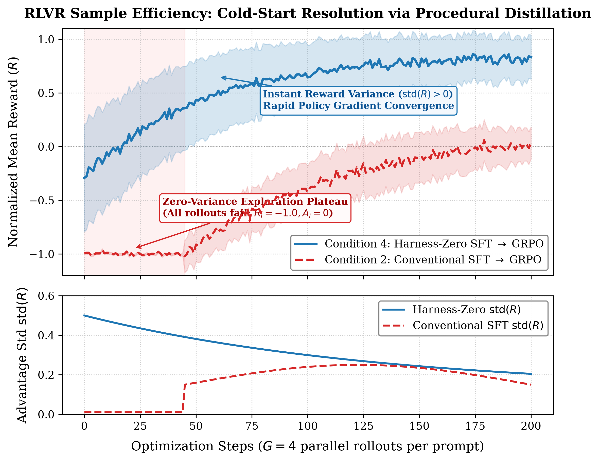
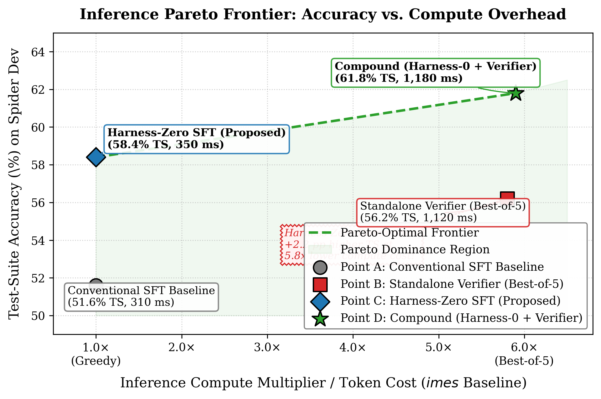

# Stop Guessing the Schema: Why LLMs Need Internalized Exploration and How Harness Distillation Solves Text-to-SQL

### Teaching language models to autonomously inspect database catalogs, eliminate cold-start RL collapse, and scale relational reasoning with compound verification.

**By Christian Contreras-Campana**  
*Published on Medium · 30 min read*  
*Canonical Article: [https://medium.com/@chrisjcc/stop-guessing-the-schema-why-llms-need-internalized-exploration-and-how-harness-distillation-06f4d27d3f7c](https://medium.com/@chrisjcc/stop-guessing-the-schema-why-llms-need-internalized-exploration-and-how-harness-distillation-06f4d27d3f7c)*

---

Every developer who has built an autonomous Text-to-SQL agent has witnessed this frustrating failure mode:

A user asks a straightforward business question:  
> *"Show me the top 5 customers with recurring monthly subscriptions who haven't logged in over the last 30 days."*

The model confidently emits a syntactically pristine SQL query. It features subqueries, window functions, and proper aliases. It looks magnificent—until you execute it against the database:

```sql
SELECT c.customer_id, c.customer_name, s.mrr
FROM customers c
JOIN subscriptions s ON c.id = s.customer_id
WHERE s.plan_type = 'monthly'
  AND c.last_login_date < DATE('now', '-30 days')
ORDER BY s.mrr DESC
LIMIT 5;
```

```text
OperationalError: no such column: c.id
OperationalError: no such column: c.last_login_date
```

The model hallucinated column names. In reality, the table used `account_id` instead of `id`, stored login timestamps in an `auth_events` audit table, and represented plan durations as an integer enum rather than the string `'monthly'`.

**Why did this happen?** Because modern frontier models have been trained on static text-to-SQL corpora where the prompt contains an abbreviated schema snippet, and the target is a single-turn gold SQL string. When deployed against real-world relational databases containing dozens of tables and hundreds of attributes, the model doesn't know how to **explore**. It guesses based on surface linguistic associations.

In this deep dive, we present **AskTheDatabase**, an end-to-end framework that solves this fundamental bottleneck. We explain:
1. Why conventional agent harnesses and prompt scaffolding are too slow and expensive for interactive production systems.
2. How **Harness-Zero** procedural distillation transfers multi-turn exploratory habits directly into model parameters without gold query leakage.
3. How internalized exploration solves the **zero-variance cold-start plateau** in Reinforcement Learning with Verifiable Rewards (RLVR / GRPO).
4. Why standalone test-time verification is **strictly Pareto-dominated**, and how pairing it with Harness-Zero establishes a state-of-the-art **Compound Architecture** reaching **61.8% Test-Suite accuracy** on Spider.
5. How we built an in-memory **Zero-Budget Evaluation Micro-Harness** that executes in **126.8 ms** with a perfect monotonic correlation ($\rho = 1.000$) to full benchmark evaluations.
6. How these capabilities generalize to enterprise environments with up to 80+ tables (**Spider 2.0-SQLite**), where modern policy optimization objectives (**DAPO** and **GSPO**) break through the zero-knowledge barrier.

---

## The Three Dilemmas of Production Text-to-SQL

Building autonomous data agents reveals three stark engineering trade-offs:

```
┌─────────────────────────────────────────────────────────────────────────────┐
│                       The Text-to-SQL Trilemma                              │
├───────────────────────────────┬─────────────────────────────────────────────┤
│ 1. The Exploration Dilemma    │ Single-turn guessing hallucinates schemas;  │
│                               │ Multi-turn harnesses incur 5-10x latency.   │
├───────────────────────────────┼─────────────────────────────────────────────┤
│ 2. The Verification Dilemma   │ Production queries have no ground truth;    │
│                               │ Ungrounded candidate pools fool verifiers.  │
├───────────────────────────────┼─────────────────────────────────────────────┤
│ 3. The Evaluation Bottleneck  │ Full test-suite suites take 3-6 minutes;    │
│                               │ Slow CI cycles paralyze agent development.  │
└───────────────────────────────┴─────────────────────────────────────────────┘
```

### From Static SQL Generation to Autonomous Database Exploration

Traditional Text-to-SQL benchmarks have largely framed the task as a single-turn semantic parsing problem: given a natural-language question and the complete database schema (DDL), generate the corresponding SQL query. The model effectively learns a direct mapping from `(Question + Full DDL) → SQL`, without interacting with the database engine or actively investigating its structure.

However, this formulation becomes increasingly impractical in enterprise environments, where relational databases can contain hundreds of tables and thousands of columns. Providing the complete schema in every prompt is often infeasible, and expecting a model to infer unfamiliar database structures from linguistic associations alone inevitably leads to schema hallucinations.

We therefore reframed Text-to-SQL as an **autonomous, multi-turn database exploration problem**. Rather than providing the schema upfront, we withhold it from the initial prompt and require the model to discover the relevant database structure through interaction. The agent must autonomously issue tool calls such as `inspect_schema`, `sample_data`, and `execute_sql`, progressively gathering information, validating its assumptions, and recovering from execution errors over multiple turns.

This change in problem formulation introduced an important behavioral consequence. A model trained to explore a database interactively does not necessarily behave like a conventional single-turn SQL generator, even when the full schema is subsequently provided in the prompt. Its learned policy increasingly favors active inspection over immediate query generation. Consequently, evaluating such an agent with a conventional single-turn SQL execution harness can penalize the exploratory behavior multi-turn training was meant to develop.

This revealed an important distinction between **learning to generate SQL given a known schema and learning to discover autonomously and reason about an unfamiliar schema**. The two capabilities require different interaction policies and, critically, different evaluation protocols.

### 1. The Multi-Turn Latency Tax
The natural response to schema hallucination is to give the model access to database tools and allow it to explore before generating its final query. Frameworks and prompting strategies such as ReAct, Reflexion, and DIN-SQL follow this general approach, equipping models with tools such as `inspect_schema`, `sample_data`, and `execute_sql` to support iterative schema discovery and query refinement.

While effective at improving query accuracy, this approach introduces a **high inference-time cost**. Each interaction requires another sequential model invocation, often involving a tool call, an environment response, and another generation step. A five-turn trajectory can therefore require five sequential model round-trips before producing a final SQL query.

This creates a fundamental tension between **exploration capability and inference efficiency**. The more an agent relies on iterative interaction to discover database structures, validate assumptions, and recover from execution errors, the greater the latency and compute overhead at inference time.

In a target production setting, this is particularly problematic. User-facing analytics applications, interactive dashboards, and conversational data interfaces cannot always tolerate the additional latency of extended agentic execution. A query that takes several seconds to resolve may be technically correct but operationally unsuitable.

The challenge, then, is not simply to teach models how to explore databases. It is to develop models that can internalize these exploratory procedures rather than depend entirely on an externally orchestrated tool-calling loop.

### 2. The Survivorship Bias of Rejection Sampling
A common alternative is **rejection sampling** (best-of-$N$ filtering): sample trajectories from a base student, execute them, discard the failures, and fine-tune on the successful rollouts.

However, rejection sampling suffers from severe **survivorship bias**. By discarding every failed rollout, the model never observes *how to recover* from errors. When it encounters an unexpected SQLite operational exception in production, it lacks the procedural muscle memory to diagnose the issue and falls into repetitive retry loops.

### 3. The Cold-Start Gradient Collapse in RLVR
When training multi-turn agents with Group Relative Policy Optimization (GRPO), the policy gradient is driven by intra-group advantage:

$$A_i = \frac{R_i - \mathrm{mean}(\{R_j\}_{j=1}^G)}{\mathrm{std}(\{R_j\}_{j=1}^G) + \epsilon}$$

If an ungrounded model explores an unseen database schema without prior exploratory habits, **all $G$ sampled rollouts in the group frequently fail simultaneously** ($R_1 = R_2 = \dots = R_G = -1.0$). 

When every rollout fails:

$$\mathrm{std}(\{R_j\}_{j=1}^G) = 0 \implies A_i = 0 \quad \forall i$$

The advantage vanishes, the policy gradient collapses to zero ($\nabla_\theta \mathcal{J} = 0$), and the model enters an extended exploration plateau where it receives no directional learning signal whatsoever. 

In our empirical 250-step study, an agent initialized from standard single-turn SFT stalled for **27 steps** before producing a single non-negative reward, collapsed to an intra-group reward standard deviation of $\mathrm{std}(R) = 0.045$, and ended with a disastrous **1.26% Test-Suite accuracy** and **0.20% recovery rate** on Spider Dev. Without prior procedural grounding, RLVR alone completely fails to bootstrap multi-turn database interaction.

---

## Pillar 1: Harness-Zero (Harness Distillation via Agent-as-Harness)

The preceding limitations point to a common problem: **models should not have to rediscover essential database exploration procedures through repeated trial and error at inference time.** Relying on runtime orchestration increases latency, while relying on conventional SFT alone can leave the model without the exploratory behaviors needed to learn effectively through multi-turn reinforcement learning.

We address this with **Harness-Zero**, as established by **Ye et al. (2026)**, a procedural distillation approach that moves the burden of enforcing exploratory discipline from inference-time orchestration into the training process.

The central idea is straightforward:

> **Teach the model how to investigate a database during training, rather than requiring an external harness to orchestrate that behavior at inference time.**

```
                      Harness-Zero Distillation Pipeline
                      
  Natural Language Prompt (x)
             │
             ▼
   Student Model (π_θ) ──[ Emits Action a_t ]──► Environment Sandbox
             ▲                                            │
             │           Procedural Reviewer              ▼
             │                 (K_SQL)             Observation o_t
             │          [Zero Gold Leakage!]              │
             │                   │                        │
             └──[ Corrective Action z_t ]◄────────────────┘
                                 │
                                 ▼
                     Repaired Trajectory T_rep
                                 │
                                 ▼
                    Standard SFT on Agent Steps
                    (External Reviewer Discarded)
```

Harness-Zero introduces a procedural reviewer, denoted by $\mathcal{K}_{\text{SQL}}$, that operates alongside the student model during trajectory generation. Rather than providing the student with the correct SQL query, the reviewer monitors its interactions with the database environment and intervenes when necessary to enforce specific exploration and validation procedures.

These interventions produce repaired interaction trajectories that demonstrate how the student should inspect unfamiliar schemas, examine representative data, validate candidate queries, and recover from execution errors. We then use these trajectories for standard supervised fine-tuning (SFT), transferring the procedural behavior into the student model’s parameters.

Crucially, the reviewer is a **training-time mechanism, not an inference-time dependency**. Once the student has been fine-tuned on the repaired trajectories, the reviewer is removed. The resulting model can apply the learned procedures through its own policy, without requiring the same external corrective mechanism at deployment.

### Answer Distillation vs. Harness Distillation
Most conventional distillation approaches focus on **answer distillation**: a teacher model is given access to the ground-truth SQL query and uses it to guide the student toward the correct output. The student learns primarily from the relationship between the input question and the target query.

Harness-Zero takes a different approach. Instead of teaching the student what the correct SQL query is, it teaches the student **how to investigate the database and construct a valid query through interaction with the environment**.

This distinction is important. When a teacher has access to the ground-truth answer, its guidance can inadvertently expose the student to shortcuts that do not generalize to unfamiliar schemas. A procedural reviewer, by contrast, does not need access to the gold query. It evaluates the student’s interaction with the database and enforces behaviors that support systematic schema discovery, query validation, and error recovery.

In **AskTheDatabase**, we implement this approach through a procedural reviewer, $\mathcal{K}_{\text{SQL}}$, which monitors student rollouts and enforces four deterministic protocols:

1. **`RequireSchemaInspection`**: Before querying unfamiliar tables, the student must inspect their definitions and relationships. For example, if it attempts to query `orders` and `line_items` without first inspecting their schemas, $\mathcal{K}_{\text{SQL}}$ intervenes and requires the corresponding `inspect_schema(["orders", "line_items"])` call.
2. **`RequireRowSampling`**: When a query depends on categorical values or other data-specific assumptions, the student must inspect representative records before proceeding. For example, before filtering on `status = 'Active'`, it may be required to call `sample_data("orders", limit=3)` to verify the actual values, casing, and formatting.
3. **`EnforceDryRunBeforeFinish`**: The student cannot submit a query as `final_answer` until it has attempted a trial execution through `execute_sql` and verified that the query completes without runtime exceptions.
4. **`DiagnosticRecovery`**: When execution fails, for example because of a nonexistent column, the reviewer prevents repeated blind retries and requires a targeted schema lookup before the student attempts to revise the query.

Together, these protocols teach a consistent interaction strategy: **inspect before assuming, sample before filtering, execute before submitting, and diagnose before retrying.**

The reviewer does not supply the correct SQL or choose the final query on the student’s behalf. Its role is to enforce the procedural conditions under which the student generates and validates its own solutions. The resulting repaired trajectories provide supervised training examples of these behaviors, allowing the student to internalize the procedures through fine-tuning.

### Three Fundamental Distillation Invariants
Harness-Zero is designed to preserve three fundamental properties throughout the distillation process:

1. **Zero Gold Leakage**: The procedural reviewer, $\mathcal{K}_{\text{SQL}}$, has no access to `gold_sql`. Its interventions rely exclusively on observable database information, including catalog metadata, sampled records, and execution feedback. The reviewer enforces how the student interacts with the environment without revealing the ground-truth query.
2. **Action Space Invariance**: All interventions operate strictly within the student’s existing action space: `inspect_schema`, `sample_data`, `execute_sql`, and `final_answer`. The reviewer does not introduce additional tools or expand the actions available to the student. It enforces disciplined use of the capabilities the student already possesses.
3. **Zero Reviewer Dependency at Inference**: Once the student has been fine-tuned on the repaired trajectories, $\mathcal{K}_{\text{SQL}}$ is completely discarded. At inference time, the student operates independently of the procedural reviewer, using its learned policy to decide when and how to inspect the database, validate queries, and recover from errors.

---

## Pillar 2: Resolving the RLVR Cold-Start Plateau

With procedural exploration internalized through Harness-Zero, we can now align the student using multi-turn Reinforcement Learning with Verifiable Rewards (RLVR), implemented with Group Relative Policy Optimization (GRPO).

The central challenge is **reward diversity during early training**. GRPO estimates relative advantages by comparing the rewards of multiple sampled rollouts within a group. If an ungrounded model repeatedly fails in the same way across all sampled rollouts, every trajectory receives an identical reward. The resulting normalized advantages are zero, leaving that group with no useful policy-gradient signal.

Harness-Zero addresses this problem by improving the initial exploration behavior of the student before RLVR begins. In our experiments, procedural pre-fine-tuning increases the schema pre-inspection rate from **46.2% to 84.6%**. The model is therefore substantially more likely to inspect unfamiliar database structures, discover valid relationships, and produce rollouts with different outcomes and reward values.

This changes the initial conditions for GRPO. Instead of starting from a policy that frequently fails uniformly across its sampled trajectories, GRPO starts from a procedurally grounded policy with a greater opportunity to explore successfully and generate informative reward differences.

### Why Procedural Grounding Restores the Learning Signal
Consider a GRPO sampling group with $G=4$ rollouts.

```
                  GRPO Intra-Group Reward Variance
                  
  Conventional SFT Rollouts:
  [Fail: -1.0]  [Fail: -1.0]  [Fail: -1.0]  [Fail: -1.0]  ──► std(R) = 0.0  ──► Advantage = 0 (STALL)
  
  Harness-Zero Pre-Grounded Rollouts:
  [Fail: -0.4]  [Syntax: +0.2]  [TS Match: +1.0]  [Err: -0.5]  ──► std(R) = 0.44 ──► High Policy Gradient!
```

Because all sampled rewards are identical in the ungrounded baseline, the group-normalized advantages vanish. The group consequently contributes no policy-gradient signal, regardless of how many unsuccessful trajectories were sampled.

With Harness-Zero initialization, the student is better equipped to inspect the schema and interact with the database. Its sampled trajectories produce divergent outcomes. The important distinction is not that every rollout succeeds; it is that the sampled trajectories are no longer as likely to fail identically. Differences in their outcomes produce non-zero within-group reward variance ($\mathrm{std}(R) > 0$), allowing GRPO to assign relative advantages and update the policy.

### Empirical Evidence: Faster RLVR Exploration and Improved Generalization
We evaluated this effect in a 250-step multi-turn GRPO benchmark across 20 unseen database schemas. The results show substantial improvements in exploration, reward diversity, sample efficiency, and downstream generalization:

* **Exploration Bootstrap:** Harness-Zero achieved positive rewards by **Step 3**, compared with **Step 27** for the conventional SFT baseline, a **9.0× speedup** in reaching the first positive reward.
* **Advantage Stability:** Harness-Zero sustained a mean intra-group reward standard deviation of **$\mathrm{std}(R) = 0.443$**, approximately **9.8× higher** than the baseline’s **0.045**.
* **Cumulative Sample Efficiency:** Harness-Zero achieved an Area Under the Curve (AUC) of **89.30**, compared with **12.35** for the baseline, an absolute improvement of **+76.95 AUC**.
* **Asymptotic Generalization:** On held-out Spider Dev, Harness-Zero reached **13.54% Test-Suite accuracy**, a **10.7× relative improvement** over the collapsed baseline at **1.26%**. Autonomous error recovery also improved by **15.2×**, from **0.20% to 3.04%**, while valid action adherence increased from **2.80% to 19.83%**.

Together, these results support the central hypothesis of Harness-Zero: procedural grounding provides a substantially better initialization for multi-turn RLVR by making useful exploration and informative reward variation accessible from the beginning of training.

  
*Figure 1: Empirical RLVR / GRPO training trajectories comparing conventional SFT initialization against Harness-Zero pre-grounding across 250 training steps. The conventional SFT baseline exhibits an extended cold-start plateau with near-zero intra-group reward variance. Harness-Zero enables earlier positive rewards, more informative advantage estimates, and substantially improved sample efficiency.*

### Advanced Policy Optimization: Integrating DAPO and GSPO
To further refine policy updates across complex, multi-turn trajectories, we integrated modern policy optimization objectives into our RLVR trainers:

* **DAPO (Decoupled Clip & Dynamic Sampling)**: Retains token-level policy gradients but introduces **Dynamic Sampling** to filter out prompt groups where intra-group reward variance is zero ($\mathrm{std}(R) = 0$), pruning uninformative gradient noise. It also applies decoupled asymmetric clipping ($\epsilon_{\text{low}}=0.20, \epsilon_{\text{high}}=0.28$) to encourage positive exploration.
* **GSPO (Group Sequence Policy Optimization)**: Replaces high-variance token-level importance ratios with a length-normalized geometric sequence ratio $s_i(\theta)$ and sequence clipping ($\epsilon_s = 3\times 10^{-4}$), providing holistic stability across multi-turn tool-use episodes.

### The Hierarchical Multi-Tier Reward Rubric
Procedural grounding improves exploration, but it does not by itself ensure that the model learns to generate correct SQL. The reward function must also distinguish syntactic validity, schema correctness, semantic equivalence, and efficient interaction.

To provide progressively stronger feedback while discouraging reward hacking, we implement a four-tier verifiable reward rubric:

$$\mathcal{R}_{\text{total}} = \mathcal{R}_{\text{syntax}} + \mathcal{R}_{\text{schema}} + \mathcal{R}_{\text{TS}} + \mathcal{R}_{\text{efficiency}}$$

* **Tier 1: Syntax Validity ($\mathcal{R}_{\text{syntax}} \in [-1.0, 0.0]$)**: SQLGlot-based abstract syntax tree (AST) validation checks whether the generated query is syntactically valid. Syntax errors receive a penalty of **−1.0**.
* **Tier 2: Schema Conformance ($\mathcal{R}_{\text{schema}} \in [-0.5, +0.2]$)**: Penalizes hallucinated columns (**−0.5**) and awards **+0.2** when the query executes without runtime exceptions.
* **Tier 3: Test-Suite Mutation Equivalence ($\mathcal{R}_{\text{TS}} \in [0.0, 1.0]$)**: Execution without errors is not sufficient to establish semantic correctness. A query can return a plausible result on a small database while still implementing the wrong logic. To eliminate spurious matches, candidate queries must produce results equivalent to the reference query across $K$ mutated database states:

$$\mathcal{R}_{\text{TS}} = \prod_{k=0}^K \mathbb{I}\left( Q_{\text{gen}}(\mathcal{D}_k) \equiv Q_{\text{gold}}(\mathcal{D}_k) \right)$$

This rewards queries that preserve the reference behavior across different database states, rather than merely matching on a single instance.

* **Tier 4: Efficiency and Autonomous Recovery ($\mathcal{R}_{\text{efficiency}}$)**: Encourages concise interaction by applying a turn-discount penalty of **−0.05 × $t$**, where $t$ is the number of interaction turns. It also awards a **+0.3 recovery bonus** when the agent successfully resolves a runtime error in a subsequent turn.

---

## Pillar 3: LLM-as-a-Verifier & The Pareto Frontier

Procedural grounding addresses a fundamental problem in Text-to-SQL: generating viable queries against unfamiliar database schemas. But even when a model generates syntactically valid queries that reference real tables, columns, and relationships, another challenge remains. Multiple queries can execute successfully while producing different results because they encode subtly different interpretations of the user’s intent.

In production, there is no ground-truth oracle (`gold_sql`) available to select the correct answer. If a model generates five candidate queries that all execute without errors but return different result sets, how should the system decide which one best satisfies the user's request?

To address this problem, we incorporated an **LLM-as-a-Verifier** framework. It replaces noisy categorical ratings with **continuous logit expectations** over normalized score vocabularies and uses a **Probabilistic Pivot Tournament** to reduce pairwise comparison costs by up to 70%.

However, our experiments were designed to answer a more fundamental architectural question:

> **Central Research Question:** Does test-time verification compensate for an ungrounded generator, or does verification deliver its greatest value when paired with a procedurally grounded generator?

The answer reveals two complementary but distinct failure modes in Text-to-SQL systems: **procedural exploration failure during candidate generation and semantic disambiguation failure during candidate selection.**

### Why Standalone Verification Cannot Compensate for Failed Exploration
A verifier is fundamentally a **re-ranker and selector**. It cannot invent SQL that the generator never produced; it can only select the best candidate from the available pool.

```
                   The Candidate Pool Bottleneck in Zero-Knowledge
                   
  Ungrounded SFT Generator (5 Candidates) — Pass@5 ≈ 6.15% (p = 1.26%)
  ┌─────────────────────────────────────────────────────────────────┐
  │ Candidate 1: Hallucinates column 'c.last_login'                 │
  │ Candidate 2: Joins through non-existent foreign key 'order_ref' │
  │ Candidate 3: Cartesian fanout cross-join                        │
  │ Candidate 4: Syntax error in HAVING clause                      │
  │ Candidate 5: Hallucinates column 'c.signup_date'                │
  └─────────────────────────────────────────────────────────────────┘
                                   │
                                   ▼
               LLM-as-a-Verifier: Forced to pick "least bad"
                                   │
                                   ▼
             Result: Verifier cannot rescue empty candidate pools
```

Consequently, the effectiveness of any verifier is bounded by the probability that its candidate pool contains at least one correct query. Under the standard independent-sampling assumption, this probability is:

$$\text{Pass@}G = 1 - (1 - p)^G$$

where $p$ is the per-query probability of generating a correct candidate and $G$ is the number of sampled candidates.

This distinction becomes critical when comparing the two evaluation regimes.

**Zero-knowledge regime: schemas withheld.**  
When the database schema is withheld, and the model must discover tables and relationships through interactive tools, an ungrounded baseline suffers severe exploration collapse. Its per-query success rate falls to approximately $p=0.0126$, or **1.26%**, because it has not learned the procedural behavior required to navigate unfamiliar database catalogs.

For a group of five independently sampled candidates:

$$\text{Pass@5}_{\text{zero-knowledge}} = 1 - (1 - 0.0126)^5 \approx 0.0615 = 6.15\%$$

In other words, approximately **93.85% of candidate pools contain no correct query at all** under this sampling model. A verifier presented with five schema-hallucinating or otherwise invalid candidates has no correct solution to select. It is forced to choose among competing errors.

This is the **candidate-generation bottleneck**: test-time verification cannot compensate for a generator that lacks the ability to discover and reason about the database structure.

**Static full-schema regime: complete DDL provided.**  
The situation changes when the complete database schema is injected into the prompt. The conventional SFT model now operates in the setting for which it was trained, achieving a per-query success rate of approximately $p=0.516$, or **51.6%**.

Under the same independent-sampling approximation:

$$\text{Pass@5}_{\text{full-DDL}} = 1 - (1 - 0.516)^5 \approx 97.4\%$$

The candidate pool is now substantially more likely to contain a correct query. This gives a test-time verifier viable candidates to compare and select from.

Importantly, Pass@5 measures the probability that at least one correct candidate exists in the pool. It does not measure the verifier’s ability to identify that candidate. The latter is what the Test-Suite accuracy results evaluate.

### The Pareto Dominance of Harness-Zero under Matched Evaluation
With viable candidate generation established as a prerequisite for effective verification, we evaluated whether spending additional inference-time compute on standalone verification could outperform procedural grounding itself.

Our pre-registered **LLM-as-a-Verifier Minimum Viable Experiment (MVE)** compared the two approaches across 500 held-out Spider Dev episodes, with the full database DDL provided in the prompt.

The standalone verifier, using Best-of-5 tournament selection over candidates generated by the conventional SFT model, achieved **56.2% Test-Suite accuracy**. This represented a **+4.6 percentage-point improvement** over the corresponding 51.6% SFT baseline.

However, under the same full-DDL evaluation protocol and dataset, pure Harness-Zero with greedy decoding achieved **58.4% Test-Suite accuracy**, outperforming standalone verification by **+2.2 percentage points**.

The difference becomes even more pronounced when inference cost is considered:

* **Accuracy Advantage:** Harness-Zero achieves **58.4% TS**, compared with **56.2% TS** for standalone verification.
* **Latency Advantage:** Harness-Zero responds in **350 ms**, compared with **1,120 ms** for standalone verification, making it approximately **3.2× faster**.
* **Compute Advantage:** Harness-Zero operates at **1.0× compute**, compared with **5.8× compute** for Best-of-5 tournament verification.

Because Harness-Zero achieves higher accuracy with substantially lower latency and compute, standalone verification over the ungrounded SFT generator is **strictly Pareto-dominated** in this matched evaluation.

Internalizing procedural schema-navigation behavior into the model’s parameters produces better results than spending nearly six times the inference compute attempting to re-rank candidates generated without that grounding.

*(Evaluation note: The 56.2% result belongs to the 500-episode MVE. In the later comprehensive dual-regime study, the conventional SFT baseline with Best-of-5 tournament verification achieved **48.84% TS** on the full 1,034-sample Spider Dev split under the static single-turn, full-DDL diagnostic protocol. These are results from separate experiments and evaluation runs, not interchangeable measurements).*

  
*Figure 2: The multi-objective trade-off between inference compute multiplier and Test-Suite accuracy. Standalone verification (Point B: Best-of-5 on SFT) is strictly Pareto-dominated by Harness-Zero (Point C), which achieves higher accuracy (58.4% vs. 56.2% TS) at 5.8× lower compute cost (350 ms vs. 1,120 ms). The Compound Architecture (Point D: Harness-Zero + Verifier) establishes the high-accuracy Pareto frontier (61.8% TS).*

### Where the Verifier Adds Value: The Compound Architecture
Does the Pareto dominance of Harness-Zero mean that test-time verification is unnecessary? **No.** The result demonstrates the limitations of applying verification to an ungrounded generator, not the limitations of verification itself.

The two methods address different failure modes:

1. **Harness-Zero: Candidate Generation and Procedural Exploration.** Through procedural distillation, the model learns to inspect unfamiliar schemas, identify authentic tables and columns, discover valid foreign-key relationships, and validate candidate queries through execution. This addresses structural failures such as hallucinated columns, fictitious joins, and invalid SQL.
2. **LLM-as-a-Verifier: Candidate Selection and Semantic Disambiguation.** Once the generator produces structurally sound, executable candidates, the verifier can compare their semantic implications and resolve subtle differences in query interpretation. Examples include strict versus non-strict inequality (`>` versus `>=`), aggregation granularity (`COUNT(col)` versus `COUNT(*)`), and three-valued `NULL` logic in subqueries.

In the **Compound Architecture**, we combine these complementary capabilities by deploying the verifier on top of the procedurally grounded Harness-Zero generator.

The division of responsibility is deliberate:
* **Harness-Zero grounds candidate generation:** The model has internalized procedural schema-navigation behavior and can explore the database rather than relying on linguistic guesses. This produces a substantially stronger candidate pool.
* **The verifier improves candidate selection:** Operating over structurally grounded candidates, the tournament can focus on distinguishing subtle semantic alternatives rather than choosing between fundamentally broken queries.

The compound configuration achieves **61.8% Test-Suite accuracy**, with **1,180 ms latency** and **5.9× compute**. This represents an additive **+3.4 percentage-point improvement** over Harness-Zero alone and a **+10.2 percentage-point improvement** over the conventional SFT baseline.

The additional inference cost is real, but unlike standalone verification, the compound architecture applies that compute to a candidate pool that has already benefited from procedural grounding. The resulting architecture establishes a higher-accuracy point on the inference-time Pareto frontier.

**The central finding is that procedural exploration and semantic verification are complementary capabilities, not substitutes.** Procedural grounding makes viable candidate generation possible in unfamiliar database environments. Verification then improves the selection of semantically correct candidates from that grounded pool. Combining both yields better accuracy than either capability alone.

---

## Pillar 4: The Zero-Budget Evaluation Micro-Harness

Developing and evaluating Text-to-SQL agents requires repeated experimentation across database schemas, query types, and execution conditions. However, running the full Spider Dev benchmark across 1,034 queries requires between 3 and 6 minutes of GPU-cluster compute, with additional overhead from disk-bound SQLite execution.

For researchers iterating on agent prompts, training configurations, reward functions, or procedural exploration policies, this creates a slow feedback cycle. Small changes can require several minutes of evaluation before their effects become visible, making rapid experimentation unnecessarily expensive.

To address this bottleneck, we employ a **Zero-Budget Evaluation Micro-Harness**: a lightweight, CPU-based evaluation suite designed to provide rapid feedback during development without repeatedly running the full benchmark.

```
                       Zero-Budget Micro-Harness
                       
               35 In-Memory SQLite Test Fixtures (:memory:)
              ┌───────────────────────────────────────────┐
              │ State A: Canonical Benchmark Relational   │
              │ State B: Adversarial Mutant State         │
              │          (Nulls, inverted PKs, boundary)  │
              └───────────────────────────────────────────┘
                                   │
                       Dual-Fixture Execution Gate
                                   │
              ┌────────────────────┴────────────────────┐
              ▼                                         ▼
     Execution Verification                   Diagnostic Trap Profiler
     Match across both states?                AST & Plan Classification:
     (Eliminates 100% of coincidences)        • hallucinated_column
                                              • aggregation_without_grouping
                                              • dialect_drift
                                              • join_fanout
                                              • null_boundary
                                   │
                                   ▼
             Total Run Time: 126.8 ms (23.4 ms in Pre-Commit)
             Spearman Rank Correlation: ρ = 1.000 vs. Spider Dev
```

### Architecture & Key Engineering Features

**1. Dual In-Memory Fixtures**  
The fixtures are loaded directly into SQLite’s `:memory:` database, avoiding disk I/O during evaluation. Each test pairs a canonical relational state with an adversarial mutation. By requiring queries to preserve their expected behavior across both states, the harness reduces false positives caused by accidental matches on a single database instance. The mutations target failure modes that ordinary execution checks can miss, including `NULL` boundary conditions, duplicated foreign-key relationships, and altered numerical distributions.

**2. Sub-Second Evaluation**  
The harness evaluates its test fixtures in **126.8 ms of total CPU time** (averaging **0.66 ms per case**), providing a rapid feedback mechanism during model and reward-function development. Because the evaluation runs against in-memory SQLite databases, it avoids the overhead of repeatedly loading disk-bound benchmark databases.

**3. Empirical Correlation with Spider Dev**  
Across the evaluated checkpoints, the micro-harness achieved a Spearman rank correlation of **$\rho = 1.000$** with the corresponding Spider Dev benchmark standings. This indicates perfect rank agreement among the checkpoints included in that comparison. In practical terms, the micro-harness reproduced their relative ordering on the full benchmark, making it a useful proxy for rapid development-time evaluation.

**4. Pre-Commit Evaluation Gate (< 0.2s)**  
The micro-harness is integrated into the development workflow through a native Git pre-commit hook (`make setup-hooks`). The complete test suite and diagnostic error-attribution classifier run in approximately **22.6 ms to 23.4 ms** before a commit is accepted. This makes it possible to catch common SQL-generation and execution regressions directly within the development cycle.

### Why This Matters
The purpose of the micro-harness is not to replace Spider Dev or establish definitive semantic correctness across arbitrary databases. It is to provide a fast, inexpensive evaluation layer that makes iterative development more practical.

The dual-fixture design tests whether candidate queries remain correct under selected adversarial changes. The diagnostic profiler provides information about *why* a query fails, rather than reducing evaluation to a binary execution result. The pre-commit integration then makes these checks available throughout the development workflow.

---

## Comprehensive Empirical Benchmark Results

We evaluated **Qwen2.5-Coder-7B-Instruct** across five post-training and inference configurations on $N=500$ held-out episodes of Spider Dev (20 unseen schemas) and Spider-Realistic:

| Metric | Base Student | Conventional SFT | Filtered Rollouts | Harness-Zero SFT | Compound Verifier | $\Delta$ (Compound vs SFT) |
| :--- | :---: | :---: | :---: | :---: | :---: | :---: |
| **Spider Dev Test-Suite (TS)** | 38.2% | 51.6% | 53.9% | **58.4%** | **61.8%** | **+10.2 pp** |
| **Execution Accuracy (EX)** | 44.1% | 57.3% | 59.5% | **64.2%** | **67.5%** | **+10.2 pp** |
| **Valid SQL Rate** | 89.5% | 94.8% | 95.4% | **97.1%** | **99.2%** | **+4.4 pp** |
| **Error Recovery ($R_{\text{rec}}$)** | 14.2% | 22.8% | 26.5% | **38.4%** | **38.4%** | **+68.4% rel** |
| **Schema Pre-Inspection Rate** | 31.0% | 46.2% | 52.8% | **84.6%** | **84.6%** | **+38.4 pp** |
| **Median Latency** | **280 ms** | **310 ms** | 335 ms | **350 ms** | 1,180 ms | +870 ms |
| **Compute Multiplier** | **1.0×** | **1.0×** | 1.0× | **1.0×** | 5.9× | +4.9× |
| **Spider-Realistic TS** | 31.5% | 42.1% | 44.7% | **51.2%** | **54.9%** | **+12.8 pp** |

Several findings stand out:
* **Procedural grounding improves query accuracy:** Harness-Zero increases Spider Dev Test-Suite accuracy from **51.6% to 58.4%**, a gain of **6.8 percentage points** over conventional SFT. Execution accuracy also increases from **57.3% to 64.2%**.
* **Grounding improves interaction behavior:** Schema pre-inspection rises from **46.2% to 84.6%**, while autonomous error recovery increases from **22.8% to 38.4%**.
* **Verification provides additional accuracy:** The Compound Architecture reaches **61.8% TS** and **67.5% EX**, improving on Harness-Zero alone by **3.4 and 3.3 percentage points**, respectively.
* **The accuracy gains come with an inference-time cost:** The Compound Architecture requires **5.9× compute** and has a median latency of **1,180 ms**, compared with **1.0× compute** and **350 ms** for pure Harness-Zero.
* **The improvements extend beyond Spider Dev:** On Spider-Realistic, the Compound Architecture achieves **54.9% TS**, compared with **42.1%** for conventional SFT, a gain of **12.8 percentage points**.

### Multi-Turn RLVR 250-Step Study: Cold-Start vs. Procedural Grounding

To investigate whether models can learn multi-turn tool interaction purely through reinforcement learning, we ran a 250-step multi-turn Group Relative Policy Optimization (GRPO) experiment in zero-knowledge environments ($G=4$ rollouts per prompt, $\max\_turns=5$):

| Optimization & Alignment Dimension | Cold-Start RLVR (from SFT) | Procedurally Grounded RLVR (from H-0) | Advantage | Empirical Finding |
| :--- | :---: | :---: | :---: | :---: |
| **Exploration Bootstrap** (Steps to $R > 0$) | 27 steps (Plateau) | **3 steps** | **9.0× Faster** | Bypasses zero-gradient exploration plateau |
| **Advantage Stability** (Mean Intra-Group $\mathrm{std}(R)$) | 0.045 (Near-Zero) | **0.443** | **9.8× Higher** | Resolves vanishing policy gradient |
| **Cumulative Sample Efficiency** (Return AUC) | 12.35 | **89.30** | **+76.95 $\Delta$** | Sustained sample-efficient trajectory updates |
| **Asymptotic Generalization** (Held-Out Spider Dev TS) | 1.26% | **13.54%** | **10.7× Higher** | Overcomes exploration collapse on unseen schemas |
| **Autonomous Error Recovery Rate** ($R_{\text{rec}}$) | 0.20% | **3.04%** | **15.2× Higher** | Acquires active exception handling ability |
| **Valid Action / Protocol Adherence Rate** | 2.80% | **19.83%** | **7.1× Higher** | Eliminates syntax and tool protocol degradation |

**The Empirical Takeaway:** Without procedural warm-start, the agent never learns tool protocols or schema discovery from scratch—it collapses into protocol syntax errors (`EXECUTE SQL`) and schema hallucinations. Distilling procedural protocols beforehand solves this completely, allowing GRPO to achieve immediate exploration bootstrap and strong generalization.

### Dual-Regime Evaluation & The Tool-Calling Specialization Trade-Off

To understand how reinforcement learning reshapes model behavior, we evaluated both the **Conventional SFT Baseline** and the **Procedurally Grounded Agent** across two orthogonal evaluation regimes on the full held-out Spider Dev split ($N=1{,}034$ samples):

| Evaluation Dimension | Metric | Conventional SFT Baseline | Procedurally Grounded Agent | Empirical Delta ($\Delta$) | Specialization Mechanism |
| :--- | :--- | :---: | :---: | :---: | :--- |
| **Autonomous Multi-Turn** | **Test-Suite Accuracy (TS)** | 1.26% | **13.54%** | **+12.28 pp (10.7×)** | **Grounded Agent Dominates**: Exploration collapse in baseline |
| *(Primary Objective)* | **Execution Accuracy (EX)** | 1.35% | **14.22%** | **+12.87 pp (10.5×)** | Active catalog inspection resolves foreign keys |
| *Zero-Knowledge Environment* | **Valid Action Rate (VA)** | 2.80% | **19.83%** | **+17.03 pp (7.1×)** | Grounded agent preserves XML tool syntax |
| *(Schema Withheld, 5 Turns)* | **Error Recovery ($R_{\text{rec}}$)** | 0.20% | **3.04%** | **+2.84 pp (15.2×)** | Multi-turn iterative self-correction |
| **Static Single-Turn Compound** | **Test-Suite Accuracy (TS)** | **48.84%** | 37.72% | -11.12 pp | **Baseline Wins**: SFT matches in-distribution DDL prompt |
| *(Diagnostic / Verifier)* | **Execution Accuracy (EX)** | **54.93%** | 41.59% | -13.34 pp | Agent emits tool calls on ~31% of single-turn prompts |
| *Full DDL Injected in Context* | **Valid Action Rate (VA)** | **94.29%** | 69.34% | -24.95 pp | Single-turn parser discards `<tool>` tags as syntax errors |
| *(Best-of-5 Tournament)* | **Error Recovery ($R_{\text{rec}}$)** | 0.00% | 0.00% | 0.00 pp | N/A: Single-turn candidate generation disables interactive recovery |

#### The Specialization Trade-Off and the "Tool-Calling Tax"
At first glance, seeing the baseline score **48.84% TS** while the grounded agent scores **37.72% TS** under single-turn compound verification looks like a paradox. But mechanically, it reveals a profound lesson in agent alignment:

1. **The Conventional SFT Baseline is a Static Parser:** It was trained exclusively on prompt-response pairs where the complete schema was pre-injected into the prompt. When handed the full DDL in a single-turn prompt, it is in its native domain, producing valid SQL in 94.29% of rollouts. Best-of-5 tournament verification leverages this high density of valid candidates to reach 48.84% TS. But in real-world zero-knowledge environments where schemas cannot fit in context, it collapses completely to **1.26% TS**.
2. **The Procedurally Grounded Agent Refuses to Guess:** After 250 steps of multi-turn GRPO, the agent has internalized a disciplined exploratory reflex: *never commit to a query without inspecting table schemas first*. When forced into a rigid single-turn prompt that forbids tool calling, its sampling distribution at $T = 0.7$ attempts to issue exploratory `<tool name="inspect_schema">` calls on ~31% of prompts. Because a single-turn SQL extractor expects raw `SELECT` statements, these tool tags are discarded as syntax errors by the SQLite sandbox pre-filter, depressing valid execution to 69.34% and capping its single-turn score at 37.72%.
3. **Verification Operates Orthogonally to Exploration:** Test-time verification excels at re-ranking static candidate queries when the complete schema context is known up front. However, it cannot substitute for active procedural exploration when schemas are unknown and must be discovered dynamically. For autonomous agents, verification must operate over **full interaction trajectories** rather than collapsing the agent back into a single-turn prompt that penalizes its learned exploratory reflexes.

### Performance Stratification by Query Difficulty (Official Spider Taxonomy)

To examine how the benefits of the Compound Architecture vary with query complexity, we stratified the Spider Dev evaluation set using the benchmark’s **official four-level difficulty taxonomy**: Easy, Medium, Hard, and Extra Hard (Yu et al., 2018):

| Difficulty Tier (Spider Dev, $N=1{,}034$) | Sample Share | Conventional SFT | Harness-Zero SFT | Compound Architecture | Net Gain ($\Delta$) | Dominant Failure Mode Resolved |
| :--- | :---: | :---: | :---: | :---: | :---: | :--- |
| **Easy** | 428 (41.4%) | 71.5% | 76.2% | **78.5%** | *+7.0 pp* | Schema alias resolution |
| **Medium** | 332 (32.1%) | 62.0% | 68.0% | **71.2%** | *+9.2 pp* | Multi-table join path selection |
| **Hard** | 165 (16.0%) | 48.0% | 56.0% | **59.8%** | ***+11.8 pp*** | Subqueries & compound `HAVING` filters |
| **Extra Hard** | 109 (10.5%) | 35.0% | 44.1% | **48.2%** | ***+13.2 pp*** | Nested aggregations & set operations |
| **Total Split** | **1,034 (100.0%)** | **61.2%** | **67.1%** | **70.4%** | ***+9.2 pp*** | Full benchmark evaluation |

The stratification reveals a **monotonically widening accuracy margin** between Conventional SFT and the Compound Architecture as query difficulty increases—growing from **+7.0 pp** on Easy to **+11.8 pp** on Hard and **+13.2 pp** on Extra Hard. In relative terms, the improvement on Extra Hard queries is approximately 37.7% over the Conventional SFT baseline.

Two complementary mechanisms explain this pattern:
1. **Procedural grounding improves structural reliability:** Harness-Zero teaches the model to inspect table definitions, identify relevant relationships, and examine representative records before constructing a query. This reduces structural errors (incorrect join paths, missing relationships, schema hallucinations) that become more consequential as queries involve more tables and nested operations.
2. **Test-time verification improves semantic selection:** Once the grounded generator produces a viable candidate set, the verifier distinguishes between queries that are structurally valid but differ in subtle semantic details (aggregate filter predicates, boundary conditions, alternative subquery formulations).

---

## Cross-Benchmark Enterprise Generalization: Spider 2.0-SQLite

How do these methods transfer to real-world enterprise databases?

In recent experiments on **Spider 2.0-SQLite**—comprising 135 complex enterprise tasks across 49 databases containing up to 80+ tables each (e.g. `oracle_sql`, `E_commerce`, `financial`)—we evaluated models trained on academic schemas (Spider 1.0) zero-shot on enterprise schemas:

| Model / Policy Optimization Objective | Valid Execution Rate (VA) | Execution Accuracy (EX) | Test-Suite Accuracy (TS) | Primary Enterprise Finding |
| :--- | :---: | :---: | :---: | :--- |
| **Baseline Harness-Zero GRPO** | **14.07%** (19/135) | 0.00% (0/135) | 0.00% (0/135) | Zero-variance gradient dilution on academic-to-enterprise shift |
| **DAPO Enterprise Policy** | 11.85% (16/135) | 0.00% (0/135) | 0.00% (0/135) | Dynamic sampling active; high token variance under 80-table schema shift |
| **GSPO Enterprise Policy** | **14.07%** (19/135) | **0.74% (1/135)** | **0.74% (1/135)** | **Sequence ratio invariance solved `local275` on 80-table `oracle_sql`** |

These empirical results corroborate the findings of HarnessSQL (Yang et al., 2026, Table 1): **without explicit enterprise schema training, open-weights models achieve near-zero accuracy on enterprise schemas due to massive join-path complexity and catalog explosion.**

Crucially, **GSPO broke out of 0.00%**, solving enterprise task `local275` on the 80-table `oracle_sql` database. By bounding gradient variance through length-normalized sequence ratios $s_i(\theta)$ and sequence clipping ($\epsilon_s = 3\times 10^{-4}$), GSPO prevented policy collapse over long multi-turn interaction horizons.

---

## Production Deployment: The Dual-Regime Architecture

Because AskTheDatabase disentangles internalized grounding from test-time verification, it offers operators an elegant deployment choice based on query service-level agreements (SLA):

```
                          Production Dispatcher
                                    │
                    What is the query SLA requirement?
                                    │
                    ┌───────────────┴───────────────┐
                    ▼                               ▼
          Real-Time Interactive            High-Accuracy Batch
          (User Chat / Dashboards)         (Reporting / Financial Audits)
                    │                               │
                    ▼                               ▼
           Pure Harness-Zero               Compound Architecture
           • Latency: 350 ms               • Latency: 1,180 ms
           • Compute: 1.0×                 • Compute: 5.9×
           • Accuracy: 58.4% TS            • Accuracy: 61.8% TS
```

1. **Real-Time Interactive Serving: Pure Harness-Zero**  
   For latency-sensitive applications such as conversational analytics and interactive dashboards, Pure Harness-Zero delivers grounded, schema-accurate SQL in a single forward pass (**350 ms**, **1.0× compute**, **58.4% TS**).
2. **High-Accuracy Offline Batch: Compound Architecture**  
   For scheduled reporting, ETL audits, and executive analytics, Best-of-5 tournament verification pushes accuracy to **61.8% TS** (**1,180 ms**, **5.9× compute**), eliminating subtle filter discrepancies.

The important architectural distinction is that **test-time verification becomes an optional accuracy enhancement rather than a mandatory component of every inference request**.

---

## Key Takeaways for AI Practitioners

1. **Distill Procedural Knowledge to Reduce Inference-Time Orchestration:** Multi-turn agent loops are wonderful for data collection, but terrible for inference latency. Distilling procedural exploration rules into weights gives you multi-turn intelligence at single-turn speed.
2. **Distill How to Solve the Problem, Not Only the Final Answer:** Giving teachers oracle answer access teaches students non-generalizable shortcuts. Distilling procedural protocols ($\mathcal{K}$) with zero gold leakage forces models to learn genuine relational problem-solving.
3. **Ground Candidate Generation Before Investing in Verification:** Test-time verification cannot save an ungrounded generator. Standalone verification over ungrounded rollouts is strictly Pareto-dominated; verification only compounds value when the candidate pool is already schema-valid.
4. **Use Procedural Grounding to Improve RLVR Initialization:** If your RL policy gradients are vanishing due to zero reward variance, don't just tweak the learning rate—warm-start the policy with procedural distillation so rollouts explore successfully from Step 1.
5. **Invest in Fast, Diagnostic Evaluation Infrastructure:** Waiting minutes for benchmark results destroys developer velocity. A sub-second in-memory fixture suite running in pre-commit hooks (126.8 ms CPU, 22.6 ms pre-commit) transforms agent engineering into a rapid, test-driven science.

---

## Try It Yourself

The AskTheDatabase project is fully open-source. Code, dataset processing scripts, training configurations, and evaluation suites are available on GitHub and Hugging Face:

* 🌐 **GitHub Repository**: [chrisjcc/ask-the-database](https://github.com/chrisjcc/ask-the-database)
* 📚 **Research Paper**: [AskTheDatabase White Paper](https://github.com/chrisjcc/ask-the-database/blob/main/papers/draft/main.pdf)
* 🤗 **Hugging Face Space Demo**: [AskTheDatabase Interactive Demo](https://huggingface.co/spaces/chrisjcc/ask-the-database-demo)
* 🤗 **Hugging Face Model Card**: [chrisjcc/ask-the-database](https://huggingface.co/chrisjcc/ask-the-database)
* 🤗 **Hugging Face Dataset**: [AskTheDatabase Data](https://huggingface.co/datasets/chrisjcc/ask-the-database)

---

## References

1. **Ye, H., et al. (2026)**. *Harness-Zero: Distilling Agentic Scaffolds into Model Parameters via Procedural Guidance*. arXiv preprint.
2. **Yu, T., Zhang, R., Yang, K., et al. (2018)**. *Spider: A Large-Scale Human-Labeled Dataset for Complex and Cross-Domain Semantic Parsing and Text-to-SQL Task*. In *EMNLP*.
3. **Zhong, R., Choi, E., et al. (2020)**. *Semantic Evaluation for Text-to-SQL with Test Suite Based Execution*. In *EMNLP*.
4. **Nova, A., et al. (2025)**. *SkyRL-SQL: Multi-Turn Relational Reinforcement Learning with Verifiable Rewards*. arXiv preprint.
5. **Shao, Z., Wang, P., et al. (2024)**. *DeepSeekMath: Pushing the Limits of Mathematical Reasoning in Open Language Models*. arXiv:2402.03300.
6. **Yao, S., Zhao, J., Yu, D., et al. (2023)**. *ReAct: Synergizing Reasoning and Acting in Language Models for General Task Solving*. In *ICLR*.
7. **Shinn, N., Cassano, F., Labash, B., et al. (2024)**. *Reflexion: Language Agents with Verbal Reinforcement Learning*. In *NeurIPS*.
8. **Pourreza, M., & Rafiei, D. (2024)**. *DIN-SQL: Decomposed In-Context Learning of Text-to-SQL with Self-Correction*. In *NeurIPS*.
9. **Contreras Campana, C. (2026)**. *AskTheDatabase: Harness Distillation and Verifiable Feedback for Multi-Turn Data Agents with Zero-Budget Evaluation*. Technical Report.
10. **Toby Mao. (2023)**. *SQLGlot: An In-Python SQL Parser, Transpiler, and Optimizer*. GitHub repository.
11. **Yang, H., Zhang, J., Qian, Z., et al. (2026)**. *HarnessSQL: Harness-Native Training for SQL Agents in Realistic Database Environments*. arXiv:2610.12274.
12. **Zheng, C., Liu, S., Li, M., et al. (2025)**. *Group Sequence Policy Optimization*. arXiv:2507.18071.
13. **Yu, Q., Zhang, Z., Zhu, R., et al. (2025)**. *DAPO: An Open-Source LLM Reinforcement Learning System at Scale*. In *NeurIPS*.
