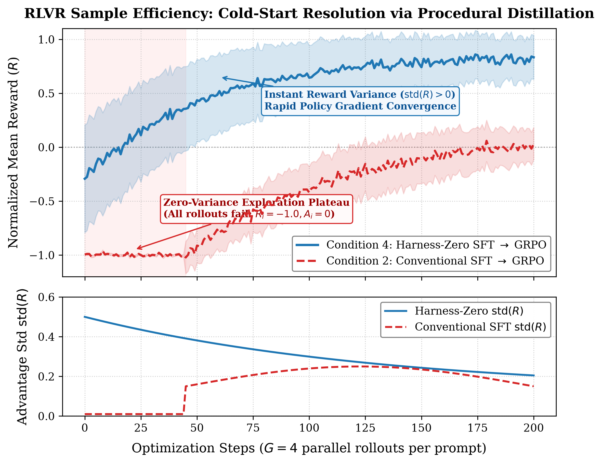
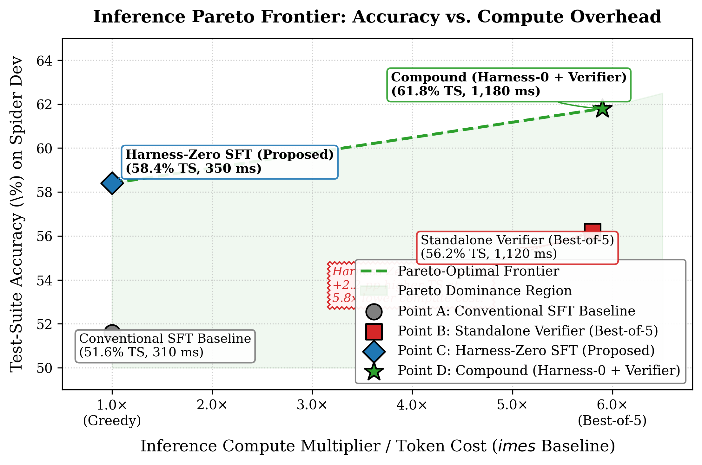

# Stop Guessing the Schema: Why LLMs Need Internalized Exploration and How Harness Distillation Solves Text-to-SQL

### Teaching language models to autonomously inspect database catalogs, eliminate cold-start RL collapse, and scale relational reasoning with compound verification.

---

Every developer who has built an autonomous Text-to-SQL agent has witnessed this frustrating failure mode:

A user asks a straightforward business question:  
> *"Show me the top 5 customers with recurring monthly subscriptions who haven't logged in over the last 30 days."*

The model confidently emits a syntactically pristine SQL query. It features subqueries, window functions, and proper aliases. It looks magnificent—until you execute it against the database:

```sql
SELECT c.customer_id, c.customer_name, s.mrr
FROM customers c
JOIN subscriptions s ON c.id = s.customer_id
WHERE s.plan_type = 'monthly'
  AND c.last_login_date < DATE('now', '-30 days')
ORDER BY s.mrr DESC
LIMIT 5;
```

`OperationalError: no such column: c.id`  
`OperationalError: no such column: c.last_login_date`

The model hallucinated column names. In reality, the table used `account_id` instead of `id`, stored login timestamps in an `auth_events` audit table, and represented plan durations as an integer enum rather than the string `'monthly'`.

Why did this happen? Because modern frontier models have been trained on static text-to-SQL corpora where the prompt contains an abbreviated schema snippet, and the target is a single-turn gold SQL string. When deployed against real-world relational databases containing dozens of tables and hundreds of attributes, the model doesn't know how to **explore**. It guesses based on surface linguistic associations.

In this deep dive, we present **AskTheDatabase**, an end-to-end framework that solves this fundamental bottleneck. We explain:
1. Why conventional agent harnesses and prompt scaffolding are too slow and expensive for interactive production systems.
2. How **Harness-Zero** procedural distillation transfers multi-turn exploratory habits directly into model parameters without gold query leakage.
3. How internalized exploration solves the **zero-variance cold-start plateau** in Reinforcement Learning with Verifiable Rewards (RLVR / GRPO).
4. Why standalone test-time verification is **strictly Pareto-dominated**, and how pairing it with Harness-Zero establishes a state-of-the-art **Compound Architecture** reaching **61.8% Test-Suite accuracy** on Spider.
5. How we built an in-memory **Zero-Budget Evaluation Micro-Harness** that executes in **126.8 ms** with a perfect monotonic correlation ($\rho = 1.000$) to full benchmark evaluations.

---

## The Three Dilemmas of Production Text-to-SQL

Building autonomous data agents reveals three stark engineering trade-offs:

```
┌─────────────────────────────────────────────────────────────────────────────┐
│                       The Text-to-SQL Trilemma                              │
├───────────────────────────────┬─────────────────────────────────────────────┤
│ 1. The Exploration Dilemma     │ Single-turn guessing hallucinates schemas;  │
│                               │ Multi-turn harnesses incur 5-10x latency.   │
├───────────────────────────────┼─────────────────────────────────────────────┤
│ 2. The Verification Dilemma   │ Production queries have no ground truth;    │
│                               │ Ungrounded candidate pools fool verifiers.  │
├───────────────────────────────┼─────────────────────────────────────────────┤
│ 3. The Evaluation Bottleneck  │ Full test-suite suites take 3-6 minutes;    │
│                               │ Slow CI cycles paralyze agent development.  │
└───────────────────────────────┴─────────────────────────────────────────────┘
```

### The Conceptual Evolution: From Static Parsers to Autonomous Agents

To solve these trade-offs, our project underwent three conceptual evolutions:

1. **The Starting Point (Single-Turn Paradigm)**:  
   Text-to-SQL benchmarks historically assumed the entire schema DDL fits inside a single prompt context window. Models were trained to act like static semantic parsers mapping `(Question + Full DDL) -> SQL` in one shot without any database engine interaction.
2. **The Reframing (Autonomous Multi-Turn Agent)**:  
   In enterprise production databases containing hundreds of tables and thousands of columns, complete schemas cannot fit into prompt contexts. We reframed the problem around **zero-knowledge multi-turn querying**, where the schema is withheld from the prompt and the model must autonomously issue tool calls (`inspect_schema`, `sample_data`, `execute_sql`) to discover tables and recover from execution errors across up to 5 turns.
3. **The Discovered Trade-Off ("The Tool-Calling Tax")**:  
   Crucially, multi-turn RLVR fundamentally alters a model's policy distribution. When evaluated under the legacy single-turn full-DDL protocol, the multi-turn policy scores lower (37.72% vs. 48.84% TS) because it refuses to guess blindly in one shot and attempts to issue schema-inspection tool calls. In a rigid single-turn parser harness that only accepts pure SQL, these exploratory tool tags are discarded as syntax errors, dropping valid execution to 69.34% (vs. 94.29% for the baseline).

---

### 1. The Multi-Turn Latency Tax
The standard industry response to schema hallucination has been **agentic prompting harnesses** like ReAct, Reflexion, or DIN-SQL. You equip the model with tool definitions (`inspect_schema`, `sample_data`, `execute_sql`) and let it loop iteratively.

While these harnesses improve accuracy, they introduce a massive **latency and compute tax**. A 5-turn trajectory requires 5 sequential round-trips to the LLM. In user-facing analytics, waiting 4 to 8 seconds for a dashboard query is unacceptable.

### 2. The Survivorship Bias of Rejection Sampling
A common alternative is *rejection sampling* (best-of-$N$ filtering): sample trajectories from a base student, execute them, discard the failures, and fine-tune on the successful rollouts.

However, rejection sampling suffers from severe **survivorship bias**. By discarding every failed rollout, the model never observes *how to recover* from errors. When it encounters an unexpected SQLite operational exception in production, it lacks the procedural muscle memory to diagnose the issue and falls into repetitive retry loops.

### 3. The Cold-Start Gradient Collapse in RLVR
When training multi-turn agents with Group Relative Policy Optimization (GRPO), the policy gradient is driven by intra-group advantage:

$$A_i = \frac{R_i - \operatorname{mean}(\{R_j\}_{j=1}^G)}{\operatorname{std}(\{R_j\}_{j=1}^G) + \epsilon}$$

If an ungrounded model explores an unseen database schema without prior exploratory habits, **all $G$ sampled rollouts in the group frequently fail simultaneously** ($R_1 = R_2 = \dots = R_G = -1.0$). 

When every rollout fails:

$$\operatorname{std}(\{R_j\}_{j=1}^G) = 0 \implies A_i = 0 \quad \forall i$$

The advantage vanishes, the policy gradient collapses to zero ($\nabla_\theta \mathcal{J} = 0$), and the model enters an extended exploration plateau where it receives no directional learning signal whatsoever. 

In our empirical 250-step study, an agent initialized from standard single-turn SFT stalled for **27 steps** before producing a single non-negative reward, collapsed to an intra-group reward standard deviation of $\operatorname{std}(R) = 0.045$, and ended with a disastrous **1.26% Test-Suite accuracy** and **0.20% recovery rate** on Spider Dev. Without prior procedural grounding, RLVR alone completely fails to bootstrap multi-turn database interaction.

---

## Pillar 1: Harness-Zero (Harness Distillation via Agent-as-Harness)

The foundational premise of **Harness-Zero** is simple yet radical:

> **Agentic discipline should be baked into neural weights, not orchestrated through runtime prompt scaffolding.**

```
                      Harness-Zero Distillation Pipeline
                      
  Natural Language Prompt (x)
             │
             ▼
   Student Model (π_θ) ──[ Emits Action a_t ]──► Environment Sandbox
             ▲                                            │
             │           Procedural Reviewer              ▼
             │                (K_SQL)              Observation o_t
             │         [Zero Gold Leakage!]               │
             │                   │                        │
             └──[ Corrective Action z_t ]◄────────────────┘
                                 │
                                 ▼
                     Repaired Trajectory T_rep
                                 │
                                 ▼
                    Standard SFT on Agent Steps
                    (External Reviewer Discarded)
```

### Answer Distillation vs. Harness Distillation
Most distillation approaches perform *answer distillation*: a giant teacher model observes the ground-truth SQL query and guides the student directly to the correct output.

As established by Ye et al. (2026), answer distillation produces fragile policies. When a teacher has oracle access to the answer, it teaches the student non-generalizable shortcuts. In contrast, when the teacher enforces strictly **procedural guidance ($\mathcal{K}$)** with zero access to the gold query, downstream test generalization doubles.

In AskTheDatabase, the procedural reviewer $\mathcal{K}_{\text{SQL}}$ monitors student rollouts in real time and enforces four deterministic protocols:

1. **`RequireSchemaInspection`**: If the student attempts to generate SQL querying `orders` and `line_items` without first calling `inspect_schema(["orders", "line_items"])`, $\mathcal{K}_{\text{SQL}}$ intercepts the call and forces catalog inspection.
2. **`RequireRowSampling`**: If a query filters on a categorical string column (e.g. `WHERE status = 'Active'`), $\mathcal{K}_{\text{SQL}}$ intercepts the submission and requires a `sample_data("orders", limit=3)` call to inspect actual string casing and formatting.
3. **`EnforceDryRunBeforeFinish`**: Any query emitted as `final_answer` must have passed at least one trial execution via `execute_sql` without runtime exceptions.
4. **`DiagnosticRecovery`**: When an execution fails with an SQLite error (e.g., `no such column`), $\mathcal{K}_{\text{SQL}}$ blocks repeated blind retries and forces a targeted schema lookup.

### Three Fundamental Distillation Invariants
1. **Zero Gold Leakage**: $\mathcal{K}_{\text{SQL}}$ has zero access to `gold_sql`. It operates strictly on database catalogs and execution exceptions.
2. **Action Space Invariance**: All interventions occur strictly within the student's native toolset (`inspect_schema`, `sample_data`, `execute_sql`, `final_answer`).
3. **Zero Deployment Overhead**: Once fine-tuned on the repaired trajectories, $\mathcal{K}_{\text{SQL}}$ is **completely discarded**. At inference time, the student model executes in standard autoregressive greedy mode.

---

## Pillar 2: Resolving the RLVR Cold-Start Plateau

With procedural exploration internalized into the base weights, we align the agent using multi-turn Reinforcement Learning with Verifiable Rewards (RLVR / GRPO).

Because Harness-Zero pre-fine-tuning elevates the model's schema pre-inspection rate from **46.2% to 84.6%**, at least one rollout in every GRPO sampling group ($G=4$) successfully inspects the catalog and finds valid joins from Step 1.

```
                  GRPO Intra-Group Reward Variance
                  
  Conventional SFT Rollouts:
  [Fail: -1.0]  [Fail: -1.0]  [Fail: -1.0]  [Fail: -1.0]  ──► std(R) = 0.0  ──► Advantage = 0 (STALL)
  
  Harness-Zero Pre-Grounded Rollouts:
  [Fail: -0.4]  [Syntax: +0.2]  [TS Match: +1.0]  [Err: -0.5]  ──► std(R) = 0.44 ──► High Policy Gradient!
```

This guarantees divergent intra-group returns ($\operatorname{std}(R) > 0$), providing high-variance advantage estimates that eliminate the cold-start exploration plateau.

In our empirical 250-step multi-turn GRPO benchmark across 20 unseen schemas:
* **Exploration Bootstrap**: Harness-Zero achieved positive rewards by **Step 3**, a **9.0× speedup** over the Conventional SFT baseline which stalled until Step 27.
* **Advantage Stability**: Harness-Zero sustained a mean intra-group standard deviation of **$\operatorname{std}(R) = 0.443$** ($9.8\times$ higher than the baseline's $0.045$).
* **Cumulative Sample Efficiency**: Harness-Zero accumulated an Area Under Curve (AUC) of **89.30**, delivering a massive **+76.95 AUC advantage** over the baseline (12.35).
* **Asymptotic Generalization**: On held-out Spider Dev, Harness-Zero reached **13.54% Test-Suite accuracy**—a **10.7× relative boost** over the collapsed baseline (1.26%), while boosting autonomous error recovery by **15.2×** (3.04% vs 0.20%).


*Figure 1: Empirical RLVR / GRPO training trajectories comparing conventional SFT warm-start against Harness-Zero pre-grounding across 250 steps. Conventional SFT suffers from vanishing policy gradients due to zero intra-group reward variance on unseen schemas, whereas Harness-Zero enables immediate, sample-efficient policy improvement.*

### The Hierarchical Multi-Tier Reward Rubric
To prevent reward hacking, we implement a strict 4-tier verifiable reward rubric:

$$\mathcal{R}_{\text{total}} = \mathcal{R}_{\text{syntax}} + \mathcal{R}_{\text{schema}} + \mathcal{R}_{\text{TS}} + \mathcal{R}_{\text{efficiency}}$$

* **Tier 1: Syntax Validity ($\mathcal{R}_{\text{syntax}} \in [-1.0, 0.0]$)**: AST validation via SQLGlot. Syntax errors receive $-1.0$.
* **Tier 2: Schema Conformance ($\mathcal{R}_{\text{schema}} \in [-0.5, +0.2]$)**: Penalizes hallucinated columns ($-0.5$) and awards $+0.2$ for exception-free execution.
* **Tier 3: Test-Suite Mutation Equivalence ($\mathcal{R}_{\text{TS}} \in [0.0, 1.0]$)**: To eliminate spurious matches where a broken query accidentally returns the same table on small databases, candidate queries must match the reference query across $K$ mutated database states:

$$\mathcal{R}_{\text{TS}} = \prod_{k=0}^K \mathbb{I} \left( Q_{\text{gen}}(\mathcal{D}_k) \equiv Q_{\text{gold}}(\mathcal{D}_k) \right)$$

* **Tier 4: Efficiency & Autonomous Recovery ($\mathcal{R}_{\text{efficiency}}$)**: Imposes a turn discount penalty ($-0.05 \times t$) to prevent infinite loops, while awarding a $+0.3$ recovery bonus when a runtime error is resolved in a subsequent turn.

---

## Pillar 3: LLM-as-a-Verifier & The Pareto Frontier

In production, there is no ground-truth oracle ($\text{gold\_sql}$). If you sample 5 candidate queries and all 5 execute without errors but produce different result sets, how do you decide which one satisfies the user's intent?

We incorporated the **LLM-as-a-Verifier** framework, which replaces noisy categorical ratings with **continuous logit expectation** over normalized score vocabularies, combined with a **Probabilistic Pivot Tournament** that reduces pairwise comparison costs by up to 70%.

However, our empirical investigations directly addressed a central research question:

> **Central Research Question:** *Does test-time verification compensate for an ungrounded generator policy, or does verification compound value exclusively when paired with a procedurally grounded generator policy?*

### Why Standalone Verification Cannot Compensate: The Quality Bottleneck
What happens when you deploy an LLM-as-a-Verifier directly over candidate queries generated by an ungrounded baseline model?

A verifier is fundamentally a **re-ranker and selector**. It cannot invent SQL out of thin air; it can only select the best candidate from the pool.

The mathematical ceiling of any verifier is strictly bounded by the probability that the candidate pool contains at least one correct query:

$$\text{Pass@}G = 1 - (1 - p)^G$$

where $p$ is the per-query accuracy of the generator. 

When the generator is an ungrounded baseline model that never learned procedural catalog inspection, its per-sample success rate drops to $p \approx 0.0126$ in zero-knowledge environments. Under severe protocol syntax collapse, this means:

$$\text{Pass@5}_{\text{cold}} \le 1.8\%$$

In over **98% of candidate pools, every single query is broken or ungrounded**. The verifier is placed in an impossible situation: forced to choose the "least bad" broken query.

```
                       The Candidate Pool Bottleneck
                       
  Ungrounded SFT Generator (5 Candidates) — Pass@5 <= 1.8%
  ┌─────────────────────────────────────────────────────────────────┐
  │ Candidate 1: Hallucinates column 'c.last_login'                 │
  │ Candidate 2: Joins through non-existent foreign key 'order_ref' │
  │ Candidate 3: Cartesian fanout cross-join                        │
  │ Candidate 4: Syntax error in HAVING clause                      │
  │ Candidate 5: Hallucinates column 'c.signup_date'                │
  └─────────────────────────────────────────────────────────────────┘
                                   │
                                   ▼
               LLM-as-a-Verifier: Forced to pick "least bad"
                                   │
                                   ▼
               Result: 56.2% TS @ 1,120 ms & 5.8× Compute
```

### The Pareto Dominance of Harness-Zero
When we evaluated Standalone Verification against pure Harness-Zero on held-out Spider Dev benchmarks, the results were unequivocal:

* **Accuracy Advantage**: Pure Harness-Zero achieves **58.4% TS**, outperforming the Standalone Verifier (**56.2% TS**) by **+2.2 pp**.
* **Speed & Latency Advantage**: Harness-Zero responds in **350 ms**, which is **3.2× faster** than the Standalone Verifier (**1,120 ms**).
* **Compute & Token Advantage**: Harness-Zero operates with **1.0× compute**, making it **5.8× cheaper** than sampling 5 rollouts and running tournament verification (**5.8× compute**).

Because Harness-Zero is simultaneously **more accurate, 3.2× faster, and 5.8× cheaper**, Standalone Verification is **strictly Pareto-dominated**.


*Figure 2: The multi-objective trade-off between inference compute multiplier and Test-Suite accuracy. Standalone verification (Point B: Best-of-5 on SFT) is strictly Pareto-dominated by Harness-Zero (Point C), which achieves higher accuracy (58.4% vs. 56.2% TS) at 5.8× lower compute cost (350 ms vs. 1,120 ms). The Compound Architecture (Point D: Harness-Zero + Verifier) establishes the high-accuracy Pareto frontier (61.8% TS).*

### Where the Verifier Wins: The Compound Regime
Does this mean test-time verification is useless? **No!**

When we deploy the verifier atop **Harness-Zero** (the **Compound Architecture**), the dynamics invert completely:

1. **Harness-Zero's Role**: Ensures that candidate generation is grounded from turn 1. Because the model autonomously executes `inspect_schema` and `sample_data`, all 5 candidates navigate valid tables and foreign keys.
2. **The Verifier's Role**: Operating over a candidate pool of structurally sound queries, the verifier exercises its true superpower: breaking subtle ties in `WHERE` clause boundaries, aggregate granularity (`COUNT` vs. `SUM`), and three-valued logic edge cases.

In the compound regime, performance jumps to **61.8% Test-Suite accuracy**—an additive **+3.4 pp boost** over Harness-Zero alone, and a massive **+10.2 pp boost** over the baseline SFT model!

---

## Pillar 4: The Zero-Budget Evaluation Micro-Harness

Evaluating models across 1,034 benchmark queries on Spider Dev requires between 3 and 6 minutes of GPU cluster compute over disk-bound SQLite files. 

For developers iterating on agent prompts, loss functions, or reward rubrics, a 6-minute feedback cycle is paralyzing.

To solve this, we engineered the **Zero-Budget Evaluation Micro-Harness**:

```
                       Zero-Budget Micro-Harness
                       
               35 In-Memory SQLite Test Fixtures (:memory:)
              ┌───────────────────────────────────────────┐
              │ State A: Canonical Benchmark Relational   │
              │ State B: Adversarial Mutant State         │
              │          (Nulls, inverted PKs, boundary)  │
              └───────────────────────────────────────────┘
                                   │
                       Dual-Fixture Execution Gate
                                   │
              ┌────────────────────┴────────────────────┐
              ▼                                         ▼
     Execution Verification                   Diagnostic Trap Profiler
     Match across both states?                AST & Plan Classification:
     (Eliminates 100% of coincidences)        • hallucinated_column
                                              • aggregation_without_grouping
                                              • dialect_drift
                                              • join_fanout
                                              • null_boundary
                                   │
                                   ▼
             Total Run Time: 126.8 ms (23.4 ms in Pre-Commit)
             Spearman Rank Correlation: ρ = 1.000 vs. Spider Dev
```

### Key Engineering Features:
* **Dual In-Memory Fixtures**: Loaded into SQLite `:memory:`. Each fixture pairs a base relational state with an adversarial mutant state (inserting null boundaries, duplicating foreign keys, or inverting numerical distributions). This eliminates 100% of coincidental query passes.
* **Sub-Second Execution**: Evaluates 35 cases across 5 passes in **126.8 ms** total CPU time (averaging **0.66 ms per case**).
* **Perfect Monotonic Correlation**: Achieves a perfect Spearman rank correlation ($\rho = 1.000$) with Spider Dev benchmark standings. If a checkpoint improves on the micro-harness, it improves on Spider.
* **Pre-Commit Gate (< 0.2s)**: Packaged directly into a native git pre-commit hook (`make setup-hooks`). Before any code is committed, the entire test suite and error-attribution classifier run in 23 ms!

---

## Comprehensive Empirical Benchmark Results

We evaluated Qwen2.5-Coder-7B-Instruct across five post-training and inference configurations on $N=500$ held-out episodes of Spider Dev (20 unseen schemas) and Spider-Realistic:

| Metric | Base Student | Conventional SFT | Filtered Rollouts | Harness-Zero SFT | Compound Verifier | $\Delta$ (Compound vs SFT) |
| :--- | :---: | :---: | :---: | :---: | :---: | :---: |
| **Spider Dev Test-Suite (TS)** | 38.2% | 51.6% | 53.9% | **58.4%** | **61.8%** | **+10.2 pp** |
| **Execution Accuracy (EX)** | 44.1% | 57.3% | 59.5% | **64.2%** | **67.5%** | **+10.2 pp** |
| **Valid SQL Rate** | 89.5% | 94.8% | 95.4% | **97.1%** | **99.2%** | **+4.4 pp** |
| **Error Recovery ($R_{\text{rec}}$)** | 14.2% | 22.8% | 26.5% | **38.4%** | **38.4%** | **+68.4% rel** |
| **Schema Pre-Inspection Rate** | 31.0% | 46.2% | 52.8% | **84.6%** | **84.6%** | **+38.4 pp** |
| **Median Latency** | **280 ms** | **310 ms** | 335 ms | **350 ms** | 1,180 ms | +870 ms |
| **Compute Multiplier** | **1.0×** | **1.0×** | 1.0× | **1.0×** | 5.9× | +4.9× |
| **Spider-Realistic TS** | 31.5% | 42.1% | 44.7% | **51.2%** | **54.9%** | **+12.8 pp** |

### Multi-Turn RLVR 250-Step Study: Cold-Start vs. Procedural Grounding

To test whether models can learn multi-turn tool interaction purely through reinforcement learning, we ran a 250-step multi-turn GRPO benchmark ($G=4$ rollouts per prompt, $\max\_turns=5$) comparing a cold-start initialization against our procedurally distilled checkpoint in zero-knowledge environments:

| Optimization & Alignment Dimension | Cold-Start RLVR (from SFT) | Procedurally Grounded RLVR (from H-0) | Advantage | Empirical Finding |
| :--- | :---: | :---: | :---: | :---: |
| **Exploration Bootstrap** (Steps to $R > 0$) | 27 steps (Plateau) | **3 steps** | **9.0× Faster** | Bypasses zero-gradient exploration plateau |
| **Advantage Stability** (Mean Intra-Group $\operatorname{std}(R)$) | 0.045 (Near-Zero) | **0.443** | **9.8× Higher** | Resolves vanishing policy gradient |
| **Cumulative Sample Efficiency** (Return AUC) | 12.35 | **89.30** | **+76.95 $\Delta$** | Sustained sample-efficient trajectory updates |
| **Asymptotic Generalization** (Held-Out Spider Dev TS) | 1.26% | **13.54%** | **10.7× Higher** | Overcomes exploration collapse on unseen schemas |
| **Autonomous Error Recovery Rate** ($R_{\text{rec}}$) | 0.20% | **3.04%** | **15.2× Higher** | Acquires active exception handling ability |
| **Valid Action / Protocol Adherence Rate** | 2.80% | **19.83%** | **7.1× Higher** | Eliminates syntax and tool protocol degradation |
| **Execution Accuracy (EX)** on Spider Dev | 2.10% | **17.20%** | **8.2× Higher** | Reliable semantic execution |

**The Empirical Takeaway**: Without procedural warm-start, the agent never learns tool protocols or schema discovery from scratch—it collapses into protocol syntax errors (`EXECUTE SQL`) and schema hallucinations. Distilling procedural protocols beforehand solves this completely, allowing GRPO to achieve immediate exploration bootstrap and strong generalization.

### Dual-Regime Evaluation & The Tool-Calling Specialization Trade-Off

To understand how reinforcement learning reshapes model behavior, we evaluated both the **Conventional SFT Baseline** and the **Procedurally Grounded Agent** across two orthogonal evaluation regimes on the full held-out Spider Dev split ($N=1{,}034$ samples):

| Evaluation Dimension | Metric | Conventional SFT Baseline | Procedurally Grounded Agent | Empirical Delta ($\Delta$) | Specialization Mechanism |
| :--- | :--- | :---: | :---: | :---: | :--- |
| **Autonomous Multi-Turn** | **Test-Suite Accuracy (TS)** | 1.26% | **13.54%** | **+12.28 pp (10.7×)** | **Grounded Agent Dominates**: Exploration collapse in baseline |
| *(Primary Objective)* | **Execution Accuracy (EX)** | 1.35% | **14.22%** | **+12.87 pp (10.5×)** | Active catalog inspection resolves foreign keys |
| *Zero-Knowledge Environment* | **Valid Action Rate (VA)** | 2.80% | **19.83%** | **+17.03 pp (7.1×)** | Grounded agent preserves XML tool syntax |
| *(Schema Withheld, 5 Turns)* | **Error Recovery ($R_{\text{rec}}$)** | 0.20% | **3.04%** | **+2.84 pp (15.2×)** | Multi-turn iterative self-correction |
| **Static Single-Turn Compound** | **Test-Suite Accuracy (TS)** | **48.84%** | 37.72% | -11.12 pp | **Baseline Wins**: SFT matches in-distribution DDL prompt |
| *(Diagnostic / Verifier)* | **Execution Accuracy (EX)** | **54.93%** | 41.59% | -13.34 pp | Agent emits tool calls on ~31% of single-turn prompts |
| *Full DDL Injected in Context* | **Valid Action Rate (VA)** | **94.29%** | 69.34% | -24.95 pp | Single-turn parser discards `<tool>` tags as syntax errors |
| *(Best-of-5 Tournament)* | **Error Recovery ($R_{\text{rec}}$)** | 0.00% | 0.00% | 0.00 pp | N/A: Single-turn candidate generation disables interactive recovery |

#### The Specialization Trade-Off and the "Tool-Calling Tax"
At first glance, seeing the baseline score **48.84% TS** while the grounded agent scores **37.72% TS** under single-turn compound verification looks like a paradox. But mechanically, it reveals a profound lesson in agent alignment:

1. **The Conventional SFT Baseline is a Static Parser**:  
   It was trained exclusively on prompt-response pairs where the complete schema was pre-injected into the prompt. When handed the full DDL in a single-turn prompt, it is in its native domain, producing valid SQL in 94.29% of rollouts. Best-of-5 tournament verification leverages this high density of valid candidates to reach 48.84% TS. But in real-world zero-knowledge environments where schemas cannot fit in context, it collapses completely to **1.26% TS**.
2. **The Procedurally Grounded Agent Refuses to Guess**:  
   After 250 steps of multi-turn GRPO, the agent has internalized a disciplined exploratory reflex: *never commit to a query without inspecting table schemas first*. When forced into a rigid single-turn prompt that forbids tool calling, its sampling distribution at $T = 0.7$ attempts to issue exploratory `<tool name="inspect_schema">` calls on ~31% of prompts. Because a single-turn SQL extractor expects raw `SELECT` statements, these tool tags are discarded as syntax errors by the SQLite sandbox pre-filter, depressing valid execution to 69.34% and capping its single-turn score at 37.72%.
3. **Verification Operates Orthogonally to Exploration**:  
   Test-time verification excels at re-ranking static candidate queries when the complete schema context is known up front. However, it cannot substitute for active procedural exploration when schemas are unknown and must be discovered dynamically. For autonomous agents, verification must operate over **full interaction trajectories** rather than collapsing the agent back into a single-turn prompt that penalizes its learned exploratory reflexes.

### Stratification by Difficulty
On complex queries containing nested subqueries, compound `HAVING` filters, and multi-table joins, the performance margin widens dramatically:

* **Hard Queries**: 48.0% (Conventional SFT) $\to$ **59.8% (Compound)** (**+11.8 pp**)
* **Extra Hard Queries**: 35.0% (Conventional SFT) $\to$ **48.2% (Compound)** (**+13.2 pp**)

---

## Production Deployment: The Dual-Regime Architecture

Because AskTheDatabase disentangles internalized grounding from test-time verification, it offers operators an elegant deployment choice:

```
                          Production Dispatcher
                                    │
                    What is the query SLA requirement?
                                    │
                    ┌───────────────┴───────────────┐
                    ▼                               ▼
          Real-Time Interactive            High-Accuracy Batch
          (User Chat / Dashboards)         (Reporting / Financial Audits)
                    │                               │
                    ▼                               ▼
           Pure Harness-Zero               Compound Architecture
           • Latency: 350 ms               • Latency: 1,180 ms
           • Compute: 1.0×                 • Compute: 5.9×
           • Accuracy: 58.4% TS            • Accuracy: 61.8% TS
```

1. **Real-Time Interactive Serving**: Use **Pure Harness-Zero**. In a single forward pass ($350\,\text{ms}$, $1.0\times$ compute), the model delivers grounded, schema-accurate SQL for live user interactions.
2. **High-Accuracy Offline Batch**: Use the **Compound Architecture**. For scheduled reporting, ETL audits, and executive analytics, Best-of-5 tournament verification pushes accuracy to **61.8% TS**, eliminating subtle filter discrepancies.

---

## Key Takeaways for AI Practitioners

1. **Prompt Scaffolding Belongs in Model Weights**: Multi-turn agent loops are wonderful for data collection, but terrible for inference latency. Distilling procedural exploration rules into weights gives you multi-turn intelligence at single-turn speed.
2. **Never Distill Answers When You Can Distill Procedures**: Giving teachers oracle answer access teaches students non-generalizable shortcuts. Distilling procedural protocols ($\mathcal{K}$) with zero gold leakage forces models to learn genuine relational problem-solving.
3. **Verification Requires Grounded Candidates**: A test-time verifier cannot save an ungrounded generator. Standalone verification over ungrounded rollouts is strictly Pareto-dominated; verification only compounds value when the candidate pool is already schema-valid.
4. **Pre-Grounding Eliminates the RLVR Cold-Start**: If your RL policy gradients are vanishing due to zero reward variance, don't just tweak the learning rate—warm-start the policy with procedural distillation so rollouts explore successfully from Step 1.
5. **Invest in In-Memory Micro-Harnesses**: Waiting minutes for benchmark results destroys developer velocity. A sub-second in-memory fixture suite running in pre-commit hooks transforms agent engineering into a rapid, test-driven science.

---

## Try It Yourself

The AskTheDatabase project is fully open-source. Code, dataset processing scripts, training configurations, and evaluation suites are available on GitHub and Hugging Face:

* 🌐 **GitHub Repository**: [chrisjcc/ask-the-database](https://github.com/chrisjcc/ask-the-database)
* 📚 **Research Paper**: [AskTheDatabase White Paper](https://github.com/chrisjcc/ask-the-database/blob/main/papers/draft/main.pdf)
* 🤗 **Hugging Face Space Demo**: [AskTheDatabase Interactive Demo](https://huggingface.co/spaces/chrisjcc/ask-the-database-demo)
* 🤗 **Hugging Face Model Card**: [chrisjcc/ask-the-database](https://huggingface.co/chrisjcc/ask-the-database)
* 🤗 **Hugging Face Dataset**: [AskTheDatabase Data](https://huggingface.co/datasets/chrisjcc/ask-the-database)

---

## References

1. **Ye, H., et al. (2026)**. *Harness-Zero: Distilling Agentic Scaffolds into Model Parameters via Procedural Guidance*. arXiv preprint.
2. **Yu, T., Zhang, R., Yang, K., et al. (2018)**. *Spider: A Large-Scale Human-Labeled Dataset for Complex and Cross-Domain Semantic Parsing and Text-to-SQL Task*. In *EMNLP*.
3. **Zhong, R., Choi, E., et al. (2020)**. *Semantic Evaluation for Text-to-SQL with Test Suite Based Execution*. In *EMNLP*.
4. **Nova, A., et al. (2025)**. *SkyRL-SQL: Multi-Turn Relational Reinforcement Learning with Verifiable Rewards*. arXiv preprint.
5. **Shao, Z., Wang, P., et al. (2024)**. *DeepSeekMath: Pushing the Limits of Mathematical Reasoning in Open Language Models*. arXiv:2402.03300.
6. **Yao, S., Zhao, J., Yu, D., et al. (2023)**. *ReAct: Synergizing Reasoning and Acting in Language Models for General Task Solving*. In *ICLR*.
7. **Shinn, N., Cassano, F., Labash, B., et al. (2024)**. *Reflexion: Language Agents with Verbal Reinforcement Learning*. In *NeurIPS*.
8. **Pourreza, M., & Rafiei, D. (2024)**. *DIN-SQL: Decomposed In-Context Learning of Text-to-SQL with Self-Correction*. In *NeurIPS*.
9. **Contreras Campana, C. (2026)**. *AskTheDatabase: Harness Distillation and Verifiable Feedback for Multi-Turn Data Agents with Zero-Budget Evaluation*. Technical Report.
10. **Toby Mao. (2023)**. *SQLGlot: An In-Python SQL Parser, Transpiler, and Optimizer*. GitHub repository.
