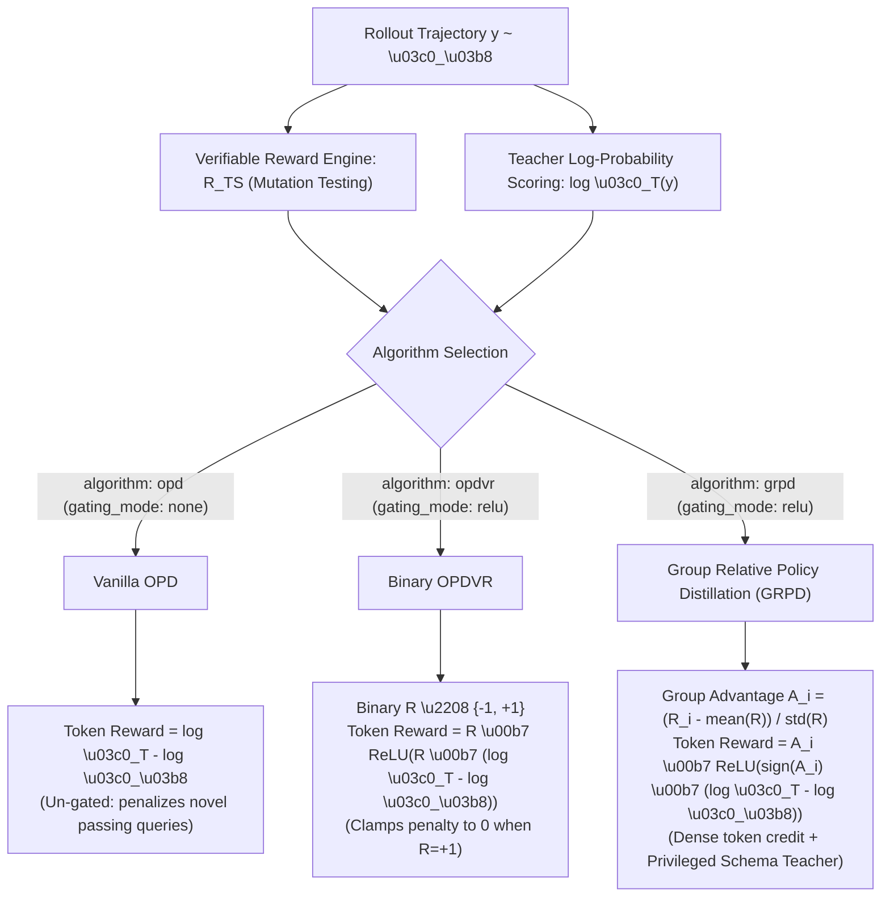

# OPDVR & GRPD Policy Distillation Training Guide

This operational and technical guide explains the architecture, algorithmic dispatch, verifiable reward gating mechanics, and execution targets for **On-Policy Distillation with Verifiable Reward (OPDVR)** and **Group Relative Policy Distillation (GRPD)** in AskTheDatabase.

---

## 1. Unified Execution Architecture

All multi-turn reinforcement learning and policy distillation methods in AskTheDatabase share a single, unified execution pipeline:

```
                                      CLI Invocations
                   ┌──────────────────────────────────────────────────┐
                   │ make train-grpd     OR     make train-rlvr ARGS  │
                   └────────────────────────┬─────────────────────────┘
                                            │
                                            ▼
                     ┌──────────────────────────────────────────────┐
                     │           scripts/train_rlvr.py              │
                     │  (Environment Rollouts, Turn History, ChatML) │
                     └──────────────────────┬───────────────────────┘
                                            │
                                            ▼
                     ┌──────────────────────────────────────────────┐
                     │            TRLGRPOAdapter                    │
                     │  (Advantage Normalization & Teacher Scoring) │
                     └──────────────────────┬───────────────────────┘
                                            │
                                            ▼
                     ┌──────────────────────────────────────────────┐
                     │          compute_policy_loss()               │
                     │   (Action Token Masking & Gated Objectives)  │
                     └──────────────────────────────────────────────┘
```

### Core Invariants of the Unified Engine:
1. **Shared Forward-Pass Pipeline**: All algorithms (`grpo`, `dapo`, `gspo`, `opd`, `opdvr`, and `grpd`) execute through `scripts/train_rlvr.py` using [`TRLGRPOAdapter`](file:///Users/christiancontrerascampana/Desktop/GitHub/text-to-sql/ask-the-database/src/ask_the_database/training/adapters/trl_grpo.py#L475) and [`compute_policy_loss`](file:///Users/christiancontrerascampana/Desktop/GitHub/text-to-sql/ask-the-database/src/ask_the_database/training/adapters/trl_grpo.py#L203).
2. **Zero Duplicate Parameter VRAM**: When running in shared base model mode (`share_base_model: true`), the [`PrivilegedSchemaTeacher`](file:///Users/christiancontrerascampana/Desktop/GitHub/text-to-sql/ask-the-database/src/ask_the_database/training/privileged_teacher.py#L23) temporarily disables the student's PEFT/LoRA adapter during its forward pass (`model.disable_adapter()`). The teacher evaluates token log-probabilities using the student's base parameters, consuming **zero extra parameter memory**.
3. **Strict Action Token Loss Masking**: The [`ActionMaskGenerator`](file:///Users/christiancontrerascampana/Desktop/GitHub/text-to-sql/ask-the-database/src/ask_the_database/training/action_masking.py#L36) isolates student-generated actions:
   $$M_t = \begin{cases} 1.0, & \text{inside agent thought traces, tool calls, or final SQL answers} \\ 0.0, & \text{inside SQLite sandbox observations, schema dumps, or user prompts} \end{cases}$$
   Observation tokens receive strictly zero gradient updates, eliminating policy gradient leakage and reward hacking.
4. **Verifiable Reward Gating**: What distinguishes `opd`, `opdvr`, and `grpd` is **how verifiable rewards ($\mathcal{R}_{\text{TS}}$) gate the teacher distillation signal**.

---

## 2. Verifiable Reward Engine ($\mathcal{R}_{\text{TS}}$) & Distillation Gating Architecture

In classical On-Policy Distillation (OPD), the student is forced to mimic teacher probabilities on every sampled token. When a student generates an alternative valid SQL syntax (e.g. using a CTE or subquery instead of an inner join), vanilla OPD penalizes this divergence even if the query produces the exact correct database state.

AskTheDatabase couples token-level distillation with its **4-tier Verifiable Reward Engine** ($\mathcal{R}_{\text{TS}}$ via SQLite mutation testing):

```
                                  Verifiable Reward Engine (R_TS)
                                               │
               ┌───────────────────────────────┼──────────────────────────────┐
               ▼                               ▼                              ▼
          Vanilla OPD                   Binary OPDVR                   Full GRPD
       (Xiao et al., 2026)          (Lin et al., Aug 2026)          (Our Proposed Target)
               │                               │                              │
    No reward gating                 Binary R ∈ {-1, +1}            Group Advantage A_i
    Forces student to mimic          Gating: ReLU(R · log_ratio)    Gating: A_i · ReLU(sign(A_i) · log_ratio)
    teacher syntax strictly.         Protects novel passing SQL.    Extends to group relative ranking &
                                                                    multi-turn interactive tool use.
```

### Algorithmic Comparison



### Detailed Algorithm Descriptions

#### 1. OPD (Vanilla On-Policy Distillation)
- **Reference**: Xiao et al. (2026).
- **Configuration**: `algorithm: "opd"` or `distillation.gating_mode: "none"`.
- **Formulation**:
  $$r_{t,i}^{\text{OPD}} = \log \pi_T(y_{t,i} \mid x, y_{<t,i}) - \log \pi_\theta(y_{t,i} \mid x, y_{<t,i})$$
- **Behavior**: Distills teacher token log-probabilities without gating.
- **Limitation**: Suffers from **Type-I Conflict**: penalizes the student whenever it diverges from the teacher's preferred phrasing, even if the student's solution passes all mutation test suites with 100% execution accuracy.

#### 2. OPDVR (Binary On-Policy Distillation with Verifiable Reward)
- **Reference**: Lin et al. (arXiv:2608.24696, August 2026).
- **Configuration**: `algorithm: "opdvr"` or `distillation.gating_mode: "relu"`.
- **Formulation**:
  $$R_i \in \{-1, +1\}, \quad r_{t,i}^{\text{OPDVR}} = R_i \cdot \mathrm{ReLU}\left( R_i \cdot \left(\log \pi_T(y_{t,i} \mid x, y_{<t,i}) - \log \pi_\theta(y_{t,i} \mid x, y_{<t,i})\right) \right)$$
- **Behavior**:
  - When $R_i = +1$ (student SQL passes verifiable test suite): Gating evaluates $\mathrm{ReLU}(\log \pi_T - \log \pi_\theta)$. If $\pi_\theta > \pi_T$ (student is more confident in its novel formulation), the reward is **zeroed out**, eliminating the distributional penalty!
  - When $R_i = -1$ (student SQL fails): Gating evaluates $-\mathrm{ReLU}(\log \pi_\theta - \log \pi_T)$, penalizing tokens where the failing student diverged from the teacher.

#### 3. GRPD (Group Relative Policy Distillation — Proposed / Primary Target)
- **Reference**: AskTheDatabase Extension (2026).
- **Configuration**: `algorithm: "grpd"`, `distillation.gating_mode: "relu"`.
- **Formulation**:
  Given a group of $G$ rollouts per prompt with group-normalized relative advantage $\hat{A}_i = \frac{R_i - \mathrm{mean}(R)}{\mathrm{std}(R) + \epsilon}$:
  $$r_{t,i}^{\text{GRPD}} = \hat{A}_i \cdot \mathrm{ReLU}\left( \mathrm{sign}(\hat{A}_i) \cdot \left(\log \pi_T(y_{t,i} \mid x, y_{<t,i}) - \log \pi_\theta(y_{t,i} \mid x, y_{<t,i})\right) \right)$$
- **Policy Gradient Loss**:
  $$\mathcal{L}_{\text{GRPD}}(\theta) = - \frac{1}{\sum_{i,t} M_{t,i}} \sum_{i=1}^G \sum_{t=1}^T M_{t,i} \cdot r_{t,i}^{\text{GRPD}} \cdot \log \pi_\theta(y_{t,i} \mid x, y_{<t,i})$$
- **Behavior**: Dense token credit assignment scales with group-relative trajectory advantages. On queries where all candidates fail ($\mathrm{std}(R) = 0$), the GRPD token reward remains active via teacher guidance, eliminating cold-start exploration plateaus.
- **Privileged Schema Teacher**: When `privileged_schema: true`, the teacher prompt is automatically augmented with the database's complete oracle DDL schema, transferring relational join priors to an unprivileged student.

---

## 3. Makefile Targets & CLI Operations

The repository provides two primary Makefile targets for multi-turn training:

```makefile
train-rlvr:
	$(PYTHON) scripts/train_rlvr.py $(ARGS)

train-grpd:
	$(PYTHON) scripts/train_rlvr.py training=rlvr_grpd $(ARGS)
```

| Target | Default Configuration | Primary Use Case |
| :--- | :--- | :--- |
| `make train-rlvr` | [`configs/training/rlvr.yaml`](file:///Users/christiancontrerascampana/Desktop/GitHub/text-to-sql/ask-the-database/configs/training/rlvr.yaml) | **General RLVR launcher**: Runs any training method (`grpo`, `dapo`, `gspo`, `opd`, `opdvr`, `grpd`) with arbitrary Hydra CLI overrides. |
| `make train-grpd` | [`configs/training/rlvr_grpd.yaml`](file:///Users/christiancontrerascampana/Desktop/GitHub/text-to-sql/ask-the-database/configs/training/rlvr_grpd.yaml) | **Preset distillation launcher**: Preconfigures GRPD with ReLU gating, base weight sharing, privileged schema injection, and saves checkpoints to `models/rlvr/grpd_final`. |

---

## 4. Execution Commands Cookbook

### A. Fast Sanity Checks & Dry Runs

```bash
# Validate GRPD pipeline, action masking, and reward dynamics (< 2s)
make train-grpd ARGS="dry_run=true"

# Validate GRPD dry run with custom step count
make train-grpd ARGS="dry_run=true training.max_steps=5"
```

### B. Launching Specific Algorithmic Conditions

#### 1. Condition C4: Full GRPD (Group Relative Policy Distillation)
```bash
make train-grpd

# Or equivalently using the general launcher:
make train-rlvr ARGS="training=rlvr_grpd"
```

#### 2. Condition C6: Privileged Schema Teacher GRPD
```bash
make train-grpd ARGS="training.distillation.privileged_schema=true"
```

#### 3. Condition C3: Binary OPDVR
```bash
make train-rlvr ARGS="training.algorithm=opdvr training.distillation.enabled=true training.distillation.gating_mode=relu"
```

#### 4. Condition C2: Vanilla OPD (Un-gated Baseline)
```bash
make train-rlvr ARGS="training.algorithm=opd training.distillation.enabled=true training.distillation.gating_mode=none"
```

#### 5. Condition C5: Inverted GRPD (Negative Control Ablation)
```bash
make train-grpd ARGS="training.distillation.gating_mode=inverse"
```

#### 6. Condition C1: Pure RLVR Baseline (GRPO without Distillation)
```bash
make train-rlvr ARGS="training.algorithm=grpo training.distillation.enabled=false"
```

---

## 5. Telemetry & Conflict Diagnostics

During training, [`compute_conflict_diagnostics`](file:///Users/christiancontrerascampana/Desktop/GitHub/text-to-sql/ask-the-database/src/ask_the_database/training/losses.py#L182) computes token-level metrics logged to the console and streamed to Weights & Biases / Weave:

| Metric | Formal Definition | Target Range | Interpretation |
| :--- | :--- | :---: | :--- |
| `train/r_zero_ratio` ($r_{\text{zero}}$) | $\frac{1}{N_{\text{act}}} \sum_{t} \mathbb{I}(r_{t,i} = 0)$ | $0.40 - 0.50$ | Proportion of action tokens where ReLU gating clamps distillation signal to zero. Confirms student autonomy on passing tokens and suppression on failing tokens. |
| `train/type1_conflict_ratio` | $\frac{1}{N_{\text{pos}}} \sum_{t \in \mathcal{Y}^+} \mathbb{I}(\pi_\theta > \pi_T)$ | $> 0.20$ | Measures protection of student novel valid syntax. In vanilla OPD, this causes negative gradients; in GRPD, it is safely clamped to zero. |
| `train/type2_conflict_ratio` | $\frac{1}{N_{\text{neg}}} \sum_{t \in \mathcal{Y}^-} \mathbb{I}(\pi_\theta > \pi_T)$ | $> 0.30$ | Measures suppression of student hallucinated columns or syntax errors on failing trajectories. |
| `train/effective_tokens` | $\sum_{i,t} M_{t,i}$ | $> 0$ | Number of action/thought tokens contributing to policy gradients (strictly excludes SQLite sandbox observations). |

---

## 6. DVC Pipeline Integration

The GRPD training stage is tracked in [`dvc.yaml`](file:///Users/christiancontrerascampana/Desktop/GitHub/text-to-sql/ask-the-database/dvc.yaml):

```yaml
  train-grpd:
    cmd: python scripts/train_rlvr.py training=rlvr_grpd
    deps:
      - configs/training/rlvr_grpd.yaml
      - scripts/train_rlvr.py
      - src/ask_the_database/training/adapters/trl_grpo.py
      - src/ask_the_database/training/privileged_teacher.py
      - src/ask_the_database/training/action_masking.py
      - src/ask_the_database/training/losses.py
    outs:
      - models/rlvr/grpd_final
```

Verify pipeline dependency tracking at any time:
```bash
dvc repro --dry
```
