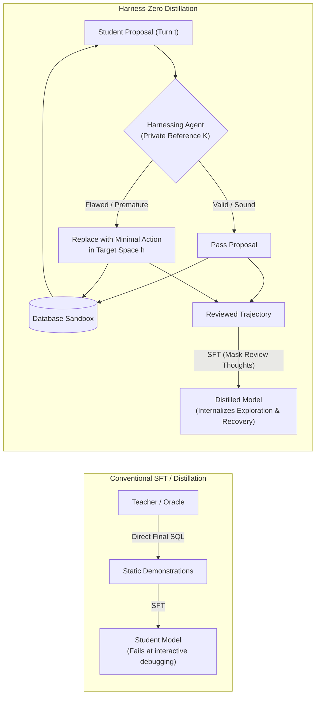
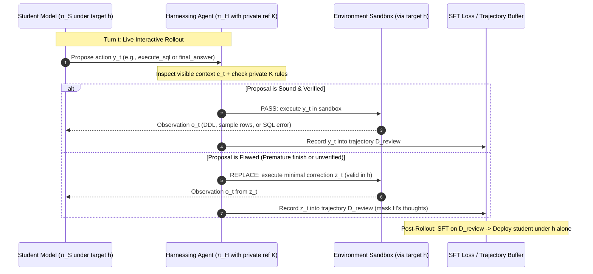
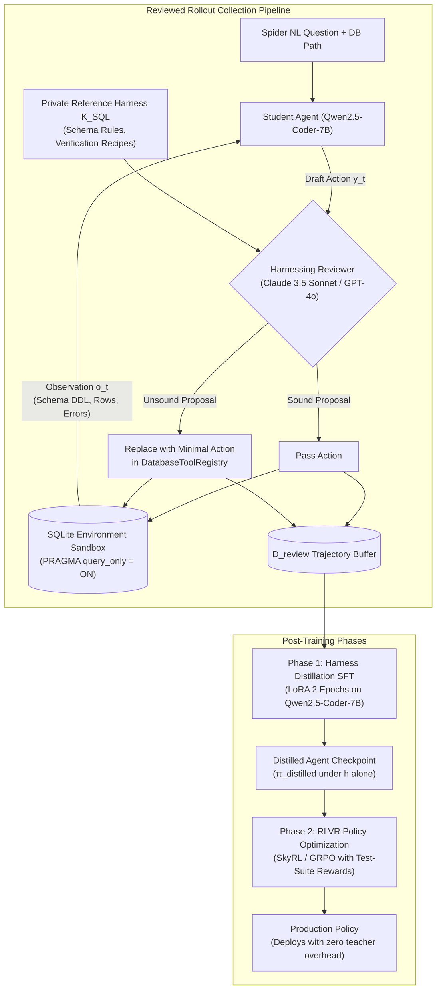

# Feasibility Study: Harness-Zero for AskTheDatabase
## Evaluating Agent-as-Harness Distillation for Multi-Turn Text-to-SQL Post-Training

**Date:** October 2026  
**Project:** [AskTheDatabase](https://github.com/chrisjcc/ask-the-database)  
**Target Document:** `docs/research/harness-zero/feasibility_study.md`  
**Primary Reference:** *Harness-Zero: Harness Distillation via Agent-as-Harness* (Ye et al., 2026, [arXiv:2609.24974](https://arxiv.org/abs/2609.24974), [Official Code](https://github.com/metaevo-ai/harness-zero))

---

## 1. Executive Summary

This study critically evaluates whether the methodology introduced in **Harness-Zero** (Ye et al., September 2026) can improve **AskTheDatabase** (`ask-the-database`), an agentic post-training framework for natural-language-to-SQL translation across complex relational databases.

### Key Conceptual Finding: Answer Distillation vs. Harness Distillation
A common misconception is that Harness-Zero is simply another form of teacher distillation where a stronger model supplies ground-truth SQL answers when the student errs. **It is not.** Harness-Zero's central insight is **Agent-as-Harness**: an external harnessing agent intercepts the student's actions *step-by-step at its response boundary* during live environment interaction. Guided by an evolved, domain-adapted reference harness ($\mathcal{K}$), the harnessing agent either passes the student's proposal unchanged or replaces it with a minimal coherent correction expressed entirely within the student's native target action space ($h$). Supervised fine-tuning (SFT) on these reviewed trajectories transfers procedural interaction behaviors—such as schema probing, row sampling, syntax dry-running, and runtime error recovery—into the model's weights. At deployment, the external harnessing agent and specialized harness are discarded.



### Strategic Synergy with RLVR
Harness-Zero is **not an RL algorithm**; it is an imitation learning strategy designed to resolve the exploratory "cold-start" bottleneck. In AskTheDatabase, Reinforcement Learning with Verifiable Rewards (RLVR / GRPO / SkyRL) relies on objective execution rewards (Test-Suite Correctness, execution tuples, AST validity). However, pure RLVR struggles when unguided policies fail to stumble upon correct multi-table joins or valid schemas, producing zero-reward feedback loops. Harness-Zero provides an ideal initialization: it seeds the policy with disciplined multi-turn exploration trajectories before RLVR policy optimization takes over.

### Verdict & Recommendation
**GO (Conditional)** on executing a **Minimum Viable Experiment (MVE)**. We recommend a 4-condition controlled experiment comparing:
1. Base Student Policy (Qwen2.5-Coder-7B under target tool harness $h$)
2. Conventional SFT on Ground-Truth SQL
3. Successful-Rollout Filtering (Rejection sampling on self-generated rollouts)
4. Harness-Zero SFT (On-policy student rollouts reviewed and corrected via $\mathcal{K}_{\text{SQL}}$)

If Harness-Zero SFT demonstrates $\ge 5.0$ percentage points higher Test-Suite Correctness (TS) over conventional SFT and successful-rollout filtering on unseen databases, and increases error recovery by $\ge 20\%$, the project should adopt harness distillation to generate warm-up checkpoints for production RLVR sweeps.

---

## 2. Research Question and Scope

### Primary Research Question
> *Can the Agent-as-Harness distillation methodology of Harness-Zero transfer procedural database exploration and error recovery behaviors into the weights of an open-weights model (Qwen2.5-Coder-7B), thereby enhancing Test-Suite Correctness (TS) and RLVR training stability in AskTheDatabase?*

### Scope
1. **Target Action Space ($h$)**: The existing tool-calling interface of AskTheDatabase (`DatabaseToolRegistry`):
   - `inspect_schema(tables: list[str])`
   - `sample_data(table: str)`
   - `execute_sql(query: str)`
   - `final_answer(sql: str)`
2. **Evaluation Benchmarks**: The Spider relational benchmark suite, specifically testing out-of-domain generalization across:
   - Spider Standard Dev Split (unseen database schemas)
   - Spider-DK (Domain Knowledge shifts)
   - Spider-Syn (Synonym and phrasing perturbations)
   - Spider-Realistic (Ambiguous column and table selections)
3. **Core Metrics**: Test-Suite Correctness (TS), Execution Accuracy (EX), Valid SQL (VA), Mean Reciprocal Rank (MRR), and Error Recovery Rate ($R_{\text{rec}}$).
4. **Boundary**: This study does *not* propose eliminating essential runtime execution environments (SQLite / DuckDB engines, AST security validation). The goal of harness distillation is to internalize orchestration, planning, and verification logic—not to eliminate the execution sandbox itself.

---

## 3. Paper Summary and Core Methodological Contribution

### 3.1 The Research Problem: The Harness Dilemma
An LLM agent's practical performance is governed jointly by its underlying language model and its **harness**—the external scaffolding that manages tools, context, middleware execution loops, and persistent memory (Weng, 2026; Ning et al., 2026b). While automating harness optimization (e.g., Meta-Harness, Lee et al., 2026) produces large task gains, these gains remain **tethered to the external harness at deployment**.

This creates a dilemma:
- A single general-purpose harness (e.g., Claude Code, DeepAgents) sacrifices domain-specific optimizations.
- Maintaining separate specialized harnesses requires complex task-routing infrastructure and incurs recurring costs in context tokens, tool calls, and orchestration latency.

### 3.2 The Core Method: Harness-Zero
Ye et al. (2026) introduce **Harness Distillation via Agent-as-Harness** to transfer the behavioral capabilities induced by an optimized harness into model weights, allowing the model to deploy under a single, minimal target harness ($h$).

The Harness-Zero lifecycle consists of three distinct stages:



1. **Harness Evolution & Adaptation (§3.1)**:
   - **Evolution**: A specialized student-side harness $h^\star$ is evolved on training tasks using failure-driven iterations (analyzing errors in tools, middleware, skills, and memory).
   - **Adaptation**: Because $h^\star$ cannot be directly run by the student at deployment, it is transformed into a **private reference harness ($\mathcal{K}$)** for an external harnessing agent $\pi_H$. Tools become *action recipes*; middleware guards become *review conditions*; skills and failure memories become *review diagnostic rules*.
2. **Agent-as-Harness Rollout Collection (§3.2)**:
   - The student model $\pi_S$ operates in the target harness $h$ and proposes response $y_t$.
   - The harnessing agent $\pi_H$ intercepts $y_t$. It reviews the student's visible context $c_t$, previous reviews $r_{<t}$, and the rules in $\mathcal{K}$.
   - **Intervention Decision ($d_t$)**:
     - $\text{PASS}$: If the proposal follows good practices, $y_t$ is executed directly.
     - $\text{REPLACE}$: If the proposal violates $\mathcal{K}$ (e.g., finishing prematurely without checking), $\pi_H$ constructs a replacement $z_t$ in the *student's native action space* $h$.
   - **Grounding & Privacy Constraints**: The harnessing agent cannot peek at hidden test labels or execute private commands in the student sandbox. Any diagnostic must be executed via $h$, ensuring the evidence is visible to the student.
3. **Imitation Learning via SFT (§3.3)**:
   - Supervised fine-tuning is performed on accepted responses in the reviewed trajectories $\mathcal{D}_{\text{review}}$:
     $$\mathcal{L}_{\text{SFT}}(\theta) = -\sum_{\tau \in \mathcal{D}_{\text{review}}} \sum_{t=1}^{T_\tau} \log \pi_\theta^h (\tilde{y}_t \mid c_t)$$
   - Reviewer-perspective reasoning is masked. At deployment, the distilled policy $\pi_{\hat{\theta}}^h$ runs directly under $h$ with no harnessing agent and no $h^\star$.

---

## 4. Clarification: Answer Distillation vs. Harness Distillation

To determine whether Harness-Zero applies to AskTheDatabase, we must delineate the precise differences between distillation paradigms:

| Paradigm | What is Provided | Supervisory Point | Target Action Space | Key Weakness / Risk |
| :--- | :--- | :--- | :--- | :--- |
| **Conventional Knowledge Distillation** | Teacher output logits or token probabilities | Per-token output layer | Identical model vocabulary | Computationally heavy; does not teach tool exploration. |
| **Gold-Answer SFT (Teacher SQL)** | Ground-truth final SQL query $y^*$ | Final step only | SQL text | Fails on multi-turn agent rollouts; ignores intermediate schema inspection and debugging. |
| **Rejection Sampling / Rollout Filtering** | Unassisted student rollouts filtered by verification ($R=1$) | Complete trajectory | Student native actions | Severe sample inefficiency; if task is hard, successful rollouts are near zero. |
| **Critique-and-Revision (Reflection)** | Natural language critique after an entire rollout fails | End-of-trial conversational turn | Prompt/chat history | Chat history bloat; introduces conversational "excuse-making" artifacts; out-of-distribution at deployment. |
| **Agent Harness Distillation (Harness-Zero)** | **Step-level behavioral review & minimal replacement from $\mathcal{K}$** | **Pre-execution response boundary** | **Student target action space ($h$)** | Requires a capable harnessing teacher during data collection. Discarded at deployment. |
| **Reinforcement Learning (RLVR)** | Scalar verifiable reward ($R \in [-1, 1]$) from execution test suite | Trajectory / turn level | Policy action space | High variance; suffers from reward sparsity during early exploration without warm-up. |

### Why This Distinction Matters for AskTheDatabase
In natural language-to-SQL, providing a correct final SQL string (Gold-Answer SFT) teaches the model *what* the query should look like, but fails to teach the model *how* to arrive at that query when faced with an unfamiliar schema. 

When a 7B model encounters a Spider database with 15 tables and 80 columns:
1. It must first decide to call `inspect_schema(["table_a", "table_b"])`.
2. It must recognize ambiguous categorical values (e.g., `'F'` vs `'Female'`) and call `sample_data("table_a")`.
3. If it executes a draft SQL that throws an `OperationalError: no such column: T1.id`, it must know how to parse the traceback and correct the alias, rather than re-submitting the identical broken query.

Harness distillation enforces these exact behavioral loops during training rollouts. The teacher does not simply say "here is the correct query"; it forces the student to inspect the schema, test the query, and verify the output before emitting `<final_answer>`.

---

## 5. Key Findings and Quantitative Results from the Paper

The Harness-Zero paper reports experiments across three complex domains: SpreadsheetBench Verified (knowledge work), AppWorld (multi-app tool use), and USPTO Retrosynthesis (scientific reasoning). The student model is **Qwen3.5-9B**, evaluated under a minimal **mini-SWE-agent** target harness $h$ (single Bash execution tool).

### 5.1 Primary Performance Transfer
*Source: Ye et al. (2026), Table 1 & Table 2*

| System Configuration | Harness Type | SpreadsheetBench (pass@1 %) | AppWorld (SGC %) | USPTO (pass@1 %) | **Macro Average (%)** |
| :--- | :--- | :---: | :---: | :---: | :---: |
| **Base Student (Qwen3.5-9B)** | Minimal $h$ | 31.0 | 26.8 | 12.0 | **23.3** |
| Base Student + DeepAgents | Generic Scaffold | 35.0 | 19.6 | 7.0 | 20.5 |
| Base Student + Claude Code | Generic Scaffold | 31.0 | 10.7 | 6.0 | 15.9 |
| **Base Student + Evolved $h^\star$** | Specialized Code Harness | 39.0 | 48.2 | 38.0 | **41.7** |
| **Harness-Zero Distilled Student** | **Minimal $h$ (Harness Removed)** | **44.0** | **58.9** | 30.0 | **44.3** |

#### Critical Observations:
1. **Surpassing the Evolved Harness**: On the macro average, the distilled model under the minimal target harness alone (**44.3%**) outperforms the base model with the specialized harness actively mounted (**41.7%**), a **+21.0 point absolute gain** (+90.1% relative) over the base student.
2. **Procedural vs. Declarative Internalization**: On SpreadsheetBench (+13.0 pp) and AppWorld (+32.1 pp), the distilled student completely internalizes the workflow procedures (diff checks, pre-filled verification). On USPTO (30.0% vs. 38.0%), the distilled model improves substantially over base (12.0%), but trails the specialized harness because $h^\star$ in USPTO embedded deep chemical heuristics and SMILES validation libraries that pure LoRA SFT could not fully absorb.

### 5.2 The Crucial Supervision Source Ablation
*Source: Ye et al. (2026), Table 3 (USPTO Retrosynthesis, 500 collection tasks)*

The paper conducted a rigorous ablation on USPTO comparing alternative supervision sources:

| Training Data Source | Teacher / Rollout Model | Harness During Rollout | Harnessing Agent Guidance | Collection Success (%) | Test Pass@1 (%) (Student under $h$) |
| :--- | :--- | :---: | :---: | :---: | :---: |
| **Direct Teacher Rollouts** | GPT-5.6 Sol | Minimal $h$ | N/A | 52.0 | 12.0 |
| **Teacher under $h^\star$** | GPT-5.6 Sol | Evolved $h^\star$ | N/A | 62.0 | 3.0 |
| **Student under $h^\star$** | Qwen3.5-9B | Evolved $h^\star$ | N/A | 39.4 | 12.0 |
| **Student + Empty Review** | Qwen3.5-9B | Minimal $h$ | Empty $\mathcal{K}$ | 33.6 | 11.0 |
| **Student + Oracle Review** | Qwen3.5-9B | Minimal $h$ | **Ground-Truth Answer** | **98.6** | 15.0 |
| **Harness-Zero** | Qwen3.5-9B | Minimal $h$ | **Reference $\mathcal{K}$ (No Answers)** | 59.4 | **30.0** |

#### Crucial Insights for AskTheDatabase:
- **High Collection Success $\neq$ High Distillation Value**: Providing the harnessing agent with the oracle answer yielded 98.6% collection success, but the resulting student achieved only **15.0%** test accuracy. The model learned "shortcut leaps" that it could not reproduce at test time.
- **Action Space Mismatch Destroys Transfer**: Training on teacher rollouts generated under $h^\star$ collapsed test performance to **3.0%** because the model learned to call specialized tools that do not exist in target harness $h$.
- **Harness Guidance Drives Generalization**: Review guided by procedural reference harness $\mathcal{K}$ (without answer access) yielded **30.0%** test accuracy—double that of oracle answer supervision.

### 5.3 Behavioral Pattern Recovery
*Source: Ye et al. (2026), Table 4*
- Across 28 mined harness-exclusive behavior patterns (actions observed under $h^\star$ but absent in base model rollouts under $h$), Harness-Zero achieved an average **82.3% recovery rate** after distillation.
- This proves that specific agent behaviors (e.g., verifying inputs before finishing, asserting non-empty outputs) were successfully transferred into parameter weights.

---

## 6. Relevance to AskTheDatabase

AskTheDatabase Post-Training Architecture operates in an established multi-turn environment. Here is how Harness-Zero maps to our existing components:

```text
AskTheDatabase Component       Harness-Zero Counterpart      Adaptation Required
─────────────────────────────────────────────────────────────────────────────────
DatabaseToolRegistry (h)    ──> Target Harness (h)        ──> None. Fixed action space.
ChatML Action Tags          ──> Response Syntax           ──> Supported directly.
SchemaManager & SQLiteEnv   ──> Environment Sandbox       ──> Read-only sandbox is ready.
MultiTurnRewardEvaluator    ──> Verifiable Reward / TS    ──> Used for rollout scoring.
configs/training/           ──> SFT / LoRA Training       ──> Reused for reviewed SFT.
SkyRLSQLEnvironment         ──> Student Execution Loop    ──> Interception hook needed.
None (New Component)        ──> Reference Harness (K_SQL) ──> Formulate SQL review rules.
None (New Component)        ──> Harnessing Reviewer       ──> Implement review wrapper.
```

### 6.1 Direct Applications in AskTheDatabase

#### A. Schema Grounding & Anti-Hallucination Middleware
In standard Spider rollouts, a base 7B student often attempts to generate SQL immediately without inspecting the schema.
- **Adapted Rule in $\mathcal{K}_{\text{SQL}}$**: If the student proposes `execute_sql` or `final_answer` referencing tables that have not been checked via `inspect_schema`, the review middleware triggers.
- **Intervention**: The harnessing agent replaces the response with:
  ```xml
  <tool name="inspect_schema">["candidate_table_1", "candidate_table_2"]</tool>
  ```
  The student observes the actual columns in the next turn, grounding subsequent SQL in verified schema definitions.

#### B. Categorical Value Alignment (`sample_data`)
A frequent failure mode in text-to-SQL is case-sensitivity and enum mismatch (e.g., querying `WHERE status = 'Active'` when the database uses `'active'` or `1`).
- **Adapted Rule in $\mathcal{K}_{\text{SQL}}$**: If the question specifies a conditional filter on a categorical column, and the student proposes a final query without verifying the format, $\pi_H$ replaces the action with:
  ```xml
  <tool name="sample_data">target_table</tool>
  ```

#### C. Execution Error Recovery Disciplining
Currently, AskTheDatabase awards a $+0.2$ recovery bonus in `MultiTurnRewardEvaluator` if an agent recovers from a syntax error. However, base models rarely recover spontaneously—they frequently loop on the same SQL error until the turn limit is reached.
- **Adapted Rule in $\mathcal{K}_{\text{SQL}}$**: When `execute_sql` returns a syntax or operational error, $\pi_H$ intercepts the next proposal to ensure the student alters the query structure, checks aliases, or re-inspects column types.

---

## 7. Proposed Adaptation and Architecture for AskTheDatabase

We specify a concrete, minimal adaptation: **Harness-Zero for NL2SQL**.



### 7.1 Component Specifications

1. **Student Model ($\pi_S$)**: `Qwen/Qwen2.5-Coder-7B-Instruct` operating under the project's existing ChatML tool syntax.
2. **Target Harness ($h$)**: `DatabaseToolRegistry` exposing `inspect_schema`, `sample_data`, `execute_sql`, and `final_answer`. Max turns = 5.
3. **Harnessing Agent ($\pi_H$)**: A frontier model (e.g. `anthropic/claude-3.5-sonnet` or `openai/gpt-4o`) accessed via LiteLLM / OpenRouter.
4. **Private Reference Harness ($\mathcal{K}_{\text{SQL}}$)**:
   - `rules/schema_precheck.md`: Mandatory schema inspection before query drafting.
   - `rules/value_sampling.md`: Table sampling requirement when filtering on text/categorical columns.
   - `rules/pre_finish_verification.md`: Mandatory trial execution (`execute_sql`) before emitting `final_answer`.
   - `rules/error_recovery_recipe.md`: Diagnostic workflow when SQLite returns syntax/operational errors.
5. **Session Structure & Privacy**:
   - $\pi_H$ receives student-visible history $c_t$ and unexecuted proposal $y_t$.
   - $\pi_H$ outputs decision (`PASS` or `REPLACE`), replacement action $z_t$, and private rationale.
   - Only accepted actions enter student context. Private rationales are logged for analysis but masked during SFT.

---

## 8. Minimum Viable Experimental Plan

To validate whether harness distillation provides measurable value before allocating cluster-scale compute, we define a focused, low-cost Minimum Viable Experiment (MVE).

### 8.1 The 4-Condition Comparison Matrix

All conditions use identical training tasks, base weights (`Qwen2.5-Coder-7B-Instruct`), and evaluation harness:

```text
Condition 1: Base Student (Zero-Shot)
             Qwen2.5-Coder-7B evaluated under target harness h. No training.

Condition 2: Conventional SFT Baseline
             SFT on 500 gold-standard single-turn / static multi-turn Spider demonstrations.

Condition 3: Successful-Rollout Filtering Baseline (Rejection Sampling)
             Generate N rollouts per task with base student; filter and train only on 
             trajectories that achieve Test-Suite Correctness (TS = 1.0).

Condition 4: Harness-Zero SFT (Proposed)
             Collect on-policy student rollouts reviewed and minimally corrected by 
             pi_H using reference harness K_SQL; train SFT on accepted trajectories.

Condition 5: (Optional Follow-Up) RLVR from Cond 2 vs. Cond 4
             Run 200 steps of GRPO / SkyRL on top of SFT checkpoints to measure 
             reinforcement learning sample efficiency and asymptotic TS score.
```

### 8.2 Task Selection & Split
- **Training Subset**: 500 tasks sampled from the Spider training set, stratified by hardness:
  - 150 *Medium* tasks (multi-table joins).
  - 200 *Hard* tasks (subqueries, group-by having).
  - 150 *Extra Hard* tasks (nested set operations, multi-condition aggregation).
- **Evaluation Splits**:
  - Spider Standard Dev Set (1,034 queries across 20 unseen databases).
  - Spider-Realistic (508 queries evaluating robustness to missing column hints).

---

## 9. Baselines, Metrics, and Decision Gates

### 9.1 Evaluation Metrics

| Metric | Code Implementation | Description |
| :--- | :--- | :--- |
| **Test-Suite Correctness (TS)** | `evaluate_test_suite(...)` | Semantic execution match across mutated database instances. Primary correctness metric. |
| **Execution Accuracy (EX)** | `compute_execution_reward(...)` | Raw tuple match on default database instance. |
| **Valid SQL (VA)** | `compute_syntax_reward(...)` | Syntactic validity and AST parseability via SQLGlot. |
| **Error Recovery Rate ($R_{\text{rec}}$)** | `InteractionState.had_error_recovery` | Percentage of trials that encounter an intermediate execution error and successfully recover. |
| **Turn Efficiency** | Trajectory step count | Average number of turns taken to reach final answer. |
| **Inference Cost / Latency** | Benchmark runtime log | Total tokens, latency (ms), and cost per resolved task. |

### 9.2 Go / No-Go Decision Gate

To maintain objective research discipline, we establish strict pre-experimental thresholds:

```text
Decision Rules for Proceeding to Full-Scale Implementation:

1. PRIMARY GATE (Generalization Gain):
   - Condition 4 (Harness-Zero SFT) must achieve >= +5.0 pp Test-Suite Correctness (TS)
     over Condition 2 (Conventional SFT) on the Spider Dev Set.
   - Condition 4 must achieve >= +3.0 pp TS over Condition 3 (Filtered Rollouts).

2. BEHAVIORAL GATE (Error Recovery):
   - Error Recovery Rate (R_rec) in Condition 4 must exceed Condition 2 by >= +20% 
     relative improvement, proving that procedural debugging was internalized.

3. EFFICIENCY GATE:
   - The student under Condition 4 must not increase average trajectory turns by 
     more than 1.5 turns compared to baseline, avoiding endless exploration loops.

NEGATIVE STOP CONDITIONS (NO-GO):
- If Condition 4 TS is within +/- 1.5 pp of Condition 2, reject Harness-Zero.
  Rationale: Review distillation does not justify teacher inference overhead if 
  standard SFT achieves comparable accuracy.
- If Condition 3 (Filtered Rollouts) matches Condition 4, reject Harness-Zero.
  Rationale: Gains stem from reward filtering rather than harness guidance.
```

---

## 10. Implementation Feasibility and Dependencies

### 10.1 Technical Feasibility within AskTheDatabase
Implementation feasibility is **High**. AskTheDatabase has already implemented the required foundational infrastructure:
- `SkyRLSQLEnvironment` (`src/ask_the_database/training/adapters/skyrl_adapter.py`) already manages interactive turn-by-turn stepping and emits observations.
- `DatabaseToolRegistry` (`src/ask_the_database/agent/tool_registry.py`) provides structured tool dispatch.
- `SQLiteEnvironment` (`src/ask_the_database/environment/sqlite_env.py`) provides secure sandbox isolation.
- `NL2SQLPipeline` (`src/ask_the_database/inference/pipeline.py`) already captures serialized `AgentTrajectory` and `AgentStep` objects.

### 10.2 Architectural Changes Required
No core architecture redesign is necessary. The required additions are strictly additive:

1. **`src/ask_the_database/distillation/harness_reviewer.py`**:
   - Implements `HarnessReviewer` wrapping `SkyRLSQLEnvironment.step()`.
   - Evaluates proposals against $\mathcal{K}_{\text{SQL}}$ rules and queries the teacher model via LiteLLM.
2. **`configs/distillation/k_sql_reference.yaml`**:
   - YAML specification of review rules, replacement templates, and intervention budgets.
3. **`scripts/collect_reviewed_trajectories.py`**:
   - CLI script running rollouts across 500 Spider training tasks and saving clean ChatML trajectories to `data/distillation/reviewed_trajectories.jsonl`.

---

## 11. Compute, Engineering Effort, and Expected Costs

### 11.1 Budget Estimation for Minimum Viable Experiment

| Activity | Resource | Volume | Unit Cost | Estimated Total |
| :--- | :--- | :--- | :--- | :--- |
| **Teacher Rollout Review** | Claude 3.5 Sonnet / GPT-4o API | 500 tasks $\times$ 3.5 avg turns = 1,750 reviews | ~$0.012 / review (prompt + completion) | **~$21.00** |
| **Student Rollout Generation** | Local GPU (RTX 4090 / A100) | 500 tasks $\times$ 3.5 turns | ~0.5 GPU-hours | Local / negligible |
| **LoRA SFT Training (Cond 4)** | 1x NVIDIA A100 (80GB) | 500 trajectories $\times$ 2 epochs | ~1.2 GPU-hours | **~$3.00** |
| **Benchmark Evaluation** | Local GPU / Slurm CPU queue | 4 models $\times$ 1,034 dev queries | ~3.0 GPU-hours | **~$7.50** |
| **Total Estimated Cost** | — | — | — | **~$31.50** |

### 11.2 Engineering Effort
- **Implementation of Review Wrapper**: 1.5 engineering days.
- **Reference Harness ($\mathcal{K}_{\text{SQL}}$) Rule Design & Prompt Tuning**: 1.0 engineering day.
- **Data Collection & Quality Auditing**: 0.5 engineering days.
- **Training, Evaluation & Leaderboard Synthesis**: 1.0 engineering day.
- **Total Engineering Time**: **~4 Person-Days**.

---

## 12. Limitations, Risks, and Threats to Validity

1. **Teacher SQL Hallucination Risk**:
   - *Risk*: A frontier teacher model might propose a replacement query that is syntactically valid but semantically divergent from the user's intent.
   - *Mitigation*: The review wrapper verifies every teacher replacement in the local `SQLiteEnvironment` against test-suite mutations before accepting the step. If the replacement fails execution, it is rejected.
2. **Action Space Distribution Shift**:
   - *Risk*: If the teacher writes overly complex Bash or SQL commands that the student cannot generalize, the student policy may degrade.
   - *Mitigation*: In AskTheDatabase, the target harness $h$ is strictly constrained to the 4 tools in `DatabaseToolRegistry`. The teacher cannot emit arbitrary shell commands.
3. **Exploration Entropy Collapse in Subsequent RLVR**:
   - *Risk*: SFT on highly disciplined trajectories might make policy entropy collapse, causing the model to become overly rigid during subsequent RL exploration.
   - *Mitigation*: Use moderate LoRA rank ($r=16$, $\alpha=32$) and maintain entropy regularization ($\beta=0.01$) during subsequent GRPO / SkyRL stages.
4. **Data Contamination**:
   - *Risk*: Teacher models may have seen Spider dev questions in pre-training.
   - *Mitigation*: The MVE uses only the Spider *training* split for collection, and evaluates on *unseen database schemas* in the dev split and Spider-Realistic.

---

## 13. Go / No-Go Recommendation

### Final Verdict: **GO (Conditional on MVE)**

**Primary Rationale**:
In complex relational schemas, post-training failures are overwhelmingly driven by **poor exploratory discipline**—hallucinating column names instead of inspecting schemas, guessing value formats instead of sampling rows, and failing to parse execution errors. Conventional SFT on final answers cannot teach these multi-turn behaviors, and unassisted RLVR suffers from prohibitive sample complexity when reward signals are sparse.

Harness-Zero provides a technically sound, demonstrated mechanism to convert external database scaffolding into model weights without incurring runtime latency or harness dependencies at deployment.

---

## 14. Actionable Next Steps & Proposed GitHub Issues

To proceed with implementation, the following discrete tasks are ready to be converted into repository GitHub issues:

### Proposed Issue 1: Reference Harness ($\mathcal{K}_{\text{SQL}}$) & Review Wrapper Specification
- Create `src/ask_the_database/distillation/harness_reviewer.py`.
- Define `K_SQL` rule definitions in `configs/distillation/k_sql_rules.yaml`:
  - `Rule 1: RequireSchemaInspection`: Intercepts `execute_sql` calls if target tables were not previously inspected.
  - `Rule 2: RequireRowSampling`: Intercepts categorical equality predicates missing value verification.
  - `Rule 3: EnforceDryRun`: Replaces premature `final_answer` calls with verification `execute_sql`.
  - `Rule 4: DiagnosticRecovery`: Provides debugging action templates when SQLite emits operational errors.
- Unit tests in `tests/unit/test_harness_reviewer.py`.

### Proposed Issue 2: Reviewed Trajectory Collection Harness
- Create `scripts/collect_reviewed_trajectories.py`.
- Integrates `SkyRLSQLEnvironment` with `HarnessReviewer` and LiteLLM teacher backend.
- Collect 500 reviewed trajectories on Spider training split.
- Mask reviewer-perspective rationales and export clean ChatML format to `data/distillation/reviewed_trajectories.jsonl`.

### Proposed Issue 3: 4-Condition MVE Benchmarking & Ablation Report
- Run LoRA SFT training across Conditions 2, 3, and 4.
- Evaluate all checkpoints using `scripts/evaluate_benchmark.py` on Spider Dev and Spider-Realistic.
- Log evaluation curves and metrics to W&B / Weave.
- Synthesize findings into `docs/research/harness-zero/mve_final_report.md` and trigger the Go/No-Go decision gate.

---

## 15. References

1. **Ye, H., Lu, Y., Dong, H., Su, Z., & Song, G. (2026).** *Harness-Zero: Harness Distillation via Agent-as-Harness*. arXiv preprint [arXiv:2609.24974](https://arxiv.org/abs/2609.24974).
2. **MetaEvo AI.** *Harness-Zero Official Implementation*. GitHub Repository: [https://github.com/metaevo-ai/harness-zero](https://github.com/metaevo-ai/harness-zero).
3. **Weng, L. (2026).** *Harness engineering for self-improvement*. Lil'Log: [https://lilianweng.github.io/posts/2026-07-04-harness/](https://lilianweng.github.io/posts/2026-07-04-harness/).
4. **Lee, Y., Nair, R., Zhang, Q., Lee, K., Khattab, O., & Finn, C. (2026).** *Meta-harness: end-to-end optimization of model harnesses*. arXiv preprint [arXiv:2603.28052](https://arxiv.org/abs/2603.28052).
5. **Ning, X., Tieu, K., Fu, D., et al. (2026b).** *Code as agent harness*. arXiv preprint [arXiv:2605.18747](https://arxiv.org/abs/2605.18747).
6. **AskTheDatabase Engineering Team (2026).** *Natural-Language-to-SQL Post-Training Architecture & Implementation Blueprint*. Internal Document: `docs/nl2sql_post_training_architecture_plan.md`.
7. **AskTheDatabase Engineering Team (2026).** *Multi-Turn Agent Environment & SkyRL Integration (Phase 4 Plan)*. Internal Document: `docs/ask_the_database_phase4_implementation_plan.md`.
8. **AskTheDatabase Engineering Team (2026).** *Benchmarking, Sweeps, Slurm Deployment & Production UI (Phase 5 Plan)*. Internal Document: `docs/ask_the_database_phase5_implementation_plan.md`.
