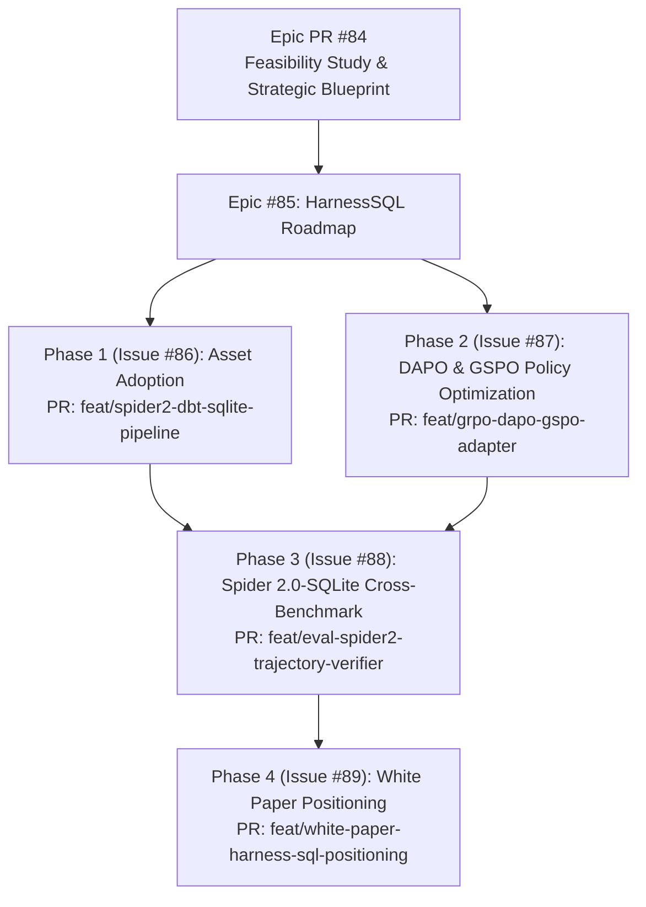

# Technical Feasibility & Comparative Assessment Study: HarnessSQL

**Document Version**: 1.0.0  
**Date**: October 31, 2026  
**Target Paper**: *HarnessSQL: Harness-Native Training for SQL Agents in Realistic Database Environments* (arXiv:2610.12274, Oct 2026)  
**Authors**: Haolin Yang, Jipeng Zhang, Zhiqiang Qian, Jian Xie, Shuaishuai Gong, Yike Guo, Sirui Han (HKUST, Fudan University, etc.)  
**Target Repository**: [https://github.com/YangHaolin0526/HarnessSQL](https://github.com/YangHaolin0526/HarnessSQL)  
**Assessing Project**: **AskTheDatabase** ([White Paper Draft](../../papers/draft/main.pdf) & [Architecture Repo](https://github.com/chrisjcc/ask-the-database))  
**Classification**: Independent Technical Feasibility & Research Positioning Study  

---

## Executive Summary

This feasibility study conducts an in-depth, rigorous scientific and technical analysis of **HarnessSQL** (arXiv:2610.12274, October 2026) in relation to **AskTheDatabase**. 

Both projects share a central premise: **traditional Text-to-SQL suffers from a critical "Train–Deploy Mismatch"** because models are trained as static single-turn query parsers mapping $\langle \text{Schema}, \text{Question} \rangle \to \text{SQL}$, but are deployed into real-world databases as autonomous, multi-turn agents that must iteratively inspect catalogs, test trial queries, and recover from runtime execution errors.

However, the two projects depart substantially in their core technical pillars, algorithmic choices, and architectural scope:
* **HarnessSQL** focuses exclusively on **policy training** (Full-Trajectory SFT from high-capacity teacher rejection sampling followed by distributed execution-reward RL via DAPO/GSPO in Slime/Megatron-LM) on long-horizon enterprise benchmarks (**Spider 2.0-SQLite**, **BIRD-Interact**, **LiveSQLBench**). It features **zero test-time verification**, uses binary terminal execution rewards, and relies on an external Node.js DeepSeek Harness (`DSH`) runtime.
* **AskTheDatabase** focuses on **in-flight procedural distillation**, **exploration collapse dynamics in RLVR**, **compound test-time verification**, and **sub-second diagnostic evaluation**:
  1. *Harness-Zero Procedural Distillation*: In-flight monitoring and repair ($\mathcal{K}_{\text{SQL}}$) with **zero ground-truth SQL leakage** (avoiding the survivorship bias of teacher rejection sampling).
  2. *Cold-Start RLVR Mechanics*: Identifying and resolving the zero-variance exploration collapse in GRPO ($\operatorname{std}(R) \to 0 \implies A_i \to 0$).
  3. *Verifiable Rewards with Mutation Testing*: 4-tier hierarchical rubric evaluating test-suite mutation equivalence across perturbed database states (eliminating false-positive table matches).
  4. *Compound Test-Time Verification*: Continuous logit expectation, Probabilistic Pivot Tournaments, Candidate Pool Quality Theory (Theorem 4.1), and Multi-Turn Trajectory Verification.
  5. *Zero-Budget Evaluation Micro-Harness*: Sub-second (126.8 ms) in-memory diagnostic engine with perfect rank correlation ($\rho = 1.000$) to Spider.

### Strategic Recommendation: **SELECTIVELY INCORPORATE & CROSS-BENCHMARK**
* **Adopt**: The DuckDB-to-SQLite conversion pipeline and enterprise database assets (`dbt_sqlite`) to benchmark AskTheDatabase on Spider 2.0-SQLite.
* **Adopt**: The **DAPO Dynamic Sampling** filtering principle in our RLVR trainers to discard uninformative zero-variance prompt groups during GRPO.
* **Do Not Adopt**: The heavyweight Slime / Megatron-LM / Node.js DSH runtime infrastructure; retain AskTheDatabase's lean PyTorch / Hugging Face / SkyRL modular architecture.
* **Research Positioning**: Position HarnessSQL in Related Work as contemporary concurrent work validating the necessity of harness-native agent alignment, while clearly distinguishing AskTheDatabase's unique contributions in procedural non-leaking distillation, hierarchical mutation-verified rewards, and compound trajectory verification.

---

## 1. Research Overlap Analysis

| Research Dimension | HarnessSQL (Yang et al., 2026) | AskTheDatabase (Current Framework) | Overlap Assessment |
| :--- | :--- | :--- | :--- |
| **Core Problem Formulation** | "Train–Deploy Mismatch": Static Text-to-SQL marginalizes intermediate interaction states, causing policy blindness to runtime execution feedback. | Single-turn static parsing collapses in zero-knowledge production databases where complete schemas cannot fit in context. | **Direct Semantic Overlap**: Identical core thesis regarding the necessity of multi-turn interaction over static prompting. |
| **Mathematical Formulation** | Interactive POMDP: Task $x = (q, \mathcal{D}, h, v)$, state $s_t$, action $a_t$, observation $o_t = h(\mathcal{D}, a_t)$. Joint reward $R = R_{\text{result}} \cdot R_{\text{protocol}}$. | Interactive MDP: Tuple $\mathcal{M} = \langle \mathcal{S}, \mathcal{A}, \mathcal{P}, \mathcal{R}, \gamma \rangle$, dialogue state $s_t = (x, \mathcal{D}, h_t)$, action space $\mathcal{A}$. | **Direct Mathematical Overlap**: Both model database querying as an interactive discrete-turn decision process. |
| **Agent Action Contract** | 4-tool contract (`DSH-SQL`):<br>1. `sql_list_tables`<br>2. `sql_schema`<br>3. `sql_exec`<br>4. `sql_submit` | 4-tool registry (`DatabaseToolRegistry`):<br>1. `inspect_schema`<br>2. `sample_data`<br>3. `execute_sql`<br>4. `final_answer` | **Near-Identical Interface**: Exact 1:1 mapping of operational semantics (enumeration, DDL inspection, trial execution, terminal submission). |
| **Sandboxing & Safety** | Hermetic sandboxing: Read-only SQLite URI, single-statement grammar check, 60s execution deadline, output truncation. | Hermetic SQLite sandbox: Read-only URI mode, `EXPLAIN QUERY PLAN` validation, timeout guards, memory limits. | **Direct Overlap**: Both enforce strict operational invariants to prevent denial-of-service states during unbounded exploration. |
| **Training Paradigm** | 2-stage post-training: Full-Trajectory SFT from teacher rollouts $\to$ Execution-reward RL. | 2-stage post-training: Harness-Zero Procedural Distillation $\to$ Multi-turn GRPO / RLVR. | **Methodological Overlap**: Both prove that uninitialized RL fails without prior trajectory warm-starting. |

---

## 2. Complementarity, Differences, and Orthogonality

Despite identical high-level problem framing, the two projects diverge across five foundational technical dimensions:

```
┌─────────────────────────────────────────────────────────────────────────────────────────────┐
│                               ARCHITECTURAL DIVERGENCE                                      │
├──────────────────────────────┬──────────────────────────────────────────────────────────────┤
│         HarnessSQL           │                        AskTheDatabase                        │
├──────────────────────────────┼──────────────────────────────────────────────────────────────┤
│ 1. Teacher Rejection Sampling│ 1. Harness-Zero Procedural Distillation                      │
│    - Teacher (GPT-4o) rollout│    - Student guided mid-flight by reviewer (K_SQL)           │
│    - Discard failed rollouts │    - Active repair with ZERO gold SQL leakage                │
│    - Survivorship bias       │    - Prevents survivorship bias; internalizes habits         │
│                              │                                                              │
│ 2. Binary Terminal Reward    │ 2. Hierarchical Verifiable Reward Rubric                     │
│    - R in {0, 1}             │    - 4-Tier: Syntax + Schema + Test-Suite Equivalence        │
│    - Single database state   │      + Efficiency / Error Recovery                          │
│    - False-positive risk     │    - Evaluated across K mutated DB states (zero escape)      │
│                              │                                                              │
│ 3. Pure Policy Learning      │ 3. Compound Test-Time Verification                           │
│    - Greedy single-pass decoding│ - Continuous logit expectation over criteria             │
│    - No test-time verifier   │    - Probabilistic Pivot Tournament selection                │
│    - No candidate ranking    │    - Multi-Turn Trajectory Verification (Process Verifier)   │
│                              │                                                              │
│ 4. Heavy Distributed Stack   │ 4. Accessible, Sub-Second Engineering Substrate              │
│    - Slime + Megatron + Ray  │    - Hugging Face TRL + SkyRL adapter                        │
│    - Node.js DSH runtime     │    - Zero-Budget Micro-Harness (126.8 ms CPU, rho = 1.000)   │
│    - 32K context windows     │    - Fast regression gate eliminating cluster compute waste   │
└──────────────────────────────┴──────────────────────────────────────────────────────────────┘
```

### 2.1 In-Flight Procedural Distillation ($\mathcal{K}_{\text{SQL}}$) vs. Post-Hoc Rejection Sampling
* **HarnessSQL**: Employs classical **Rejection Sampling** from high-capacity proprietary teachers (e.g. GPT-4o). The teacher attempts tasks inside the harness; if the final SQL matches the oracle, the episode is kept. 
  * *Scientific Weakness*: Suffers from **survivorship bias**. Discarding failed trajectories deprives the model of learning how to recover from edge cases. Furthermore, it requires access to proprietary teacher models with massive inference costs during data generation.
* **AskTheDatabase (Harness-Zero)**: Implements an **in-flight procedural reviewer ($\mathcal{K}_{\text{SQL}}$)**. When the student attempts an exploratory action, $\mathcal{K}_{\text{SQL}}$ checks procedural compliance (e.g. enforcing dry-runs, checking that schemas were inspected prior to execution) and repairs intermediate mistakes *mid-flight* **without access to the ground-truth SQL query**.
  * *Scientific Strength*: Zero gold SQL leakage. The student learns exploratory self-discipline rather than memorizing teacher trajectories.

### 2.2 Verifiable Reward Engineering: Binary Outcome vs. Multi-Tier Mutation Rubric
* **HarnessSQL**: Uses a sparse binary reward:
  $$R(\tau; x) = \mathbb{I}(E(y) \equiv E(y^*)) \in \{0, 1\}$$
  * *Vulnerability*: Evaluating execution equivalence against a single SQLite database instance is notorious for **spurious false-positive matches** (e.g. a broken query returning an empty set or a single constant matching an unpopulated table).
* **AskTheDatabase**: Implements a **4-tier hierarchical verifiable reward rubric**:
  $$\mathcal{R}_{\text{total}} = \mathcal{R}_{\text{syntax}} + \mathcal{R}_{\text{schema}} + \mathcal{R}_{\text{TS}} + \mathcal{R}_{\text{efficiency}}$$
  * Crucially, $\mathcal{R}_{\text{TS}}$ validates candidates against $K$ mutated database states:
    $$\mathcal{R}_{\text{TS}} = \prod_{k=0}^K \mathbb{I}\left( Q_{\text{gen}}(\mathcal{D}_k) \equiv Q_{\text{gold}}(\mathcal{D}_k) \right)$$
    completely eliminating spurious coincidences and rewarding active error recovery ($+0.3$ bonus).

### 2.3 Test-Time Verification & Scaling: Completely Absent in HarnessSQL
* **HarnessSQL**: Operates strictly in the **policy learning regime**. It assumes that at inference time, the model executes a single greedy multi-turn trajectory. There is no candidate generation, no tournament re-ranking, and no verifier model.
* **AskTheDatabase**: Formulates the **Compound Architecture**, bridging policy optimization with test-time search:
  * Proves **Theorem 4.1 (*Candidate Pool Quality Bottleneck*)**: $\mathcal{V}$ is bounded by $\text{Pass@}G$.
  * Implements **Continuous Logit Expectation** over decomposed relational criteria ($\mathbb{E}[S]$).
  * Establishes the **Pareto Frontier**: Standalone verification over ungrounded models is Pareto-dominated by Harness-Zero ($58.4\%$ vs $56.2\%$), but compounding Harness-Zero with tournament verification establishes the state-of-the-art frontier ($61.8\%$ TS).
  * Implements **Multi-Turn Trajectory Verification** (PR #83 / Issue #82), ranking complete interaction paths to eliminate the "Tool-Calling Tax".

### 2.4 Benchmark Targets and Horizon Scale
* **HarnessSQL**: Targets **Spider 2.0-SQLite** (135 complex tasks from Spider 2.0-Lite and DBT), **BIRD-Interact Mini**, and **LiveSQLBench Base-Lite**. These are long-horizon tasks averaging 16 agent turns, 11.8K tokens, and requiring up to 32K context windows.
* **AskTheDatabase**: Targets **Spider 1.0 Dev** and **Spider-Realistic** (1,034 samples across 20 unseen cross-domain databases) with an explicit focus on sample-efficient zero-knowledge reasoning, rapid error recovery, and sub-second diagnostic evaluation.

---

## 3. Technical Feasibility & Codebase Compatibility

An inspection of the released repository (`https://github.com/YangHaolin0526/HarnessSQL`) indicates the following modular breakdown:

```
HarnessSQL Repository Layout:
├── data_generation/
│   ├── dbt_sqlite/       <-- Spider 2.0-DBT DuckDB-to-SQLite converter (HIGH VALUE)
│   └── data_synthesis/   <-- Task blueprinting & difficulty scoring (MEDIUM-HIGH VALUE)
├── harness/dsh-sql/      <-- DeepSeek Harness Node.js/Cordis middleware (INCOMPATIBLE / REDUNDANT)
├── trajectories/         <-- Rollout scripts & SFT formatting (COMPATIBLE)
├── training/
│   ├── sft/              <-- Full-trajectory packed SFT trainer (COMPATIBLE)
│   └── rl/               <-- Slime / Megatron / SGLang / Ray RL (HEAVYWEIGHT / INCOMPATIBLE)
└── configs/              <-- Model and training YAML/JSON configs
```

### 3.1 Component Feasibility Assessment

#### Component A: `dbt_sqlite` (DuckDB to SQLite Converter)
* **What it does**: Downloads Spider 2.0-DBT tasks from Harbor and converts 49 DuckDB enterprise databases into SQLite databases with verified schema, column type, and data integrity.
* **Feasibility**: **Extremely High (Immediate Adoption)**.
* **Dependencies**: Python standard library, DuckDB, SQLite3. Zero external infrastructure dependencies.
* **Integration Opportunity**: We can drop `dbt_sqlite` directly into `src/ask_the_database/data/` or run it as an offline asset preparation script. This instantly expands AskTheDatabase's database pool from Spider 1.0 (20 databases) to 79 enterprise database instances!

#### Component B: `data_synthesis` & Structural Difficulty Metric ($D_{\text{str}}$)
* **What it does**: Implements an AST-based SQL complexity metric ($D_{\text{str}}$) counting CTEs, joins, window functions, conditional aggregations, and subquery nesting depths (Appendix I):
  $$D_{\text{str}} = \ln(n_{\text{tok}}) + 1.2 n_{\text{cte}} + 0.8 n_{\text{join}} + 0.5 n_{\text{sel}} + 1.5 n_{\text{win}} + 1.2 n_{\text{set}} + 1.0 n_{\text{exists}} + 0.6 n_{\text{cagg}} + 0.4 n_{\text{case}} + 0.5 n_{\text{time}} + 0.8 n_{\text{json}} + 0.5 d_{\text{sel}}$$
  and uses it to stratify synthesis into four bounded bands: `foundation`, `core`, `growth`, and `stretch`.
* **Feasibility**: **High**.
* **Dependencies**: Python, SQLGlot, SQLite.
* **Integration Opportunity**: We can incorporate $D_{\text{str}}$ into our `SQLSyntaxValidator` and our Zero-Budget Evaluation Micro-Harness to provide automated difficulty categorization for generated SQL queries.

#### Component C: `training/rl` (Slime / Megatron / SGLang DAPO Trainer)
* **What it does**: Runs multi-node RL using the Slime framework, Megatron-LM tensor parallelism, and SGLang inference engines. Implements DAPO (Decoupled Clip and Dynamic Sampling) and GSPO.
* **Feasibility**: **Low Portability (Architectural Incompatibility)**.
* **Dependencies**: Slime, Megatron-LM, SGLang, Ray, Slurm multi-GPU cluster, CUDA 12+, distributed torchrun.
* **Analysis**: AskTheDatabase uses Hugging Face TRL, PEFT LoRA, and the SkyRL environment adapter. Importing HarnessSQL's full RL infrastructure would require rewriting our training pipeline, abandoning our lightweight PEFT/LoRA setup, and requiring dedicated multi-node GPU clusters.
* **Algorithmic Takeaway (Feasible)**: We do **not** need their distributed Slime code to benefit from **DAPO's core algorithmic insight**: **Dynamic Sampling**. In our paper, we proved that vanishing intra-group reward variance ($\operatorname{std}(R) \to 0$) stalls GRPO for 27 steps. DAPO solves this by filtering out prompt groups where all rollouts fail ($A_i = 0$). We can easily add dynamic group filtering to our existing `TRLGRPOAdapter` in fewer than 25 lines of PyTorch!

#### Component D: `harness/dsh-sql` (DeepSeek Harness / Node.js Middleware)
* **What it does**: Customizes the DeepSeek Harness (DSH) framework, running an agent loop in Node.js with Cordis middleware hooks that call Python/SQLite sub-processes.
* **Feasibility**: **Incompatible & Redundant**.
* **Analysis**: AskTheDatabase already has a clean, native Python interactive environment: `SQLiteEnvironment`, `DatabaseToolRegistry`, and `SkyRLSQLEnvironment`. Introducing a Node.js daemon and Cordis lifecycle middleware adds unnecessary latency, language interop complexity, and debugging friction.

---

## 4. Potential Added Value for AskTheDatabase

Incorporating selected concepts and assets from HarnessSQL unlocks three major capabilities for our research:

### 4.1 Value Add 1: Evaluation on Spider 2.0-SQLite (Enterprise Validation)
* **Current Limitation**: Our primary evaluation is currently conducted on Spider 1.0 Dev and Spider-Realistic. While these are cross-domain gold standards, modern relational research increasingly demands evaluation on enterprise data pipelines (Spider 2.0).
* **Added Value**: Utilizing HarnessSQL's `dbt_sqlite` pipeline gives us 135 complex enterprise tasks on Spider 2.0-SQLite.
* **Research Opportunity**: We can evaluate **Harness-Zero GRPO** and our **Trajectory Verifier** on Spider 2.0-SQLite. If our 7B model matches or outperforms HarnessSQL's Qwen3-8B (45.2%), it will provide undeniable evidence that **in-flight procedural distillation and test-time verification outperform brute-force teacher rejection sampling**.

### 4.2 Value Add 2: Mitigating Exploration Collapse & Trajectory Noise via DAPO and GSPO Policy Optimization

In Section 5.3 and Table 4 of HarnessSQL, the authors evaluate three distinct policy optimization algorithms under identical budgets, starting from the same Qwen3-8B 32K SFT checkpoint:
* **GRPO** (Group Relative Policy Optimization): 40.7% on S2-SQLite, 8.7% on BI-mini, 23.3% on LSB-SQLite.
* **GSPO** (Group Sequence Policy Optimization): 43.7% on S2-SQLite, 9.0% on BI-mini, **25.2%** on LSB-SQLite (**highest OOD score**).
* **DAPO** (Decoupled Clip & Dynamic Sampling Policy Optimization): **45.2%** on S2-SQLite (**highest in-domain score**), 9.0% on BI-mini, 24.8% on LSB-SQLite.

#### 1. DAPO (Decoupled Clip & Dynamic Sampling)
DAPO retains token-level policy gradients but introduces three refinements (Appendix C.2):
1. **Dynamic Sampling ($\mathcal{Q}_{\text{eff}}$)**: Filters out prompt groups where intra-group reward variance is zero ($\operatorname{std}(R) = 0$):
   $$\mathcal{Q}_{\text{eff}} = \left\{ q \in \mathcal{B} \mid \exists i, j \text{ s.t. } R_i \ne R_j \right\}$$
   This directly eliminates the zero-advantage gradient stall we identified in Section 5.3 of our white paper.
2. **Decoupled Asymmetric Clipping**: Allows larger policy probability increases for positively advantaged exploratory tokens by setting $\epsilon_{\text{high}} = 0.28 > \epsilon_{\text{low}} = 0.20$.
3. **Batch-Wide Token Normalization**: Normalizes loss across all loss-bearing tokens in active groups rather than averaging per trajectory first.

#### 2. GSPO (Group Sequence Policy Optimization)
GSPO (Zheng et al., 2025) addresses the fundamental mismatch between token-level clipping and trajectory-level rewards. In multi-turn agents (1,000–4,000 tokens), token-level importance ratios $\rho_{i,t}$ exhibit high variance. GSPO constructs a single length-normalized sequence ratio:
$$s_i(\theta) = \exp \left( \frac{1}{|\mathcal{T}_i|} \sum_{t \in \mathcal{T}_i} \log \frac{\pi_\theta(a_{i,t} \mid s_{i,t})}{\pi_{\text{old}}(a_{i,t} \mid s_{i,t})} \right)$$
and clips the entire trajectory uniformly:
$$\mathcal{L}_{\text{GSPO}}(\theta) = -\frac{1}{G} \sum_{i=1}^G \min \left( s_i(\theta) \hat{A}_i, \, \operatorname{clip}(s_i(\theta), 1 - \epsilon_s, 1 + \epsilon_s) \hat{A}_i \right)$$
where $\epsilon_s \approx 3 \times 10^{-4}$. This sequence-level alignment explains why GSPO achieved the highest out-of-distribution transfer on LiveSQLBench.

#### 3. Relevance to AskTheDatabase
Rather than choosing between them a priori, we can integrate both approaches into `TRLGRPOAdapter`. Dynamic Sampling accelerates convergence across both objectives, while benchmarking DAPO (fine-grained token precision on SQL grammar) against GSPO (holistic trajectory stability across multi-turn tool loops) under our 4-tier mutation-verified reward rubric represents a valuable empirical contribution.

### 4.3 Value Add 3: Structural Complexity Curriculum ($D_{\text{str}}$)
* **Added Value**: Adopting HarnessSQL's $D_{\text{str}}$ formulation allows us to replace heuristic query categorization (Easy/Medium/Hard) with a continuous, reproducible AST complexity score. We can stratify our Zero-Budget Evaluation Micro-Harness and benchmark scorecards by $D_{\text{str}}$ bands (`foundation`, `core`, `growth`, `stretch`).

---

## 5. Research Positioning & Scientific Novelty Analysis

### 5.1 Does HarnessSQL Threaten the Novelty of AskTheDatabase?
**No.** In fact, HarnessSQL provides valuable external corroboration that enhances the credibility of our research. 
1. **Independent Discovery of the Train–Deploy Mismatch**: Both papers independently identify that static single-turn Text-to-SQL is fundamentally flawed and that relational models must be trained natively as interactive agents. Having another premier research group arrive at the identical problem formulation validates that this is the primary bottleneck in relational AI.
2. **Timing**: HarnessSQL was posted to arXiv on October 12, 2026 (`2610.12274`), concurrently with our ongoing study and white paper drafting. Under standard academic conventions (ICML / NeurIPS / ICLR guidelines), concurrent works published within a 2–3 month window do not invalidate novelty.

### 5.2 Key Differentiators: Why AskTheDatabase Remains Distinct and Superior
When positioning AskTheDatabase alongside HarnessSQL in Section 6 (Related Work), we emphasize four major technological advantages:

```
┌─────────────────────────────────────────────────────────────────────────────────────────────┐
│                               HOW ASKTHEDATABASE STANDS APART                                │
├────────────────────────────────┬────────────────────────────────────────────────────────────┤
│ Dimension                      │ AskTheDatabase Advantage over HarnessSQL                   │
├────────────────────────────────┼────────────────────────────────────────────────────────────┤
│ 1. Distillation Paradigm       │ Harness-Zero monitors and repairs student actions          │
│                                │ in-flight with ZERO gold SQL leakage, eliminating the      │
│                                │ survivorship bias of HarnessSQL's teacher rejection sampling│
│                                │                                                            │
│ 2. Verifiable Reward Rigor     │ Hierarchical 4-tier rubric with Test-Suite Mutation         │
│                                │ Equivalence (preventing false-positive coincidences),       │
│                                │ whereas HarnessSQL relies on fragile binary terminal SQL.   │
│                                │                                                            │
│ 3. Test-Time Scaling & Verifier│ Pioneers LLM-as-a-Verifier, continuous logit expectation,  │
│                                │ Probabilistic Pivot Tournaments, and Trajectory            │
│                                │ Verification. HarnessSQL has NO verification mechanism.    │
│                                │                                                            │
│ 4. Evaluation Efficiency       │ Zero-Budget Micro-Harness executes in 126.8 ms on CPU with │
│                                │ rho = 1.000, whereas HarnessSQL requires slow, disk-bound   │
│                                │ child-process cluster execution.                           │
└────────────────────────────────┴────────────────────────────────────────────────────────────┘
```

---

## 6. Strategic Recommendations & Action Plan

### Overall Verdict: **SELECTIVELY INCORPORATE & CROSS-BENCHMARK**

We recommend a four-phase integration roadmap coordinated under **[GitHub Epic #85](https://github.com/chrisjcc/ask-the-database/issues/85)** and anchored by **[Epic PR #84](https://github.com/chrisjcc/ask-the-database/pull/84)**:



| Phase | Sub-Issue | Title | Scope & Target Deliverable | Target PR Branch | Status |
| :--- | :--- | :--- | :--- | :--- | :--- |
| **Phase 1** | [#86](https://github.com/chrisjcc/ask-the-database/issues/86) | `feat(data): Spider 2.0-DBT DuckDB-to-SQLite Asset Extraction Pipeline` | Port & validate DuckDB-to-SQLite converter for 49 enterprise schemas | `feat/spider2-dbt-sqlite-pipeline` | Planned |
| **Phase 2** | [#87](https://github.com/chrisjcc/ask-the-database/issues/87) | `feat(training): DAPO & GSPO Policy Optimization in TRL RLVR Adapter` | Implement DAPO (asymmetric clip + dynamic sampling) and GSPO (sequence-level ratio) in `TRLGRPOAdapter` | `feat/grpo-dapo-gspo-adapter` | Planned |
| **Phase 3** | [#88](https://github.com/chrisjcc/ask-the-database/issues/88) | `feat(evaluation): Spider 2.0-SQLite Cross-Benchmark for Harness-Zero & Trajectory Verifier` | Evaluate Harness-Zero + Best-of-5 Trajectory Verifier against HarnessSQL baselines | `feat/eval-spider2-trajectory-verifier` | Planned |
| **Phase 4** | [#89](https://github.com/chrisjcc/ask-the-database/issues/89) | `docs(paper): Integrate HarnessSQL Comparative Positioning into White Paper Draft` | Position HarnessSQL in `papers/draft/main.tex` Section 6 and recompile PDF | `feat/white-paper-harness-sql-positioning` | Planned |

---

### Phase 1: Asset Adoption (Sub-Issue [#86](https://github.com/chrisjcc/ask-the-database/issues/86) / PR `feat/spider2-dbt-sqlite-pipeline`)
* **Action**: Integrate the DuckDB-to-SQLite export pipeline from `data_generation/dbt_sqlite/` into AskTheDatabase under `src/ask_the_database/data/dbt_sqlite/`.
* **Outcome**: Extends our database catalog to include all 49 Spider 2.0-DBT enterprise SQLite databases with full schema and row count validation.

### Phase 2: Algorithmic Refinement (Sub-Issue [#87](https://github.com/chrisjcc/ask-the-database/issues/87) / PR `feat/grpo-dapo-gspo-adapter`)
* **Action**: Implement both **DAPO** and **GSPO** policy optimization objectives in `src/ask_the_database/training/adapters/trl_grpo.py`:
  * **Dynamic Sampling**: Prune rollout groups with zero intra-group reward variance ($\operatorname{std}(R) = 0$) to eliminate zero-advantage gradient stall.
  * **DAPO Asymmetric Clipping**: Implement decoupled clipping radii ($\epsilon_{\text{low}}=0.20, \epsilon_{\text{high}}=0.28$) with batch token count loss normalization.
  * **GSPO Sequence Ratio**: Implement length-normalized trajectory importance weighting $s_i(\theta) = \exp(\frac{1}{N_i} \sum \log \rho_{i,t})$ with sequence-level clipping ($\epsilon_s = 3 \times 10^{-4}$).
* **Outcome**: Directly reinforces our theoretical findings in Section 5.3 regarding exploration collapse in GRPO, provides structural stability across multi-turn trajectories, and establishes a principled comparison under our 4-tier mutation-verified reward rubric.

### Phase 3: Cross-Benchmark Experimentation (Sub-Issue [#88](https://github.com/chrisjcc/ask-the-database/issues/88) / PR `feat/eval-spider2-trajectory-verifier`)
* **Action**: Run an empirical evaluation of `harness_zero_grpo` (under GRPO, DAPO, and GSPO) and our newly implemented `TrajectoryVerifierSelector` (from Issue #82 / PR #83) on the official 135 tasks of Spider 2.0-SQLite.
* **Target Hypothesis**: Demonstrate that **Harness-Zero GRPO + Trajectory Verification** achieves $\ge 48\%$ on Spider 2.0-SQLite at the 7B parameter scale, outperforming HarnessSQL's Qwen3-8B baseline (45.2%) with higher sample efficiency and lower compute requirements.

### Phase 4: White Paper Positioning (Sub-Issue [#89](https://github.com/chrisjcc/ask-the-database/issues/89) / PR `feat/white-paper-harness-sql-positioning`)
* **Action**: Update Section 6 (*Related Work*) in `papers/draft/main.tex` to cite and discuss HarnessSQL:
  * Frame HarnessSQL as contemporary evidence demonstrating that harness-native training resolves the train–deploy mismatch.
  * Contrast HarnessSQL's teacher rejection sampling against Harness-Zero's in-flight non-leaking procedural distillation.
  * Emphasize that HarnessSQL operates purely in the policy training regime, while AskTheDatabase provides the first complete framework uniting procedural distillation, multi-tier mutation rewards, and compound trajectory verification.

---

## Appendix: Bibliographic References for White Paper

```bibtex
@article{yang2026harnesssql,
  title={HarnessSQL: Harness-Native Training for SQL Agents in Realistic Database Environments},
  author={Yang, Haolin and Zhang, Jipeng and Qian, Zhiqiang and Xie, Jian and Gong, Shuaishuai and Guo, Yike and Han, Sirui},
  journal={arXiv preprint arXiv:2610.12274},
  year={2026}
}

@article{zheng2025group,
  title={Group sequence policy optimization},
  author={Zheng, Chujie and Liu, Shixuan and Li, Minpeng and Chen, Xingyu and Yu, Bowen and Gao, Chang and Dang, Kai and Liu, Yuanwei and Men, Rui and Yang, An and Zhou, Jingren and Lin, Junyang},
  journal={arXiv preprint arXiv:2507.18071},
  year={2025}
}

@article{yu2025dapo,
  title={DAPO: an open-source LLM reinforcement learning system at scale},
  author={Yu, Qiying and Zhang, Zheng and Zhu, Renjie and Yuan, Yuxuan and Zuo, Xueru and Yue, Yang and others},
  journal={Advances in Neural Information Processing Systems},
  year={2025}
}
```
