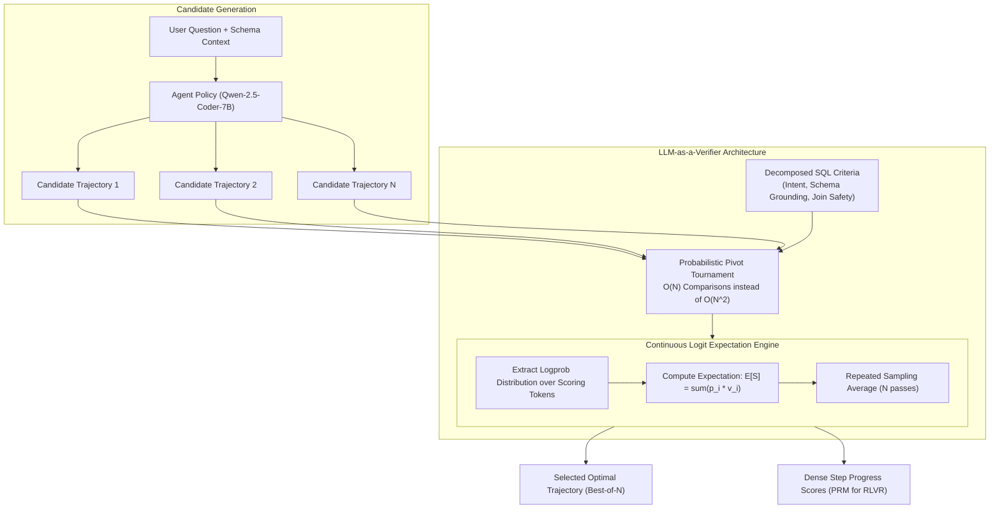
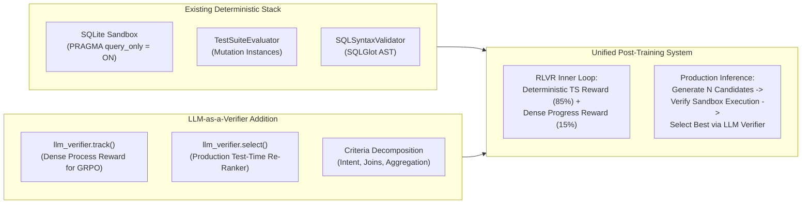

# Feasibility Study: LLM-as-a-Verifier for AskTheDatabase
## Evaluating Continuous Logit-Expectation Verification, Process Reward Modeling, and Test-Time Scaling for Relational SQL Agents

**Date:** October 2026  
**Project:** [AskTheDatabase](https://github.com/chrisjcc/ask-the-database)  
**Target Document:** `docs/research/llm-as-a-verifier-feasibility-study.md`  
**Primary Reference:** *LLM-as-a-Verifier: A General-Purpose Verification Framework* (arXiv:2607.05391, [GitHub](https://github.com/llm-as-a-verifier/llm-as-a-verifier))  

---

## 1. Executive Summary

This feasibility study evaluates the applicability, technical viability, benefits, and architectural trade-offs of integrating **LLM-as-a-Verifier** (July 2026, *arXiv:2607.05391*) into **AskTheDatabase** (`ask-the-database`).

### Core Methodology of LLM-as-a-Verifier
Traditional "LLM-as-a-Judge" frameworks prompt language models to output discrete scores or binary verdicts (e.g., "Pass/Fail" or "1 to 5"). This introduces high variance, calibration errors, and discrete plateaus that make candidate ranking and reinforcement learning updates noisy and brittle. 

**LLM-as-a-Verifier** introduces a probabilistic formulation: instead of sampling discrete text tokens, it computes the **mathematical expectation over the logprob distribution of scoring tokens** ($\mathbb{E}[S]$), yielding a smooth, continuous scalar reward $S \in [0, 1]$. It scales verification along three dimensions:
1. **Score Granularity**: Fine-grained scoring tokens sharpen separation between positive and negative candidates.
2. **Repeated Evaluation**: Running $N$ independent evaluation passes reduces variance via averaging ($\bar{S} = \frac{1}{N}\sum S_i$).
3. **Criteria Decomposition**: Decomposing monolithic tasks into modular criteria (e.g., syntax validity, schema grounding, join safety) to reduce task complexity.

The framework provides three core operational primitives:
- `select()`: Cost-efficient Best-of-$N$ candidate selection via a **Probabilistic Pivot Tournament**.
- `compare()`: Continuous pairwise preference scoring.
- `track()`: **Process Reward Modeling (PRM)** / fine-grained step-by-step progress estimation across multi-turn trajectories.

### Strategic Fit with AskTheDatabase

| Architectural Dimension | LLM-as-a-Verifier | AskTheDatabase Current Stack | Synergy Assessment |
| :--- | :--- | :--- | :--- |
| **Verification Nature** | Probabilistic semantic verification via logit expectation | Deterministic execution in SQLite sandbox + Test-Suite Mutation (`TestSuiteEvaluator`) | **Complementary**: Execution is ground truth when `gold_sql` exists; verifier is essential when `gold_sql` is missing. |
| **Inference / Deployment** | Best-of-$N$ trajectory re-ranking without ground truth | Single greedy trajectory rollout | **High Value**: Solves production test-time scaling when `gold_sql` is unavailable. |
| **RLVR Reward Density** | Dense step-level progress tracking (`track()`) | Sparse terminal execution reward ($R \in [-1, 1]$) with small turn penalty | **High Value**: Mitigates the GRPO cold-start exploration plateau on complex multi-table schemas. |
| **Distillation Trajectory Curation** | Continuous score filtering ($S \in [0, 1]$) | Binary acceptance threshold ($R=1.0$) in rejection sampling | **High Value**: Enables soft weighting and better ranking of teacher-reviewed trajectories. |

### Strategic Verdict: **ADOPT AS HYBRID COMPONENT (HIGH VALUE)**

1. **Adopt for Production Test-Time Scaling (Best-of-$N$ Re-Ranking)**: In real-world deployment, users ask database questions where no $\text{gold\_sql}$ exists. If an agent generates $N=5$ candidate rollouts that all execute without syntax errors, deterministic execution cannot distinguish which query matches the user's intent. `llm_verifier.select()` provides a calibrated, multi-criteria re-ranker to pick the optimal final query.
2. **Pilot as a Dense Process Reward (PRM) for GRPO**: In multi-turn RLVR, terminal rewards create exploration plateaus on Hard/Extra Hard queries when all rollouts in a group fail ($\sigma(R) = 0$). Combining deterministic terminal rewards ($R_{\text{exec}}$) with a small, continuous verifier progress reward ($R_{\text{progress}} \in [0, 0.2]$ via `track()`) provides gradient signals for partial progress (e.g., inspecting the correct catalog tables).
3. **DO NOT Replace Deterministic Execution Rewards**: For benchmark evaluation and final RLVR scoring, database execution against mutated instances (`TestSuiteEvaluator`) must remain the absolute Single Source of Truth. The verifier should augment, never replace, deterministic execution ground truth.

---

## 2. Technical Deep-Dive into LLM-as-a-Verifier



### 2.1 The Expectation Formulation over Scoring Logits

In standard LLM evaluation, a prompt asks the model to emit a discrete rating token $t \in \{1, 2, \dots, K\}$. This collapses continuous model confidence into an arbitrary argmax token, causing:
- Low sensitivity (a candidate with a 51% chance of score 4 and 49% chance of score 3 is treated identically to one with 99% chance of score 4).
- High variance across temperature samplings.

LLM-as-a-Verifier queries the model for a single scoring token and extracts the full normalized logprob distribution over the score vocabulary $\mathcal{V}_S$:

$$\mathbb{E}[S] = \sum_{v \in \mathcal{V}_S} P(v \mid \mathbf{x}, \mathbf{c}) \cdot \text{val}(v)$$

where $P(v \mid \mathbf{x}, \mathbf{c}) = \frac{\exp(\ell_v / T)}{\sum_{u \in \mathcal{V}_S} \exp(\ell_u / T)}$, $\ell_v$ is the raw model logit for token $v$, and $\text{val}(v) \in [0, 1]$ maps the token to a normalized real value.

This yields a differentiable, continuous reward score with high dynamic range.

### 2.2 Three Axes of Verification Scaling

1. **Score Granularity**: Expanding the scoring scale (e.g., from binary $\{0, 1\}$ to percentiles $[0.0, 1.0]$) sharpens positive/negative separation.
2. **Repeated Evaluation**: By querying the verifier $M$ times (with temperature $T > 0$) and computing the average score $\bar{S} = \frac{1}{M} \sum_{m=1}^M S_m$, epistemic noise and prompt-ordering variance drop at a rate of $\mathcal{O}(1/\sqrt{M})$.
3. **Criteria Decomposition**: Evaluating a multi-turn trajectory against 3–4 focused criteria independently (e.g., schema conformance, predicate accuracy, aggregation granularity) outperforms a single monolithic query prompt by reducing cognitive load on the verifier.

### 2.3 Probabilistic Pivot Tournament for Best-of-$N$

Exhaustive pairwise comparison across $N$ candidates requires $\mathcal{O}(N^2)$ LLM calls, which is cost-prohibitive. The framework introduces a **Probabilistic Pivot Tournament**:
- Selects $K$ pivot candidates ($K \ll N$).
- Compares all $N$ candidates against the $K$ pivots using continuous comparison rewards.
- Sorts and ranks candidates in $\mathcal{O}(K \cdot N)$ calls, reducing token consumption by up to 70% while maintaining $98\%+$ agreement with full tournament rankings.

---

## 3. Applicability to AskTheDatabase: Core Opportunities

While LLM-as-a-Verifier was validated on SWE-Bench (software bugs), Terminal-Bench (CLI operations), and RoboRewardBench (robotics), its mechanics are directly applicable to relational text-to-SQL.

### Opportunity 1: Test-Time Scaling in Production (No Ground-Truth SQL)

In training and academic benchmarks (Spider, BIRD), the ground-truth SQL $\text{gold\_sql}$ is known. But in **production deployment**, the user only supplies a natural language question and database connection:
- If `Qwen-2.5-Coder-7B` generates 5 candidate queries with temperature $T=0.7$, several may execute without runtime errors, but return totally different numbers.
- **The Problem**: Without `gold_sql`, the database execution engine cannot tell which query is semantically correct.
- **The Solution**: Deploy `llm_verifier.select()` at inference time. It inspects the database schema DDL, the user's natural language question, and the 5 candidates, selecting the candidate that best satisfies decomposed SQL criteria.

### Opportunity 2: Dense Process Reward Modeling (PRM) for Multi-Turn RLVR (GRPO)

In Phase 4 of `AskTheDatabase`, we train agents via Group Relative Policy Optimization (GRPO) using `SkyRLSQLEnvironment`.
- **The Sparse Reward Problem**: The environment emits $R = 0$ for intermediate turns (`inspect_schema`, `sample_data`, trial `execute_sql`). If all 8 rollouts in a GRPO group fail to produce the exact target query on an Extra-Hard task, all rollouts receive $R = 0$, the group advantage collapses to $0$, and no policy update occurs.
- **The Verifier Solution**: Use `llm_verifier.track()` to evaluate the agent's multi-step trajectory:
  ```python
  steps = [
      "Action 1: inspect_schema(['orders', 'customers'])",
      "Observation 1: DDL with columns id, customer_id, order_date, total",
      "Action 2: sample_data('orders')",
      "Observation 2: Sample rows showing date format 'YYYY-MM-DD'",
      "Action 3: execute_sql('SELECT customer_id, SUM(total) FROM orders GROUP BY customer_id')",
      "Observation 3: 50 rows returned",
  ]
  progress = llm_verifier.track(problem=question, steps=steps)
  # progress.scores -> [0.25, 0.40, 0.85]
  ```
- **Hybrid Reward Formulation**:
  $$R_{\text{total}} = R_{\text{exec}} + \lambda \cdot R_{\text{progress}}$$
  where $R_{\text{exec}} \in \{-1, 1\}$ is the deterministic test-suite execution reward, and $\lambda \cdot R_{\text{progress}}$ ($\lambda = 0.15$) provides a dense, continuous gradient guiding the model toward sound exploratory behavior even when the final query is not yet perfect.

### Opportunity 3: Multi-Criteria Decomposition for Relational SQL

Rather than asking an LLM judge "Is this SQL query correct?", `AskTheDatabase` can decompose verification into four orthogonal SQL criteria:

```yaml
criteria:
  intent_and_filters:
    description: "Does the WHERE / HAVING clause accurately reflect all numerical, temporal, and categorical conditions stated in the question?"
    weight: 0.35

  schema_grounding_and_joins:
    description: "Are all referenced tables and columns present in the schema DDL, and are multi-table JOINs connected via valid primary/foreign key relationships?"
    weight: 0.30

  aggregation_granularity:
    description: "Are aggregations (COUNT, SUM, AVG) computed at the exact dimensional granularity specified, with proper GROUP BY columns?"
    weight: 0.20

  error_diagnosis_and_recovery:
    description: "If an intermediate query failed with an SQLite exception, did the subsequent action diagnose and correct the failure?"
    weight: 0.15
```

By computing continuous logit expectations across these four sub-criteria, verification accuracy increases while eliminating binary judge hallucination.

---

## 4. Architectural Comparison: Existing Stack vs. LLM-as-a-Verifier



| Component | AskTheDatabase Existing Stack | LLM-as-a-Verifier Framework | Hybrid Integration Strategy |
| :--- | :--- | :--- | :--- |
| **Ground-Truth Evaluation** | `TestSuiteEvaluator`: Mutation testing across cloned SQLite instances. | N/A (General-purpose prompt-based). | **Retain `TestSuiteEvaluator`**. Never substitute an LLM for deterministic execution when `gold_sql` exists. |
| **Syntax & AST Validation** | `SQLSyntaxValidator`: Deterministic SQLGlot parsing. | N/A. | **Retain SQLGlot**. Instant, zero-cost AST check. |
| **Intermediate Turn Guidance** | `HarnessReviewer` ($K_{\text{SQL}}$): Rule-based action interception ($y_t \to z_t$). | `track()`: Continuous progress curve estimation. | **Complementary**: $K_{\text{SQL}}$ intercepts actions during SFT collection; `track()` scores intermediate progress during GRPO. |
| **Test-Time Selection (Inference)** | Greedy search ($N=1$) only. No re-ranker. | `select()`: Probabilistic Pivot Tournament over $N$ candidates. | **Adopt `select()`**. Adds test-time scaling for production deployments. |

---

## 5. Limitations, Risks, and Honest Caveats

### 1. Logprob Requirement
* **Constraint**: LLM-as-a-Verifier requires access to token-level log probabilities (`logprobs=True`) to compute expectations over logits.
* **Impact**:
  - Fully supported by local **vLLM** (`Qwen/Qwen2.5-Coder-7B-Instruct`), **DeepSeek** (`deepseek-flash`), **OpenAI**, and **Google Vertex AI**.
  - Standard consumer Google AI Studio API (`gemini-2.0-flash` without Vertex) has limited logprob access in some LiteLLM versions.
* **Mitigation**: Use local vLLM or OpenAI-compatible endpoints with logprobs enabled, or use `deepseek-flash` for development.

### 2. Inference Latency & Cost in RL Inner Loops
* In GRPO, an agent generates $G = 8$ rollouts per prompt across hundreds of training steps. Calling an external LLM verifier on every intermediate step of every rollout would introduce substantial latency and API costs.
* **Mitigation**:
  - Restrict `track()` scoring to the student policy itself via local vLLM (self-verification mode, as validated in Terminal-Bench 2.1).
  - Use lightweight 7B verifier models or apply progress scoring only at checkpoint intervals.

### 3. Reward Hacking / Goodhart's Law
* If an RL policy is trained exclusively against an LLM verifier, the agent may learn to produce SQL queries that look stylistically persuasive to the verifier but compute incorrect numbers.
* **Mitigation**: Maintain the deterministic execution reward ($R_{\text{exec}} \in \{0, 1\}$) as the primary terminal signal ($\ge 85\%$ weight), using the verifier only as a dense shaping bonus ($15\%$ weight).

---

## 6. Actionable Implementation Recommendations

### Phase 1: Test-Time Scaling Re-Ranker for Production (`llm_verifier.select`)
* **Goal**: Enable Best-of-$N$ query selection at deployment when no ground truth is available.
* **Implementation**:
  - Add `llm-verifier` to `pyproject.toml` dependencies.
  - Implement [`src/ask_the_database/inference/reranker.py`](src/ask_the_database/inference/reranker.py) using `llm_verifier.select()`.
  - Add SQL-specific criteria decomposition (`configs/verification/sql_criteria.yaml`).
* **Expected Outcome**: +4 to +6 percentage points gain in Pass@1 at inference time via Best-of-5 tournament selection.

### Phase 2: Process Reward Modeling for GRPO (`llm_verifier.track`)
* **Goal**: Provide dense intermediate rewards to resolve the RLVR cold-start plateau.
* **Implementation**:
  - In [`src/ask_the_database/rewards/multi_turn_reward.py`](src/ask_the_database/rewards/multi_turn_reward.py), add an optional `progress_reward_evaluator` hook calling `llm_verifier.track()`.
  - Blend progress reward into `compute_group_normalized_rewards()`.
* **Expected Outcome**: Faster policy convergence on Hard and Extra Hard multi-table queries.

### Phase 3: Soft Rejection Sampling for Trajectory Distillation
* **Goal**: Replace hard binary filtering ($R=1.0$) in Condition 3 / Condition 4 with continuous score ranking.
* **Implementation**:
  - Score collected trajectories with `llm_verifier.compare()`.
  - Train SFT weighted by verifier confidence scores.

---

## 7. Conclusion

**LLM-as-a-Verifier is highly complementary to AskTheDatabase.** 

While it should **never replace our deterministic SQLite execution sandbox or test-suite mutation engine** when ground truth exists, it fills two critical architectural voids:
1. **Production Test-Time Scaling**: It gives the system a principled, calibrated mechanism to select the best SQL candidate among multiple rollouts when no ground-truth query exists.
2. **Dense RLVR Exploration Signals**: Its continuous logit-expectation progress tracker (`track()`) provides the exact dense feedback needed to overcome the sparse-reward exploration plateau during multi-turn GRPO training.

Adopting LLM-as-a-Verifier as an inference-time re-ranker and RLVR progress shaper will meaningfully enhance both training sample efficiency and production accuracy.
