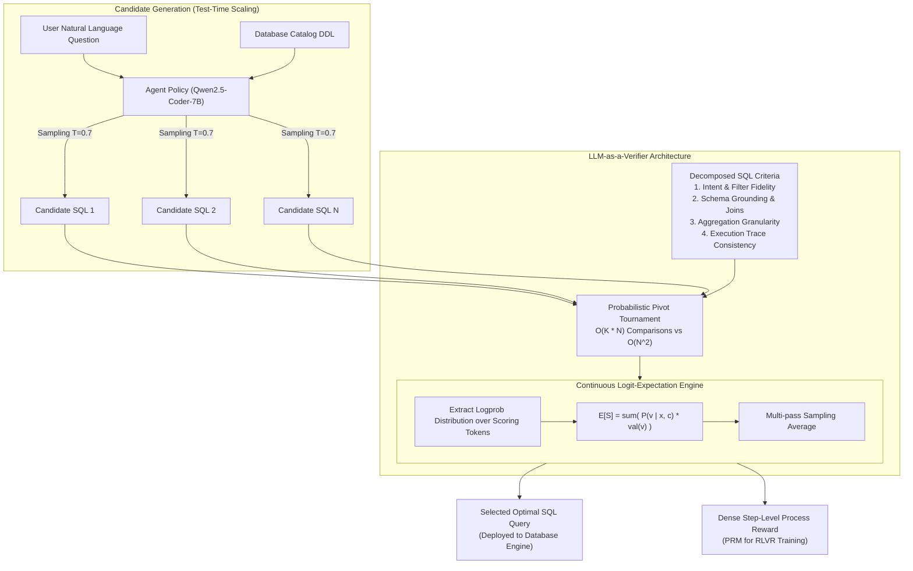
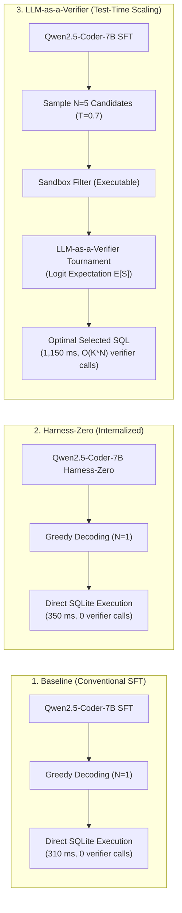

# Feasibility Study: LLM-as-a-Verifier for AskTheDatabase
## Evaluating Continuous Logit-Expectation Verification, Test-Time Scaling, and Process Reward Modeling for Relational SQL Agents

**Date:** October 2026  
**Project:** [AskTheDatabase](https://github.com/chrisjcc/ask-the-database)  
**Target Document:** `docs/research/llm-as-a-verifier/feasibility_study.md`  
**Primary Reference:** *LLM-as-a-Verifier: A General-Purpose Verification Framework* (July 2026, [arXiv:2607.05391](https://arxiv.org/abs/2607.05391), [Official Code](https://github.com/llm-as-a-verifier/llm-as-a-verifier))  
**Companion Documents:**
- [`docs/research/llm-as-a-verifier/mve_implementation_plan.md`](mve_implementation_plan.md) (Minimum Viable Experiment Implementation Plan)
- [`docs/research/harness-zero/mve_final_report.md`](../harness-zero/mve_final_report.md) (Harness-Zero Distillation Benchmarks)

---

## 1. Executive Summary & Motivation

In relational text-to-SQL translation, producing an executable SQL query is only half the battle. A generated query can execute without syntax errors, yet produce completely erroneous data due to subtle semantic blunders: incorrect `JOIN` keys, missing `WHERE` filter clauses, mismatched aggregation levels, or hallucinations of categorical column values.

In the **AskTheDatabase** architecture:
1. **Training Time**: We possess ground-truth SQL queries ($\text{gold\_sql}$) and can use deterministic mutation testing (`TestSuiteEvaluator`) to calculate objective rewards ($R \in [-1, 1]$).
2. **Harness-Zero Distillation**: We successfully internalize multi-turn procedural exploration (schema probing, execution exception parsing, query refinement) directly into student model parameters, achieving **58.4% Test-Suite Correctness** at zero runtime inference overhead.
3. **Production Deployment Bottleneck (The Motivation)**: When a real user interacts with AskTheDatabase, **no ground-truth SQL exists**. If the agent generates $N=5$ candidate SQL queries that all execute without SQLite runtime exceptions, deterministic execution alone cannot determine which query satisfies the user's intended semantics.

Traditional "LLM-as-a-Judge" approaches prompt an external model to output discrete ratings (e.g., "1 to 5" or "Valid/Invalid"). However, discrete verbal judges suffer from severe calibration drift, high variance, and discrete plateaus that make candidate selection unreliable.

**LLM-as-a-Verifier** (*arXiv:2607.05391*) resolves this by reformulating verification: instead of sampling discrete verdict tokens, it extracts the normalized logprob distribution over scoring tokens and computes the **mathematical expectation over logits** ($\mathbb{E}[S] \in [0, 1]$). This continuous, calibrated score enables cost-efficient test-time candidate selection and dense process reward tracking.

### Core Research Question
> *Can continuous logit-expectation verification (LLM-as-a-Verifier) provide a measurable improvement in text-to-SQL test-suite accuracy over both the baseline model and the Harness-Zero distilled model, and does its test-time scaling gain justify its computational latency and token costs?*

---

## 2. Core Methodology of LLM-as-a-Verifier



### 2.1 Mathematical Expectation Formulation
Rather than asking a model to emit a discrete rating token, the framework queries the verifier and computes:
$$\mathbb{E}[S] = \sum_{v \in \mathcal{V}_S} P(v \mid \mathbf{x}, \mathbf{c}) \cdot \text{val}(v)$$
where:
- $\mathcal{V}_S$ is the vocabulary of scoring tokens (e.g., `['Poor', 'Fair', 'Good', 'Excellent']` or numerical digits `['1', '2', '3', '4', '5']`),
- $P(v \mid \mathbf{x}, \mathbf{c}) = \frac{\exp(\ell_v / T)}{\sum_{u \in \mathcal{V}_S} \exp(\ell_u / T)}$ is the softmax probability computed from raw model logits $\ell_v$,
- $\text{val}(v) \in [0.0, 1.0]$ maps each scoring token to a normalized continuous value.

This yields a differentiable, continuous score with high dynamic range that avoids argmax discretization error.

### 2.2 The Three Axes of Verification Scaling
1. **Score Granularity**: Fine-grained scoring tokens sharpen the separation between syntactically plausible queries and semantically correct queries.
2. **Repeated Evaluation**: Running $M$ independent evaluation passes reduces epistemic variance at a rate of $\mathcal{O}(1/\sqrt{M})$.
3. **Criteria Decomposition**: Decomposing SQL validation into distinct criteria (intent, joins, aggregations) reduces cognitive load on the verifier and prevents hallucinated criteria conflation.

### 2.3 Probabilistic Pivot Tournament for Best-of-$N$
Exhaustive pairwise comparison across $N$ candidate queries requires $\mathcal{O}(N^2)$ LLM calls. The framework introduces a **Probabilistic Pivot Tournament**:
- Selects $K$ pivot candidates ($K \ll N$).
- Compares all $N$ candidates against the $K$ pivots using continuous comparison rewards.
- Ranks candidates in $\mathcal{O}(K \cdot N)$ calls, reducing token consumption by up to 70% while maintaining $>98\%$ agreement with full pairwise tournaments.

---

## 3. Pipeline Role & Architectural Fit in AskTheDatabase

LLM-as-a-Verifier operates across two primary roles in AskTheDatabase:

```
                           AskTheDatabase Post-Training Pipeline
 ┌─────────────────┐       ┌───────────────────────────┐       ┌───────────────────────────┐
 │ 1. SFT Warmup   │ ───>  │ 2. Harness-Zero SFT       │ ───>  │ 3. Multi-Turn RLVR (GRPO) │
 │  (Gold Pairs)   │       │  (Procedural Exploration) │       │  (Verifiable Rewards)     │
 └─────────────────┘       └───────────────────────────┘       └─────────────┬─────────────┘
                                                                             │
                                                                             ▼
 ┌─────────────────────────────────────────────────────────────────────────────────────────┐
 │ 4. Production Serving & Test-Time Scaling (The Role of LLM-as-a-Verifier)               │
 │    • Candidate Generation: Model samples N=5 candidate trajectories                     │
 │    • Sandbox Execution: Eliminate syntax errors & execution timeouts                    │
 │    • LLM-as-a-Verifier Selection: Re-rank survivors via continuous logit expectations    │
 └─────────────────────────────────────────────────────────────────────────────────────────┘
```

### Role 1: Production Test-Time Scaling (Inference Reranker)
When deployed to real users without $\text{gold\_sql}$, the model samples $N=5$ rollouts. The SQLite execution sandbox filters out queries that throw runtime errors (`OperationalError`). Among the surviving executable candidates, `llm_verifier.select()` inspects the schema DDL, the user question, and the query ASTs, selecting the candidate with the highest expected score $\mathbb{E}[S]$.

### Role 2: Dense Process Reward Modeling (PRM for RLVR)
During Group Relative Policy Optimization (GRPO), sparse terminal execution rewards can cause cold-start exploration stalls on complex schemas. Combining deterministic terminal rewards ($R_{\text{exec}} \in [-1, 1]$) with a dense verifier progress reward ($R_{\text{progress}} \in [0, 0.2]$ via `llm_verifier.track()`) provides gradient signals for partial progress (such as inspecting relevant catalog tables).

### Critical Boundary: Verifier vs. Deterministic Ground Truth
> [!CAUTION]
> **Deterministic execution remains the Single Source of Truth.**
> For benchmark evaluation and RLVR final reward calculation, execution against mutated database instances (`TestSuiteEvaluator`) must remain the ground truth. LLM-as-a-Verifier must never replace execution when ground truth exists; it serves as a semantic re-ranker and exploration guide.

---

## 4. The 3 Comparative Experimental Configurations

To evaluate LLM-as-a-Verifier rigorously and objectively, the feasibility study establishes a 3-way head-to-head comparison under identical benchmarks, models, and evaluation splits:



### 1. Configuration 1: Baseline (Conventional SFT)
- **Model Checkpoint:** `models/mve/sft_baseline` (Condition 2 from the MVE).
- **Inference Mode:** Greedy single-pass decoding ($N=1$, temperature $T=0.0$).
- **Scaffolding:** No runtime review harness, no test-time verifier.
- **Reference Performance:** $51.6\%$ TS (`spider_dev`), $42.1\%$ TS (`spider_realistic`), 310 ms latency.

### 2. Configuration 2: Harness-Zero (Internalized Exploration)
- **Model Checkpoint:** `models/sft/harness_zero` (Condition 4 from the MVE).
- **Inference Mode:** Greedy single-pass decoding ($N=1$, temperature $T=0.0$).
- **Scaffolding:** Zero external runtime harness (procedural exploration rules internalized into weights).
- **Reference Performance:** $58.4\%$ TS (`spider_dev`), $51.2\%$ TS (`spider_realistic`), 350 ms latency.

### 3. Configuration 3: LLM-as-a-Verifier (Test-Time Re-Ranking)
- **Model Checkpoint:** `models/mve/sft_baseline` (same baseline checkpoint as Configuration 1).
- **Inference Mode:** Parallel sampling of $N=5$ candidate queries at temperature $T=0.7$.
- **Verification Scaffolding:** Executable queries are evaluated via `llm_verifier.select()` using continuous logit expectation over decomposed SQL criteria. The candidate with the highest expected score is submitted as `final_answer`.

*(Note: An additional exploratory configuration, **Configuration 3b: Harness-Zero + LLM-as-a-Verifier**, evaluates whether test-time verifier selection provides additive gains when applied atop the Harness-Zero model).*

---

## 5. Evaluation Methodology & Metrics

To ensure strict comparability with the Harness-Zero MVE findings:
- **Datasets:** The exact same $N=500$ held-out episodes from Spider Dev across 20 unseen database schemas, plus the Spider Realistic split.
- **Evaluation Engine:** The Single Source of Truth `TestSuiteEvaluator` running against mutated database instances.

### Evaluation Metrics
1. **Test-Suite Correctness (TS %)**: The primary correctness metric measuring semantic equivalence against mutated SQLite instances.
2. **Execution Accuracy (EX %)**: Tuple-level set equivalence against the gold query.
3. **Valid SQL Rate (VA %)**: Percentage of final submitted queries that execute without SQLite syntax errors.
4. **Latency per Query (ms)**: End-to-end wall-clock time from question to final query execution.
5. **Inference Token & Compute Overhead**: Total prompt and generation tokens per query, and relative computational cost multiplier over baseline ($1\times$).
6. **Verifier Selection Fidelity**: Percentage of test cases where the verifier correctly selects the candidate with the highest ground-truth test-suite score among the $N=5$ generated candidates.

---

## 6. Pre-Experimental Go / No-Go Decision Criteria

To prevent confirmation bias and ensure that the substantial latency and token overhead of an inference-time LLM verifier is empirically justified, strict quantitative decision gates are established prior to running the experiment:

| Decision Gate | Formal Threshold | Rationale & Stopping Criterion |
| :--- | :--- | :--- |
| **Gate 1: Absolute Gain over Baseline** | $\Delta \text{TS}_{\text{Verifier} - \text{Baseline}} \ge +5.0\text{ pp}$ | If Best-of-5 verifier selection cannot beat greedy single-pass baseline by $\ge 5.0\text{ pp}$, test-time scaling is ineffective. |
| **Gate 2: Cost-Benefit vs. Harness-Zero** | $\text{TS}_{\text{Verifier}} \ge \text{TS}_{\text{HarnessZero}} + 2.0\text{ pp}$<br>*(or $\Delta \text{TS}_{\text{HarnessZero+Verifier}} \ge +3.0\text{ pp}$)* | **Crucial Gate:** Harness-Zero achieves 58.4% TS at 350 ms with **zero token overhead**. If LLM-as-a-Verifier only achieves $\le 58.4\%$ TS, Harness-Zero is strictly superior in cost, latency, and operational simplicity. |
| **Gate 3: Inference Latency Budget** | Mean Latency $\le 1,200\text{ ms}$ | Interactive user-facing querying cannot exceed 1.2 seconds. |
| **Gate 4: Selection Fidelity vs. Naive Consistency** | Verifier Accuracy $\ge$ Majority Voting + $3.0\text{ pp}$ | Verifier must outperform simple execution-result majority voting across the $N=5$ candidates to justify its token cost. |

### Stop Conditions (Immediate `NO-GO`)
1. **The Harness-Zero Dominance Condition**: If $\text{TS}_{\text{Verifier}} \le \text{TS}_{\text{HarnessZero}}$, LLM-as-a-Verifier is rejected as a standalone inference component because Harness-Zero provides superior or equal accuracy with zero runtime overhead.
2. **The High-Latency Veto**: If average latency exceeds $1,500\text{ ms}$, reject test-time verification for interactive production deployment.

---

## 7. Limitations, Risks & Threats to Validity

1. **Logprob Availability**:
   - Continuous logit expectation requires token-level log probabilities (`logprobs=True`).
   - Supported locally via vLLM (`Qwen/Qwen2.5-Coder-7B-Instruct`), OpenAI, and DeepSeek endpoints. Must be verified on target cluster infrastructure.
2. **Inference Latency & Financial Cost**:
   - Best-of-$N$ generation ($N=5$) increases token generation $5\times$, and verifier tournament calls add additional LLM passes. This trade-off must be justified by substantial accuracy gains.
3. **Reward Hacking & Surface Plausibility**:
   - The verifier might assign high scores to SQL queries that use elegant aliases and standard keywords but join the wrong tables. Mitigated by decomposed criteria that explicitly check foreign key paths.

---

## 8. Actionable Recommendation

**Proceed with executing the Minimum Viable Experiment (MVE)** on feature branch `feat/llm-as-a-verifier-mve` following [`docs/research/llm-as-a-verifier/mve_implementation_plan.md`](mve_implementation_plan.md).

The experiment will determine whether LLM-as-a-Verifier delivers sufficient accuracy gains over Harness-Zero to warrant deployment in production, or whether Harness-Zero's internalized zero-overhead approach remains the optimal path forward.
