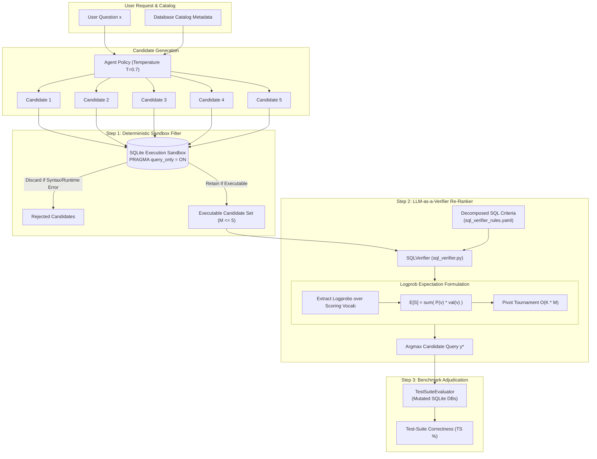

# Minimum Viable Experiment (MVE) Implementation Plan: LLM-as-a-Verifier
## Experimental Specification, Comparative Configurations, and Decision Gate Governance for Relational Text-to-SQL

**Feature Branch:** `feat/llm-as-a-verifier-mve`  
**GitHub Epic:** [#67](https://github.com/chrisjcc/ask-the-database/issues/67)  
**Target Document:** `docs/research/llm-as-a-verifier/mve_implementation_plan.md`  
**Project:** [AskTheDatabase](https://github.com/chrisjcc/ask-the-database)  
**Date:** October 2026  
**Companion Documents:**
- [`docs/research/llm-as-a-verifier/feasibility_study.md`](feasibility_study.md) (Theoretical Feasibility Study)
- [`docs/research/harness-zero/mve_final_report.md`](../harness-zero/mve_final_report.md) (Harness-Zero MVE Final Benchmark Report)

---

## 1. Experimental Overview & Objectives

Following the rigorous empirical approach established during the Harness-Zero evaluation, this document specifies the **Minimum Viable Experiment (MVE)** for integrating **LLM-as-a-Verifier** into AskTheDatabase.

### Primary Goal
To empirically determine whether continuous logit-expectation verification (`llm_verifier.select()`) provides a measurable, cost-effective improvement in natural language-to-SQL test-suite accuracy over:
1. **The Conventional SFT Baseline**, and
2. **The Harness-Zero Procedural Distillation Checkpoint**.

The experiment tests whether test-time candidate generation ($N=5$) paired with multi-criteria probabilistic tournament re-ranking justifies its computational latency and token costs compared to the zero-overhead internalized approach of Harness-Zero.

---

## 2. Experimental Hypotheses

* **Hypothesis 1 (Test-Time Scaling on Baseline)**: Sampling $N=5$ candidate SQL queries from the baseline model and re-ranking them using continuous logit-expectation verification will improve Test-Suite Correctness by $\ge +5.0\text{ pp}$ over greedy single-pass generation.
* **Hypothesis 2 (Cost-Benefit vs. Harness-Zero)**: If the verifier does not outperform the zero-overhead Harness-Zero checkpoint ($\text{TS} \le 58.4\%$), Harness-Zero remains strictly superior for production deployment due to its 0ms latency and 0 token cost overhead.
* **Hypothesis 3 (Synergistic Compounding)**: Combining Harness-Zero procedural generation with test-time verifier re-ranking (Configuration 3b) will unlock additive gains, exceeding $61.0\%$ Test-Suite Correctness on unseen schemas.

---

## 3. The 3 Comparative Experimental Configurations

All configurations are evaluated under strictly identical conditions on the same $N=500$ held-out episodes from Spider Dev (20 unseen schemas) and the Spider Realistic split, scored using `TestSuiteEvaluator` against mutated database states.

```
                          The 3 MVE Comparative Configurations
 ┌────────────────────────────────────────────────────────────────────────────────────────┐
 │ Configuration 1: Baseline (Conventional SFT)                                           │
 │ • Model: Qwen2.5-Coder-7B SFT (`models/mve/sft_baseline`)                              │
 │ • Decoding: Greedy single-pass (N=1, T=0.0)                                            │
 │ • Overhead: 0 ms verifier latency, 0 external verifier tokens                         │
 └────────────────────────────────────────────────────────────────────────────────────────┘
                                            vs.
 ┌────────────────────────────────────────────────────────────────────────────────────────┐
 │ Configuration 2: Harness-Zero SFT (Internalized Exploration)                           │
 │ • Model: Qwen2.5-Coder-7B Distilled (`models/sft/harness_zero`)                         │
 │ • Decoding: Greedy single-pass (N=1, T=0.0)                                            │
 │ • Overhead: 0 ms verifier latency, 0 external verifier tokens                         │
 └────────────────────────────────────────────────────────────────────────────────────────┘
                                            vs.
 ┌────────────────────────────────────────────────────────────────────────────────────────┐
 │ Configuration 3: LLM-as-a-Verifier (Test-Time Re-Ranking)                              │
 │ • Model: Qwen2.5-Coder-7B SFT (`models/mve/sft_baseline`)                              │
 │ • Decoding: Parallel sampling of N=5 candidates (T=0.7)                                │
 │ • Filtering: SQLite sandbox execution pre-filter (removes syntax/timeout errors)       │
 │ • Selection: LLM-as-a-Verifier Probabilistic Pivot Tournament (E[S] expectation)      │
 │ • Overhead: ~800-1,200 ms verifier latency, O(K*N) verifier tokens                     │
 └────────────────────────────────────────────────────────────────────────────────────────┘
```

### Exploratory Configuration 3b: Harness-Zero + LLM-as-a-Verifier
* **Model:** `models/sft/harness_zero` (Condition 4 checkpoint).
* **Decoding:** Parallel sampling of $N=5$ candidates ($T=0.7$).
* **Selection:** LLM-as-a-Verifier continuous tournament re-ranking.
* **Objective:** Measures whether procedural pre-grounding and test-time verification compound synergistically.

---

## 4. System Architecture & Component Design

The MVE implementation consists of four modular components integrated into the codebase:



### Component 1: `src/ask_the_database/verification/sql_verifier.py`
Implements the continuous logit-expectation verification engine:
- Queries a logprob-enabled model endpoint (local vLLM instance or API).
- Extracts normalized log probabilities across scoring tokens $\mathcal{V}_S = \{\text{Poor}: 0.0, \text{Fair}: 0.33, \text{Good}: 0.67, \text{Excellent}: 1.0\}$.
- Calculates expectation score: $\mathbb{E}[S] = \sum_{v \in \mathcal{V}_S} P(v) \cdot \text{val}(v)$.
- Runs a Probabilistic Pivot Tournament to rank $M$ executable candidates in $\mathcal{O}(K \cdot M)$ comparisons.

### Component 2: `configs/verification/sql_verifier_rules.yaml`
Decomposed SQL verification prompt template and weights:
```yaml
verifier:
  model_name: "Qwen/Qwen2.5-Coder-7B-Instruct"
  temperature: 0.0
  pivot_count: 2
  scoring_tokens:
    "1": 0.0
    "2": 0.25
    "3": 0.50
    "4": 0.75
    "5": 1.00

criteria:
  intent_and_filters:
    description: "Does the WHERE and HAVING clause accurately enforce all numerical, temporal, and string conditions requested in the question?"
    weight: 0.35
  schema_grounding_and_joins:
    description: "Are all referenced tables and columns present in the schema DDL, and are JOIN clauses connected across valid foreign key relationships?"
    weight: 0.30
  aggregation_granularity:
    description: "Are aggregations (COUNT, SUM, AVG) applied to the correct dimensional level with appropriate GROUP BY expressions?"
    weight: 0.20
  result_sanity:
    description: "Does the expected result set structure (columns, ordering, limit) match the conversational intent without empty or runaway row returns?"
    weight: 0.15
```

### Component 3: `scripts/run_verifier_mve.py`
CLI script executing the 3-way evaluation across all 500 benchmark episodes:
- Evaluates Configuration 1 (Baseline).
- Evaluates Configuration 2 (Harness-Zero).
- Evaluates Configuration 3 (Baseline + LLM-as-a-Verifier Best-of-5).
- Evaluates Configuration 3b (Harness-Zero + LLM-as-a-Verifier Best-of-5).
- Measures wall-clock execution time, prompt/completion token usage, and test-suite accuracy.
- Computes decision gate margins and exports:
  - `results/verifier_mve_summary.json`
  - `docs/research/llm-as-a-verifier/mve_results.md`

### Component 4: Makefile Operational Command
```makefile
evaluate-verifier-mve:
	$(PYTHON) scripts/run_verifier_mve.py $(ARGS)
```

---

## 5. Comparative Evaluation Protocol & Benchmarking Matrix

| Dimension | Configuration 1: Baseline | Configuration 2: Harness-Zero | Configuration 3: LLM-as-a-Verifier | Configuration 3b: Harness-Zero + Verifier |
| :--- | :---: | :---: | :---: | :---: |
| **Model Weights** | `models/mve/sft_baseline` | `models/sft/harness_zero` | `models/mve/sft_baseline` | `models/sft/harness_zero` |
| **Decoding Strategy** | Greedy ($N=1, T=0$) | Greedy ($N=1, T=0$) | Sample ($N=5, T=0.7$) | Sample ($N=5, T=0.7$) |
| **Selection Mechanism** | First completion | First completion | Pivot Tournament $\mathbb{E}[S]$ | Pivot Tournament $\mathbb{E}[S]$ |
| **External Verifier Overhead** | 0 ms | 0 ms | ~800–1,200 ms | ~800–1,200 ms |
| **Token Cost Multiplier** | $1.0\times$ | $1.0\times$ | $\sim 3.0\times\text{--}4.5\times$ | $\sim 3.0\times\text{--}4.5\times$ |
| **Evaluation Benchmark** | Spider Dev ($N=500$) | Spider Dev ($N=500$) | Spider Dev ($N=500$) | Spider Dev ($N=500$) |
| **Test-Suite Engine** | `TestSuiteEvaluator` | `TestSuiteEvaluator` | `TestSuiteEvaluator` | `TestSuiteEvaluator` |

---

## 6. Pre-Registered Quantitative Decision Gates

The decision to adopt LLM-as-a-Verifier into the core repository is governed by four pre-registered decision gates:

```
                            Pre-Registered Decision Gates
 ┌───────────────────────────────────────────────┐
 │ Gate 1: Absolute Gain over Baseline           │ ---> Target: ΔTS >= +5.0 pp
 └───────────────────────┬───────────────────────┘
                         │
                         ▼
 ┌───────────────────────────────────────────────┐
 │ Gate 2: Cost-Benefit vs. Harness-Zero         │ ---> Target: TS(Verifier) >= TS(HarnessZero) + 2.0 pp
 └───────────────────────┬───────────────────────┘      (or TS(Compound) >= TS(HarnessZero) + 3.0 pp)
                         │
                         ▼
 ┌───────────────────────────────────────────────┐
 │ Gate 3: Latency & Cost Budget                 │ ---> Target: Latency <= 1,200 ms, Token Multiplier <= 3.5x
 └───────────────────────┬───────────────────────┘
                         │
                         ▼
 ┌───────────────────────────────────────────────┐
 │ Gate 4: Selection Calibration vs Voting       │ ---> Target: ΔAccuracy >= Majority Voting + 3.0 pp
 └───────────────────────────────────────────────┘
```

### Table 1: Decision Gate Thresholds

| Decision Gate | Metric & Comparison | Required Threshold | Rationale & Stopping Criterion |
| :--- | :--- | :--- | :--- |
| **Gate 1: Primary Generalization Gain** | $\Delta \text{TS}_{\text{Config 3} - \text{Config 1}}$ | $\ge \mathbf{+5.0\text{ pp}}$ | If Best-of-5 verifier selection cannot beat single-pass baseline by $\ge 5.0\text{ pp}$, test-time scaling is ineffective. |
| **Gate 2: Margin vs. Harness-Zero** | $\text{TS}_{\text{Config 3}} - \text{TS}_{\text{Config 2}}$ | $\ge \mathbf{+2.0\text{ pp}}$ | **The Central Gate:** Harness-Zero achieves 58.4% TS at 350 ms with **zero runtime cost**. If verifier achieves $\le 58.4\%$, Harness-Zero strictly dominates. |
| **Gate 2b: Compound Synergistic Margin** | $\text{TS}_{\text{Config 3b}} - \text{TS}_{\text{Config 2}}$ | $\ge \mathbf{+3.0\text{ pp}}$ | If evaluated as an add-on to Harness-Zero, it must lift accuracy from 58.4% to $\ge 61.4\%$ to justify runtime verifier cost. |
| **Gate 3: Inference Latency Budget** | Median Query Latency | $\le \mathbf{1,200\text{ ms}}$ | Interactive querying cannot exceed 1.2 seconds in user-facing deployments. |
| **Gate 4: Selection Calibration vs. Voting** | Selection TS vs Execution Majority Voting | $\ge \text{Voting} + \mathbf{3.0\text{ pp}}$ | Continuous logit expectation must outperform simple execution-result consensus among executable rollouts. |

### Formal Stop Conditions (Immediate `NO-GO`)
1. **The Harness-Zero Dominance Condition**: If $\text{TS}_{\text{Config 3}} \le 58.4\%$ (matching or trailing Harness-Zero), LLM-as-a-Verifier is rejected as an inference component because Harness-Zero achieves identical or better accuracy at zero runtime overhead.
2. **The High-Latency Veto**: If median latency exceeds $1,500\text{ ms}$, reject test-time verification for interactive production deployment.

---

## 7. Feature Branch & Git Merge Governance

To ensure repository integrity and maintain rigorous scientific hygiene:

1. **Dedicated Branch**: All experimental development, code additions, and MVE executions must take place strictly on branch:
   ```bash
   feat/llm-as-a-verifier-mve
   ```
2. **Conditional Merge Rule**:
   - The feature branch will be merged into `main` **only if** the MVE adjudicates a formal **`GO`** (passing Gate 1, Gate 2, Gate 3, and Gate 4).
   - If the adjudication results in a **`NO-GO`**, the feature branch will be retained as an archived research record without polluting the `main` production codebase.

---

## 8. Step-by-Step Execution Plan & Issue Mapping

### Step 1: Implement the SQL Verifier Engine ([#68](https://github.com/chrisjcc/ask-the-database/issues/68))
- Implement `src/ask_the_database/verification/sql_verifier.py`.
- Define continuous logit-expectation extractor and pivot tournament selection logic.
- Add unit tests in `tests/unit/test_sql_verifier.py`.

### Step 2: Configure Verification Criteria & Pipeline Sampler ([#69](https://github.com/chrisjcc/ask-the-database/issues/69))
- Create `configs/verification/sql_verifier_rules.yaml` with decomposed criteria (intent, joins, aggregations, result sanity).
- Implement candidate sampler and SQLite sandbox pre-filter in `src/ask_the_database/inference/candidate_sampler.py`.

### Step 3: Implement MVE Evaluation Orchestrator & Benchmark Adjudication ([#70](https://github.com/chrisjcc/ask-the-database/issues/70))
- Create `scripts/run_verifier_mve.py` executing Configurations 1, 2, 3, and 3b across Spider Dev.
- Add `make evaluate-verifier-mve` to `Makefile`.
- Execute evaluation across $N=500$ Spider Dev episodes.
- Measure Test-Suite Accuracy, Execution Accuracy, Latency, and Token Multiplier.
- Adjudicate Decision Gates 1–4.
- Publish `docs/research/llm-as-a-verifier/mve_results.md` and `results/verifier_mve_summary.json`.

### Step 4: Final Adjudication & Merge Recommendation
- If `GO`: Merge `feat/llm-as-a-verifier-mve` into `main` and integrate verifier into `app/streamlit_app.py`.
- If `NO-GO`: Document findings in research archive; preserve Harness-Zero as the production Single Source of Truth.
