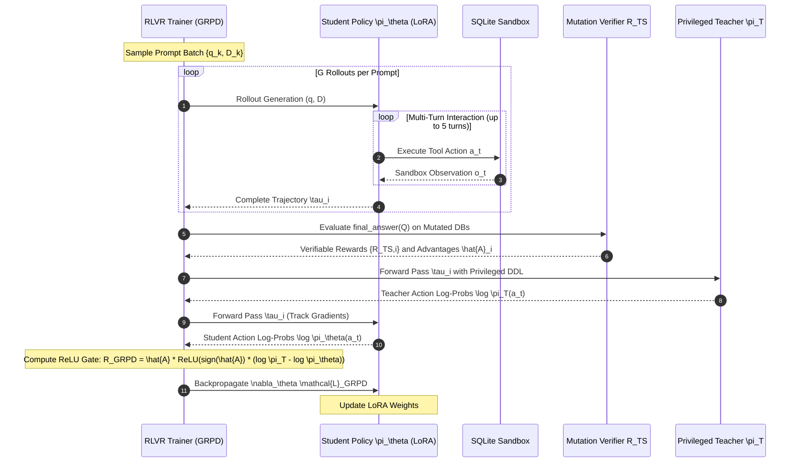

# System Architecture & Mathematical Formulation: OPDVR for AskTheDatabase

**Document Version**: 1.0.0  
**Date**: November 9, 2026  
**Target Paper**: *On-Policy Distillation with Verifiable Reward* (arXiv:2608.24696, August 2026)  
**Assessing Project**: **AskTheDatabase**  
**Classification**: System Architecture Specification & Mathematical Formulation  

---

## 1. Architectural Overview

The integration of **OPDVR (On-Policy Distillation with Verifiable Reward)** and **GRPD (Group Relative Policy Distillation)** into AskTheDatabase establishes a dual-model, multi-turn reinforcement learning architecture. The system couples an interactive, unprivileged student agent with a privileged schema teacher and a test-suite mutation verifier.

```
┌────────────────────────────────────────────────────────────────────────────────────────────────────────┐
│                                 OPDVR SYSTEM ARCHITECTURE                                              │
├────────────────────────────────────────────────────────────────────────────────────────────────────────┤
│                                                                                                        │
│  1. ENVIRONMENT INTERACTION LOOP (Student Policy Only)                                                │
│                                                                                                        │
│      Natural Language Question q + Database ID D                                                       │
│                           │                                                                            │
│                           ▼                                                                            │
│                 ┌──────────────────┐       Tool Actions a_t        ┌─────────────────────────┐         │
│                 │  Student Policy  │ ────────────────────────────> │  SQLite Sandbox Engine  │         │
│                 │   \pi_\theta     │ <──────────────────────────── │  (Isolated Container)   │         │
│                 └─────────┬────────┘    Observations o_t           └─────────────────────────┘         │
│                           │                                                                            │
│                           ▼                                                                            │
│             Interactive Multi-Turn Trajectory \tau                                                     │
│             (Action Tokens a_t  |  Obs Tokens o_t [Masked])                                            │
│                           │                                                                            │
├───────────────────────────┼────────────────────────────────────────────────────────────────────────────┤
│                           │                                                                            │
│  2. PARALLEL EVALUATION & SCORING PIPELINE                                                             │
│                           │                                                                            │
│           ┌───────────────┴───────────────────────────────┐                                            │
│           ▼                                               ▼                                            │
│  ┌───────────────────────────────┐               ┌─────────────────────────────────┐                   │
│  │ Test-Suite Mutation Verifier  │               │ Privileged Schema Teacher \pi_T │                   │
│  │ Across K Perturbed States D_k │               │ (Evaluates Actions a_t with DDL)│                   │
│  └───────────────┬───────────────┘               └────────────────┬────────────────┘                   │
│                  │                                                │                                    │
│                  ▼                                                ▼                                    │
│           Verifiable Reward                                 Teacher Token Log-Probs                    │
│           R_TS \in {0, 1} / Advantage \hat{A}_i            \log \pi_T(a_t | s_t)                       │
│                  │                                                │                                    │
├──────────────────┼────────────────────────────────────────────────┼────────────────────────────────────┤
│                  │                                                │                                    │
│  3. GRPD RELU GATING & POLICY GRADIENT UPDATE                     │                                    │
│                  │                                                │                                    │
│                  └───────────────────────┬────────────────────────┘                                    │
│                                          ▼                                                             │
│                       ┌─────────────────────────────────────┐                                          │
│                       │      OPDVR ReLU Gating Engine       │                                          │
│                       │ R_GRPD = \hat{A}_i * ReLU(sign * r) │                                          │
│                       └──────────────────┬──────────────────┘                                          │
│                                          │                                                             │
│                                          ▼                                                             │
│                       ┌─────────────────────────────────────┐                                          │
│                       │ Backward Pass & LoRA Optimization   │                                          │
│                       │ \nabla_\theta \mathcal{L}_GRPD      │                                          │
│                       └─────────────────────────────────────┘                                          │
│                                                                                                        │
└────────────────────────────────────────────────────────────────────────────────────────────────────────┘
```

---

## 2. Mathematical Formulation

### 2.1 Interactive POMDP & Trajectory Representation
The Text-to-SQL task is framed as a Partially Observable Markov Decision Process (POMDP):
$$\mathcal{M} = \langle \mathcal{S}, \mathcal{A}, \mathcal{T}, \mathcal{R}, \Omega, \mathcal{O}, \gamma \rangle$$
* **State $s_t \in \mathcal{S}$**: The underlying complete environment state, including database schemas, catalog metadata, stored table records, and historical execution buffers.
* **Observation $o_t \in \Omega$**: The textual observation returned by the SQLite sandbox after executing action $a_t$. In a zero-knowledge setting, the initial observation contains only table names; column schemas and contents are revealed dynamically via tool calls.
* **Action Space $\mathcal{A}$**: The set of valid tool calls emitted by the agent:
  $$\mathcal{A} = \{ \texttt{inspect\_schema}(T), \texttt{sample\_data}(T, k), \texttt{execute\_sql}(Q), \texttt{final\_answer}(Q) \}$$
* **Trajectory $\tau$**: A sequence of alternating agent decisions and environment feedback over $T$ turns:
  $$\tau = (u_1, a_1, o_1, u_2, a_2, o_2, \dots, u_T, a_T, o_T)$$
  where $u_t$ denotes the optional internal reasoning chain-of-thought tokens, $a_t$ denotes the formatted tool call, and $o_t$ denotes the sandbox output.

### 2.2 Token-Level Action Loss Masking
Let $x = (x_1, \dots, x_N)$ represent the full concatenated token sequence of trajectory $\tau$.
We define an action mask $M \in \{0, 1\}^N$:
$$M_t = \begin{cases} 1, & \text{if token } x_t \text{ was generated by the student policy } \pi_\theta \text{ (reasoning trace } u \text{ or action } a) \\ 0, & \text{if token } x_t \text{ was emitted by the prompt } q \text{ or environment observation } o \end{cases}$$
The set of active loss-bearing token indices is denoted $\mathcal{I}_{\text{active}} = \{ t \in \{1, \dots, N\} \mid M_t = 1 \}$.
**Strict Invariant**: Distillation loss, log-ratios, and policy gradients are evaluated exclusively over $t \in \mathcal{I}_{\text{active}}$. The policy is never penalized or rewarded for predicting SQLite environment outputs.

---

### 2.3 The Privileged Schema Teacher Formulation
In AskTheDatabase, the teacher model $\pi_T$ is endowed with **privileged contextual information**:
* **Student Prompt $P_{\text{student}}$**: Contains system instructions, operational tool descriptions, and the natural language query $q$. It has **zero database schema knowledge** in context.
* **Teacher Prompt $P_{\text{teacher}}$**: Contains identical system instructions, but prepends the **full, flattened schema DDL** of database $\mathcal{D}$, including table definitions, column types, primary keys, and foreign-key join constraints:
  $$P_{\text{teacher}} = \langle \text{SystemPrompt}, \text{FullDDL}(\mathcal{D}), q \rangle$$
* **Log-Probability Computation**:
  When evaluating the student's trajectory $\tau$, the teacher processes the sequence conditioned on its privileged prompt $P_{\text{teacher}}$:
  $$\log \pi_T(x_t \mid P_{\text{teacher}}, x_{<t})$$
  Because the teacher has the full schema in memory, it provides dense, oracle-informed probability distributions over table names, column projections, and join predicates generated by the student during zero-knowledge tool use.

---

### 2.4 Hierarchical Mutation Verifiable Reward ($\mathcal{R}_{\text{TS}}$)
When the student emits the terminal action $\texttt{final\_answer}(Q)$, the candidate query $Q$ is verified against $K$ mutated database instances:
$$\mathcal{R}_{\text{TS}}(\tau) = \prod_{k=0}^K \mathbb{I}\left( Q(\mathcal{D}_k) \equiv Q_{\text{gold}}(\mathcal{D}_k) \right) \in \{0, 1\}$$
where $\mathcal{D}_0$ is the original database, and $\mathcal{D}_1, \dots, \mathcal{D}_K$ are synthesized mutant states generated via row insertions, boundary deletions, and column value perturbations to eliminate false-positive table matches.

The composite reward rubric is:
$$\mathcal{R}_{\text{total}}(\tau) = w_{\text{syntax}} \mathcal{R}_{\text{syntax}} + w_{\text{schema}} \mathcal{R}_{\text{schema}} + w_{\text{TS}} \mathcal{R}_{\text{TS}} + w_{\text{eff}} \mathcal{R}_{\text{eff}}$$
where $w_{\text{TS}} = 1.0$, $w_{\text{syntax}} = 0.1$, $w_{\text{schema}} = 0.1$, and $w_{\text{eff}} = 0.05$.

---

### 2.5 The OPDVR ReLU Gating Mechanics

#### Case 1: REINFORCE-Style Binary Verifier
Let $R \in \{-1, +1\}$ denote the binary outcome of test-suite verification (where $+1$ indicates execution success and $-1$ indicates execution failure).
For any active token $t \in \mathcal{I}_{\text{active}}$, let the log-probability ratio be:
$$r_t = \log \left( \frac{\pi_T(x_t \mid P_{\text{teacher}}, x_{<t})}{\pi_\theta(x_t \mid P_{\text{student}}, x_{<t})} \right)$$
The OPDVR token-level reward is formulated as:
$$R_{\text{OPDVR}}(x_t) = R \cdot \mathrm{ReLU}\left( R \cdot r_t \right)$$
Expanding the sign conditions:
$$R_{\text{OPDVR}}(x_t) = \begin{cases} +\mathrm{ReLU}\left( \log \frac{\pi_T(x_t)}{\pi_\theta(x_t)} \right), & \text{if } R = +1 \\ -\mathrm{ReLU}\left( \log \frac{\pi_\theta(x_t)}{\pi_T(x_t)} \right), & \text{if } R = -1 \end{cases}$$

#### Case 2: Group Relative Policy Distillation (GRPD)
In group relative optimization, the student samples $G$ independent trajectories $\{\tau_1, \dots, \tau_G\}$ for prompt $q$.
The group-relative advantage for trajectory $i \in \{1, \dots, G\}$ is:
$$\hat{A}_i = \frac{\mathcal{R}_{\text{total}}(\tau_i) - \mu_R}{\sigma_R + \epsilon}$$
where $\mu_R = \frac{1}{G} \sum_{j=1}^G \mathcal{R}_{\text{total}}(\tau_j)$ and $\sigma_R = \sqrt{\frac{1}{G} \sum_{j=1}^G (\mathcal{R}_{\text{total}}(\tau_j) - \mu_R)^2}$.

The GRPD token-level reward for token $x_{i,t}$ is:
$$R_{\text{GRPD}}(x_{i,t}) = \hat{A}_i \cdot \mathrm{ReLU}\left( \mathrm{sign}(\hat{A}_i) \cdot \log \frac{\pi_T(x_{i,t} \mid P_{\text{teacher}}, x_{i,<t})}{\pi_\theta(x_{i,t} \mid P_{\text{student}}, x_{i,<t})} \right)$$
The GRPD objective to minimize over the group is:
$$\mathcal{L}_{\text{GRPD}}(\theta) = - \frac{1}{G} \sum_{i=1}^G \frac{1}{|\mathcal{I}_{\text{active}, i}|} \sum_{t \in \mathcal{I}_{\text{active}, i}} R_{\text{GRPD}}(x_{i,t}) \cdot \log \pi_\theta(x_{i,t} \mid P_{\text{student}}, x_{i,<t})$$

---

## 3. Theoretical Guarantees

The mathematical justification for OPDVR rests on three foundational propositions established by Lin et al. (2026), directly applicable to multi-turn Text-to-SQL:

### Proposition 1 (Strict Directional Alignment with Verifier Gradient)
Let $u_t = \nabla_\theta \log \pi_\theta(x_t \mid x_{<t})$ be the policy gradient score vector for token $t$.
* The pure verifier gradient update is $\Delta_{\text{RLVR}, t} = R \cdot u_t$.
* The standard sampled-token OPD update is $\Delta_{\text{OPD}, t} = r_t \cdot u_t$.
* The OPDVR update is $\Delta_{\text{OPDVR}, t} = R \cdot \mathrm{ReLU}(R \cdot r_t) \cdot u_t$.

**Property**: For any non-zero score $u_t \ne 0$, the inner product between the OPDVR update and the verifier update is **strictly non-negative**:
$$\langle \Delta_{\text{OPDVR}, t}, \Delta_{\text{RLVR}, t} \rangle = R^2 \cdot \mathrm{ReLU}(R \cdot r_t) \cdot \|u_t\|^2 = \mathrm{ReLU}(R \cdot r_t) \cdot \|u_t\|^2 \ge 0$$
In contrast, standard OPD satisfies:
$$\langle \Delta_{\text{OPD}, t}, \Delta_{\text{RLVR}, t} \rangle = R \cdot r_t \cdot \|u_t\|^2$$
which becomes **strictly negative** whenever $R$ and $r_t$ have opposite signs.

---

### Proposition 2 (Orthogonal Conflict Decomposition)
The standard sampled-token OPD gradient can be uniquely decomposed into two orthogonal components:
$$\Delta_{\text{OPD}, t} = \Delta_{\text{OPDVR}, t} + \Delta_{\text{conflict}, t}$$
where:
$$\Delta_{\text{conflict}, t} = \begin{cases} 0, & \text{if } R \cdot r_t \ge 0 \\ r_t \cdot u_t, & \text{if } R \cdot r_t < 0 \end{cases}$$
The projection of $\Delta_{\text{conflict}, t}$ onto the verifier gradient is **strictly non-positive**:
$$\langle \Delta_{\text{conflict}, t}, \Delta_{\text{RLVR}, t} \rangle \le 0$$
**Significance**: OPDVR is not an arbitrary heuristic modification of distillation. It is mathematically equivalent to standard On-Policy Distillation with the provably harmful, verifier-opposing gradient vectors surgically excised.

---

### Theorem 1 (Monotonic Joint Improvement under KL Mirror Descent)
Under the soft-value teacher assumption, applying a single verifier-gated mirror update simultaneously across reachable prefixes ensures:
1. **Task Success Monotonicity**: For every step size $\eta > 0$, expected test-suite execution success does not decrease:
   $$J(\pi_\theta^+) \ge J(\pi_\theta)$$
2. **Teacher Matching Regularization**: For any modest step size $\eta \le \frac{1}{2}$, the reverse KL divergence to the teacher does not increase at any reachable state:
   $$D_{\mathrm{KL}}(\pi_\theta^+(\cdot \mid s) \parallel \pi_T(\cdot \mid s)) \le D_{\mathrm{KL}}(\pi_\theta(\cdot \mid s) \parallel \pi_T(\cdot \mid s))$$

---

## 4. Sequence & Dataflow Interaction

The exact runtime sequence diagram for an OPDVR training step in AskTheDatabase is detailed below:



---

## 5. Architectural Modularity & Codebase Mapping

The implementation of OPDVR maps directly into AskTheDatabase's existing modular directory structure:

```
src/ask_the_database/
├── training/
│   ├── losses.py                 <-- [NEW] OPDVRLoss and GRPDLoss modules
│   ├── trl_grpo_adapter.py       <-- [EXTENDED] Integrate GRPD token loss & teacher scoring
│   ├── train_rlvr.py             <-- [EXTENDED] Add CLI/YAML flags: --distillation_mode {none, opd, opdvr, grpd}
│   └── privileged_teacher.py     <-- [NEW] PrivilegedSchemaTeacher wrapper with DDL context injection
├── rewards/
│   ├── execution_reward.py       <-- [REUSED] Existing sandbox execution validator
│   └── test_suite_mutation.py    <-- [REUSED] Existing mutation equivalence engine (R_TS)
└── environment/
    ├── sqlite_env.py             <-- [REUSED] SQLite execution sandbox
    └── tool_registry.py          <-- [REUSED] 4-tool contract interface
```

### 5.1 The `losses.py` Specification
The core algorithmic logic will reside in a self-contained PyTorch module:

```python
import torch
import torch.nn as nn
import torch.nn.functional as F

class GRPDLoss(nn.Module):
    """
    Group Relative Policy Distillation (GRPD) Loss with parameter-free ReLU gating.
    Lin et al. (arXiv:2608.24696, Aug 2026).
    """
    def __init__(self, eps: float = 1e-8):
        super().__init__()
        self.eps = eps

    def forward(
        self,
        student_logprobs: torch.Tensor,   # Shape: (B, L)
        teacher_logprobs: torch.Tensor,   # Shape: (B, L)
        advantages: torch.Tensor,         # Shape: (B, 1)
        action_mask: torch.Tensor         # Shape: (B, L), 1 for actions, 0 for obs/prompts
    ) -> torch.Tensor:
        # 1. Compute token-level log-ratio r_t = log(pi_T / pi_theta)
        log_ratio = teacher_logprobs - student_logprobs  # (B, L)
        
        # 2. Extract sign of trajectory advantage
        adv_sign = torch.sign(advantages)  # (B, 1)
        
        # 3. Apply ReLU gate aligned with advantage direction
        # When adv > 0: ReLU(log_ratio) -> rewards when teacher > student
        # When adv < 0: ReLU(-log_ratio) -> penalizes when student > teacher
        gated_ratio = F.relu(adv_sign * log_ratio)  # (B, L)
        
        # 4. Scale gated discrepancy by trajectory advantage magnitude
        token_rewards = advantages * gated_ratio  # (B, L)
        
        # 5. Mask out environment observation tokens
        active_rewards = token_rewards * action_mask
        active_student_logprobs = student_logprobs * action_mask
        
        # 6. Policy gradient loss: - active_rewards * log_pi_theta
        per_token_loss = - active_rewards * active_student_logprobs
        
        # 7. Normalize across active tokens
        active_token_count = action_mask.sum().clamp(min=1.0)
        loss = per_token_loss.sum() / active_token_count
        return loss
```

This clean formulation demonstrates why OPDVR is exceptionally elegant: it requires zero custom CUDA kernels, runs in pure PyTorch, and directly aligns policy gradients with verifiable relational execution.
