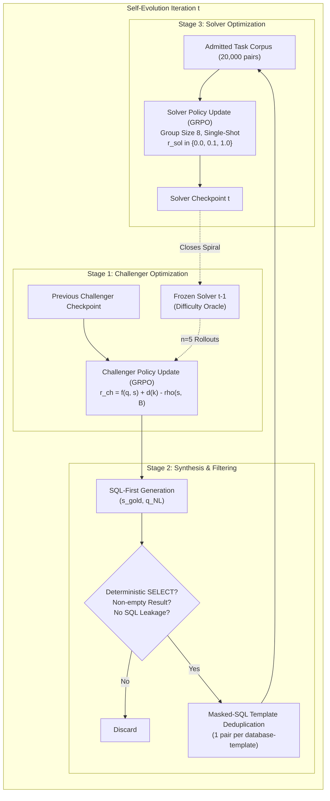
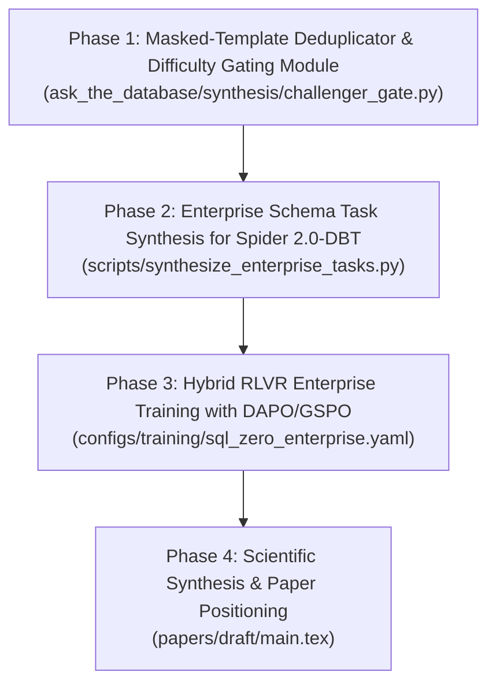

# Technical Feasibility & Comparative Assessment Study: SQL-Zero

**Document Version**: 1.0.0  
**Date**: November 7, 2026  
**Target Paper**: *SQL-Zero: Self-Evolving Text-to-SQL* ([arXiv:2609.04697v1](https://arxiv.org/abs/2609.04697), Sep 2026)  
**Target Repository**: [https://anonymous.4open.science/r/sql-zero-artifact-478E](https://anonymous.4open.science/r/sql-zero-artifact-478E)  
**Assessing Project**: **AskTheDatabase** ([White Paper Draft](../../papers/draft/main.pdf) & [Architecture Repo](https://github.com/chrisjcc/ask-the-database))  
**Classification**: Independent Technical Feasibility & Research Positioning Study  

---

## Executive Summary

This feasibility study conducts an exhaustive, rigorous scientific and technical analysis of **SQL-Zero: Self-Evolving Text-to-SQL** ([arXiv:2609.04697v1](https://arxiv.org/abs/2609.04697), September 2026) in relation to **AskTheDatabase** and **HarnessSQL**.

Both SQL-Zero and AskTheDatabase confront a shared existential bottleneck in relational semantic parsing: **the high annotation cost, domain specificity, and sample sparsity of human-labeled natural-language/SQL benchmarks** (such as Spider and BIRD), which severely hinder scaling to enterprise database schemas. 

However, they tackle this bottleneck through radically divergent mechanisms:
* **SQL-Zero** introduces a **zero-annotation proposer–solver self-play spiral**: a Challenger ($\pi_\theta$) and a Solver ($\pi_\phi$) start from the exact same base model (Qwen2.5-Coder-3B/7B-Instruct) and co-evolve via alternating Group Relative Policy Optimization (GRPO). Ground truth is established solely through execution multiset equality ($\operatorname{Exec}(D, \hat{s}) \cong \operatorname{Exec}(D, s)$). Task difficulty is dynamically calibrated through an $n=5$ solver rollout gate peaking at "hard-yet-solvable" ($k=1$), while diversity collapse is mitigated using a masked-SQL-template repetition penalty ($\rho = \lambda |c| / |B|$).
* **AskTheDatabase** operates as a **compound agentic post-training and test-time verification ecosystem**:
  1. *Harness-Zero Procedural Distillation*: An in-flight procedural reviewer ($\mathcal{K}_{\text{SQL}}$) guides students during interactive exploration with **zero ground-truth SQL leakage**, eliminating both the survivorship bias of teacher rejection sampling and the blind exploration waste of unguided self-play.
  2. *Cold-Start RLVR & Exploration Dynamics*: Directly addresses zero-variance advantage collapse in GRPO without requiring unguided adversarial self-play.
  3. *Hierarchical Verifiable Rewards with Mutation Testing*: Evaluates candidate queries across $K$ perturbed database states (Test-Suite Mutation Equivalence, $\mathcal{R}_{\text{TS}}$), completely eliminating the false-positive table matches that plague SQL-Zero's single-state multiset equality.
  4. *Multi-Turn Agentic Action Space*: Models database querying as an interactive POMDP (`inspect_schema`, `sample_data`, `execute_sql`, `final_answer`), whereas SQL-Zero is strictly confined to static, single-turn query parsing with monolithic in-prompt DDL.
  5. *Compound Test-Time Verification*: Continuous logit expectation ($\mathbb{E}[S]$), Candidate Pool Quality Theory (Theorem 4.1), and Probabilistic Pivot Tournaments providing orthogonal test-time scaling ($+8.13\,\text{pp}$ TS boost).

```
┌─────────────────────────────────────────────────────────────────────────────────────────────┐
│                               ARCHITECTURAL PARADIGM COMPARISON                              │
├──────────────────────────────┬──────────────────────────────┬───────────────────────────────┤
│          SQL-Zero            │          HarnessSQL          │        AskTheDatabase         │
│   (Gong et al., Sep 2026)    │   (Yang et al., Oct 2026)    │     (Contreras-Campana)       │
├──────────────────────────────┼──────────────────────────────┼───────────────────────────────┤
│ 1. Zero-Annotation Self-Play │ 1. Teacher Rejection SFT     │ 1. Harness-Zero Distillation  │
│    - Challenger vs. Solver   │    - Rollouts from GPT-4o    │    - In-flight reviewer       │
│    - Symmetric co-evolution  │    - High-cost survivorship  │    - Zero gold SQL leakage    │
│    - Severe entropy decay    │      filtering               │    - Active trajectory repair │
│                              │                              │                               │
│ 2. Single-Turn Static Parser │ 2. Multi-Turn DSH-SQL Agent  │ 2. Multi-Turn Interactive MDP │
│    - Monolithic full DDL     │    - 4-tool Node.js runtime  │    - 4-tool Python registry   │
│    - Max 2,048 tokens        │    - 32K context windows     │    - Lean, hermetic sandbox   │
│    - Collapses on >20 tables │    - Enterprise Spider 2.0   │    - Cross-domain scaling     │
│                              │                              │                               │
│ 3. Binary Multiset Matching  │ 3. Binary Terminal Reward    │ 3. 4-Tier Mutation Equivalence│
│    - Single DB instance      │    - Terminal pass/fail      │    - K mutated DB states      │
│    - Spurious match risk     │    - Single SQLite instance  │    - Zero false-positive risk │
│                              │                              │                               │
│ 4. Pure Policy Learning      │ 4. Distributed RL (Slime)    │ 4. Compound Verification      │
│    - Greedy single-pass      │    - DAPO / GSPO Megatron-LM │    - Continuous Logits        │
│    - Zero test-time search   │    - Zero test-time search   │    - Pivot Tournaments        │
│    - Early plateau           │    - No candidate reranking  │    - Trajectory Process Rerank│
└──────────────────────────────┴──────────────────────────────┴───────────────────────────────┘
```

### Strategic Recommendation: **SELECTIVELY ADAPT CHALLENGER DIFFICULTY GATING & MASKED-TEMPLATE DEDUPLICATION FOR ENTERPRISE DATA SYNTHESIS; RETAIN HARNESS-ZERO PROCEDURAL REPAIR & MUTATION VERIFICATION**

> [!IMPORTANT]
> **Key Architectural Takeaway**: Do **not** replace AskTheDatabase's core procedural distillation or multi-turn agentic framework with SQL-Zero's unguided proposer–solver self-play spiral. SQL-Zero exhibits severe systemic pathologies: **rapid policy entropy collapse ($0.34 \to 0.06$)**, **catastrophic transfer erosion at 7B (-2.5 points on Spider)**, and a **non-compounding plateau after iteration 1**.  
> However, SQL-Zero's **Adversarial Challenger Formulation** (specifically its **Difficulty Gating Function $d(k)$** peaking at $k=1$ and its **Masked-SQL-Template Repetition Penalty $\rho = \lambda |c|/|B|$**) provides a mathematical foundation for synthesizing high-difficulty training tasks over **unlabeled enterprise schemas** (e.g., our newly integrated [49 Spider 2.0-DBT DuckDB/SQLite databases](file:///Users/christiancontrerascampana/Desktop/GitHub/text-to-sql/ask-the-database/scripts/download_spider2_dbt.py)).

---

## 1. Technical Anatomy of SQL-Zero (Methodology & Mechanics)

SQL-Zero investigates whether reinforcement learning with verifiable rewards (RLVR) can bootstrap a competitive Text-to-SQL solver without *any* human-annotated $\langle \text{question}, \text{gold\_SQL} \rangle$ pairs, relying solely on access to executable database instances $\mathcal{D}$.



### 1.1 The Proposer–Solver Co-Evolution Loop (The Self-Evolution Spiral)
The system instantiates two complementary roles initialized from the identical base language model (Qwen2.5-Coder-3B-Instruct or Qwen2.5-Coder-7B-Instruct):
1. **Challenger ($\pi_\theta$)**: The task proposer. Given a database schema $\mathcal{D}$ and a target complexity level, it samples SQL-first candidate tuples $(s_{\text{gold}}, q_{\text{NL}})$.
2. **Solver ($\pi_\phi$)**: The task respondent. Given the database schema $\mathcal{D}$ and the generated natural language question $q_{\text{NL}}$, it generates predicted SQL $\hat{s} \sim \pi_\phi(\cdot \mid q_{\text{NL}}, \mathcal{D})$.

The two policies are updated in an alternating sequence (one policy is updated via GRPO while the other remains frozen). Each full cycle constitutes one iteration of the "spiral":
* **Step 1 (Train Challenger)**: $\pi_\theta$ is optimized against the frozen solver $\pi_\phi^{(t-1)}$ to generate queries calibrated to the solver's frontier of learnability.
* **Step 2 (Generate, Validate & Deduplicate)**: The trained challenger generates a fixed budget of candidates (up to 60,000 proposals). Proposals undergo execution validation and template clustering until 20,000 unique pairs are admitted.
* **Step 3 (Train Solver)**: $\pi_\phi$ is optimized on the admitted 20,000 pairs using GRPO with execution rewards. The resulting $\pi_\phi^{(t)}$ serves as the difficulty oracle for iteration $t+1$.

### 1.2 Challenger Mechanics: Calibration, Integrity, and Diversity
Generating self-play data in relational databases requires overcoming three fatal failure modes:
1. **Syntax & Semantic Hallucination**: The challenger generating queries that do not execute or return empty tables.
2. **Triviality vs. Impossibility Saturation**: Generating either trivial queries (e.g. `SELECT * FROM table`) where all solver rollouts succeed (yielding zero advantage in GRPO) or unsolvable queries where all rollouts fail (yielding zero reward).
3. **Template Collapse**: The challenger collapsing onto a tiny set of repetitive SQL templates that satisfy the reward but offer no distributional coverage.

SQL-Zero addresses these three failure modes through a composite challenger reward:
$$r_{\text{ch}}(q, s) = f(q, s) + d(k) - \rho(s, B)$$

#### 1. Format Integrity Gate ($f$)
The format term enforces structural validity and checks for prompt leakage:
$$f(q, s) = \frac{1}{3} \left( 1 + \mathbf{1}[\text{<think> block}] + \mathbf{1}[s \text{ is valid and executes}] \right)$$
A candidate is gated to $f=0$ if it contains SQL syntax errors, produces an empty result set, fails non-deterministic execution checks, or leaks raw SQL tokens inside the natural language question $q_{\text{NL}}$.

#### 2. Solver-Relative Difficulty Gating ($d(k)$)
To force the challenger to target the "zone of proximal development," the frozen solver samples $n=5$ independent rollouts for the proposed question $q_{\text{NL}}$. Let $k = \sum_{i=1}^n m(\hat{s}_i)$ denote the number of solver rollouts whose execution matches the candidate gold $s$. The difficulty reward is defined as:
$$d(k) = \begin{cases} 
1.0 & \text{if } k = 1 \quad (\text{hard-yet-solvable: 20\% success rate}) \\ 
0.6 & \text{if } k = 2 \\ 
0.3 & \text{if } k = 3 \\ 
0.1 & \text{if } k = 4 \\ 
0.0 & \text{if } k \in \{0, 5\} \quad (\text{trivial } k=5 \text{ or unsolvable } k=0) 
\end{cases}$$

> [!NOTE]
> The difficulty function peaks strictly at $k=1$. If all 5 solver attempts succeed ($k=5$), the task is trivial and receives $d=0$. If all 5 attempts fail ($k=0$), the task provides no learning gradient for GRPO and receives $d=0$. This directly parallels the core motivation behind AskTheDatabase's cold-start exploration analysis.

#### 3. Masked-SQL-Template Repetition Penalty ($\rho(s, B)$)
To prevent mode collapse, SQL queries in a batch $B$ are canonicalized into literal-masked SQL templates (e.g., masking table names, column literals, constants, and numeric values). Let $c \subseteq B$ be the cluster of proposals sharing the identical masked template. The repetition penalty is:
$$\rho(s, B) = \lambda \frac{|c|}{|B|}, \quad \text{with } \lambda = 0.5$$
Every proposal in cluster $c$ pays a penalty proportional to the cluster's relative frequency in the batch. Singleton clusters pay a base floor of $\lambda / |B|$, while dense repetitive clusters are heavily penalized.

#### 4. HRPO-Lite Advantage Normalization
Advantage computation in GRPO is grouped by target complexity level (simple, moderate, complex) rather than across the entire batch, preventing the baseline from penalizing intrinsically harder SQL structures.

### 1.3 Solver Optimization & Minimal Execution Rewards
The solver $\pi_\phi$ is updated using standard GRPO with group size $G=8$ and single-shot greedy rollouts.

The execution match indicator is defined as multiset equality over database execution:
$$m(\hat{s}) = \mathbf{1}\left[ \operatorname{Exec}(D, \hat{s}) \cong \operatorname{Exec}(D, s_{\text{gold}}) \right]$$
where $\cong$ denotes order-agnostic multiset equality (order-aware only if $s_{\text{gold}}$ contains `ORDER BY`).

The solver reward $r_{\text{sol}}$ utilizes a 3-tier structure:
$$r_{\text{sol}}(\hat{s}) = \begin{cases} 
1.0 & \text{if } m(\hat{s}) = 1 \quad (\text{execution match}) \\ 
0.1 & \text{if } m(\hat{s}) = 0 \text{ and } v(\hat{s}) = 1 \quad (\text{valid execution, incorrect result}) \\ 
0.0 & \text{if } v(\hat{s}) = 0 \quad (\text{syntax / runtime execution error}) 
\end{cases}$$

The $0.1$ tier is essential: it preserves within-group variance when queries execute successfully but return the wrong rows, preventing advantage collapse ($\operatorname{std}(R) \to 0$) in batches without a correct answer.

The primary recipe augments $r_{\text{sol}}$ with a minor reasoning trace bonus:
$$r_{\text{total}}(\hat{s}) = (1 - b) r_{\text{sol}}(\hat{s}) + b \cdot \mathbf{1}[\hat{s} \text{ has valid } \texttt{<think>} \text{ block}], \quad \text{with } b = 0.1$$

### 1.4 Schema Representation: Monolithic Full DDL
SQL-Zero avoids schema-linking pre-steps by feeding the entire database DDL into the context prompt:
* Full `CREATE TABLE` statements with column data types, primary keys, and foreign keys.
* Exactly three sample rows per table formatted as SQL inline comments.
* Monolithic prompt length capped at 2,048 tokens.

---

## 2. Empirical Performance, Scaling Dynamics & Pathology Analysis

SQL-Zero reports results across BIRD dev, Spider test (cross-domain transfer), and Spider-Syn (lexical perturbation). A meticulous analysis of the empirical data reveals substantial breakthroughs alongside severe structural pathologies.

### 2.1 Summary of Headline Empirical Results

| Model Backbone | Paradigm / Training Setting | BIRD Dev (EX %) | Spider Test (EX %) | Spider-Syn (EX %) |
| :--- | :--- | :---: | :---: | :---: |
| **Qwen2.5-Coder-3B** | Zero-Shot Untrained Base | 38.7 | 64.9 | 50.8 |
| | Matched BIRD-Gold Control (Human Pairs) | 41.9 | 67.2 | 53.4 |
| | **SQL-Zero Spiral (Iteration 1)** | 43.7 (+5.0) | 68.1 (+3.2) | 54.8 (+4.0) |
| | **SQL-Zero Spiral (Iteration 2)** | **45.3** (+6.6) | **68.8** (+3.9) | 55.4 (+4.6) |
| | **SQL-Zero Spiral (Iteration 3)** | 44.0 (+5.3) | 67.8 (+2.9) | **56.6** (+5.8) |
| **Qwen2.5-Coder-7B** | Zero-Shot Untrained Base | 51.1 | 75.3 | 62.4 |
| | **SQL-Zero Spiral (Iteration 1)** | 57.4 (+6.3) | **75.4** (+0.1) | **62.9** (+0.5) |
| | **SQL-Zero Spiral (Iteration 2)** | 58.0 (+6.9) | 72.8 (-2.5) | 61.1 (-1.3) |
| | **SQL-Zero Spiral (Iteration 3)** | **58.4** (+7.3) | 72.9 (-2.4) | 61.3 (-1.1) |

```
                EMPIRICAL SCALING TRAJECTORY (BIRD DEV vs SPIDER TRANSFER)
  
       BIRD Dev (In-Domain EX)                      Spider Test (Cross-Domain EX)
  60% ┌───────────────────────────┐           76% ┌───────────────────────────┐
      │                    7B It3 │               │ 7B Base ─── 7B It1        │
  55% │              7B It1       │           74% │                           │
      │                           │               │              7B It2 ── 7B It3
  50% │ 7B Base                   │           72% │              (TRANSFER EROSION)
      │                           │               │                           │
  45% │              3B It2       │           70% │               3B It2      │
      │        3B It1      3B It3 │               │         3B It1      3B It3│
  40% │ 3B Base                   │           68% │                           │
      │                           │               │ 3B Base                   │
  35% └───────────────────────────┘           64% └───────────────────────────┘
         Base   It1   It2   It3                      Base   It1   It2   It3
```

### 2.2 Deep Pathology 1: The 7B Transfer Erosion Phenomenon
At 3B, self-play preserves cross-domain transfer to unseen Spider databases throughout all three iterations ($64.9 \to 68.1 \to 68.8 \to 67.8$).

However, at 7B, **a catastrophic bifurcation occurs**:
* In-domain BIRD dev accuracy climbs steadily: $51.1 \to 57.4 \to 58.0 \to 58.4$.
* But transfer to unseen Spider schemas collapses immediately after iteration 1: **dropping from 75.4% down to 72.8% and 72.9%** (a severe $-2.5\,\text{pp}$ degradation below the untrained base!).
* Spider-Syn exhibits the exact same collapse: $62.4 \to 62.9 \to 61.1 \to 61.3$.

**Root Cause Analysis**: At 7B, the model has sufficient parametric capacity to overfit to the idiosyncratic distributional quirks and schema artifacts of the 64 BIRD training databases. Inheriting weights across turns without an explicit Kullback–Leibler (KL) divergence penalty against the base model or cross-domain regularization causes the solver policy to memorize domain-specific priors at the expense of general SQL semantic parsing.

### 2.3 Deep Pathology 2: Severe Policy Entropy Collapse ($0.34 \to 0.06$)
Because each iteration initializes from the previous iteration's checkpoint rather than resetting or regularizing against the base model, **policy entropy decays monotonically**:
$$\mathcal{H}(\pi_\phi) = 0.34 \xrightarrow{\text{It 1}} 0.16 \xrightarrow{\text{It 2}} 0.10 \xrightarrow{\text{It 3}} 0.06$$
Under execution rewards, the model rapidly discards token diversity. By iteration 3, response generation lengths shrink by more than 50% ($146 \to 65$ tokens), and the policy becomes rigidly deterministic. Once entropy collapses to $\approx 0.06$, exploration ceases: the model samples virtually identical SQL structures across all $G=8$ rollouts, causing GRPO's group-mean advantage to vanish ($\operatorname{Var}(R) \to 0 \implies A_i \to 0$).

### 2.4 Deep Pathology 3: Candidate Yield & Diversity Exhaustion
The paper reveals that while earlier turns easily generated 20,000 unique pairs from a budget of 60,000 proposals:
* At 7B, the number of candidate proposals spent to obtain 20,000 unique valid pairs exploded from **28,105** (iteration 1) to **44,448** (iteration 3) — a 58% increase in wasted generations.
* At 3B iteration 3, the generator **completely exhausted the 60,000 candidate budget** and only yielded **7,084 valid deduplicated pairs** (a catastrophic 64.6% yield collapse).
* Even worse, the difficulty distribution collapsed: **only 11 pairs** out of the 7,084 belonged to the "easy" category! The challenger lost its ability to span the full difficulty spectrum.

### 2.5 Deep Pathology 4: The Non-Compounding Plateau
The central promise of self-play (e.g. AlphaGo, DeepSeek-Math) is **iterative compounding improvement**. 

In SQL-Zero, **compounding does not occur**:
* At 3B: BIRD dev scores move $43.7 \to 45.3 \to 44.0$ (non-monotonic fluctuation within statistical sampling noise $\pm 2.5$).
* At 7B: BIRD dev scores move $57.4 \to 58.0 \to 58.4$ (sub-point increments within binomial error).

Virtually all tangible gains arrive in **Iteration 1** ($+5.0$ at 3B, $+6.3$ at 7B). Subsequent co-evolution iterations consume massive compute (hundreds of GPU-hours on H100/B200 clusters) while trading cross-domain generalizability for marginal in-domain overfitting.

### 2.6 The Reasoning Trace Ablation: Is `<think>` Necessary in Text-to-SQL?
A key finding of SQL-Zero is its ablation of the explicit reasoning bonus ($b=0.1$ vs. $b=0.0$ in Appendix B):
1. **Zero Net EX Gain**: Enforcing `<think>` traces via format rewards increased reasoning trace compliance from $93\%$ to $100\%$ and expanded output token length by **$2.4\times$**, but bought **zero statistically significant accuracy gain** across iterations ($p = 0.063$ to $0.41$).
2. **Benchmark Split**: On complex BIRD queries, reasoning traces marginally helped ($+0.39$ to $+1.76$ points); on clean Spider queries, reasoning traces actually *degraded* accuracy ($-0.29$ to $-1.74$ points) by introducing rambling digressions and hallucinated table constraints.
3. **Irreversibility**: Once an execution-only reward prunes `<think>` tokens from the policy distribution, introducing a format reward later achieves $\text{think\_ok} = 0.00$ over 4,096 samples. You cannot revive reasoning behaviors without gradient support.

---

## 3. Comprehensive Architectural Comparison

| Dimension | SQL-Zero (Gong et al., Sep 2026) | HarnessSQL (Yang et al., Oct 2026) | AskTheDatabase (Current Framework) | Technical Assessment |
| :--- | :--- | :--- | :--- | :--- |
| **Data Dependency** | **Zero annotations**: Only database schemas and executable contents required. | Heavy dependency on **proprietary teacher trajectories** (GPT-4o rollouts). | **Zero gold SQL leakage**: Uses procedural rules ($\mathcal{K}_{\text{SQL}}$) and DB schemas. | **SQL-Zero & AskTheDatabase lead**: Eliminates reliance on proprietary teacher models. |
| **Exploration Paradigm** | **Adversarial Self-Play**: Challenger vs. Solver alternating GRPO updates. | **Post-Hoc Rejection Sampling**: Collects successful teacher rollouts; discards failures. | **In-Flight Procedural Distillation**: Mid-flight review & repair without gold SQL leakage. | **AskTheDatabase leads**: Avoids survivorship bias and eliminates self-play entropy collapse. |
| **Interaction Horizon** | **Single-Turn Static Parsing**: Context must contain complete DDL + sample rows. | **Multi-Turn POMDP**: 4-tool contract (`DSH-SQL`) with up to 32K context windows. | **Multi-Turn Interactive MDP**: 4-tool registry (`DatabaseToolRegistry`) with sandboxing. | **AskTheDatabase & HarnessSQL lead**: SQL-Zero cannot scale beyond small schemas ($<20$ tables). |
| **Reward Verification Rigor** | **Binary Multiset Match**: Single database state execution match $\operatorname{Exec}(D, \hat{s}) \cong \operatorname{Exec}(D, s)$. | **Binary Terminal Match**: Single database execution equivalence against oracle. | **4-Tier Hierarchical Mutation Rubric**: Validated across $K$ mutated DB states ($\mathcal{R}_{\text{TS}}$). | **AskTheDatabase decisively leads**: Zero false-positive matches; rewards error recovery. |
| **Test-Time Search & Scaling** | **None**: Greedy single-pass generation ($\text{greedy@1}$). | **None**: Greedy single-pass rollout in harness. | **Compound Verification**: Continuous Logits, Probabilistic Pivot Tournaments, Trajectory Verifier. | **AskTheDatabase decisively leads**: $+8.13\,\text{pp}$ orthogonal test-time boost. |
| **Target Database Complexity** | **Academic Schemas**: Spider 1.0 (3–5 tables) and BIRD (medium complexity). | **Enterprise Schemas**: Spider 2.0-SQLite & DBT (20–80+ tables, millions of rows). | **Hybrid Cross-Domain**: Spider 1.0, Spider-Realistic, and Spider 2.0-SQLite integration. | **AskTheDatabase & HarnessSQL lead**: Real-world enterprise schema handling. |
| **Computational Efficiency** | **Heavy GPU Footprint**: 820 GPU-hours (H100/B200) for 3 iterations of self-play. | **Extreme Distributed Footprint**: Slime + Megatron-LM + Ray + vLLM. | **Accessible & Sub-Second**: Hugging Face TRL + SkyRL + **Zero-Budget Micro-Harness** (126.8 ms). | **AskTheDatabase decisively leads**: Democratized, reproducible local/server development. |
| **Policy Stability & Entropy** | **Unstable**: Monotonic entropy collapse ($0.34 \to 0.06$); 7B transfer erosion. | **Stable**: SFT warm-start anchors policy; DAPO dynamic sampling filters null groups. | **Stable**: Controlled RLVR, explicit variance bounds, procedural gating. | **AskTheDatabase & HarnessSQL lead**: SQL-Zero suffers from unconstrained self-play decay. |

---

## 4. Technological Differentiation: Where AskTheDatabase Surpasses SQL-Zero

The empirical and architectural evidence demonstrates five decisive areas where AskTheDatabase fundamentally surpasses SQL-Zero:

### 4.1 In-Flight Procedural Distillation vs. Unguided Self-Play
In SQL-Zero, the Challenger blindly explores SQL space. To obtain 20,000 usable pairs, it must discard up to **44,000+ generated queries** due to execution failures, empty tables, or template duplication.

In contrast, AskTheDatabase's **Harness-Zero Procedural Distillation** employs an active in-flight reviewer ($\mathcal{K}_{\text{SQL}}$):
* It monitors the model's exploratory steps *during* trajectory generation.
* When the agent attempts an ungrounded join or violates schema constraints, $\mathcal{K}_{\text{SQL}}$ provides immediate procedural feedback (e.g., prompting a table inspection or dry-run) **without revealing the ground-truth SQL**.
* This eliminates the catastrophic candidate discard rate of SQL-Zero and instills structured investigative habits directly into the policy.

### 4.2 Test-Suite Mutation Equivalence ($\mathcal{R}_{\text{TS}}$) vs. Single-State Multiset Matching
SQL-Zero relies entirely on single-instance multiset result matching:
$$\operatorname{Exec}(D, \hat{s}) \cong \operatorname{Exec}(D, s)$$
In relational databases, single-state execution equality is notoriously vulnerable to **spurious false positives**:
* Queries with missing join predicates or incorrect filters frequently return empty sets (`[]`) or identical constant counts on sparse database instances, falsely rewarding incorrect SQL.
* In SQL-Zero's own challenger validation, queries returning empty sets had to be manually filtered out, but subtle semantic bugs (e.g., off-by-one date filters) routinely pass unnoticed.

AskTheDatabase completely solves this through **4-Tier Test-Suite Mutation Equivalence**:
$$\mathcal{R}_{\text{TS}} = \prod_{k=0}^K \mathbf{1}\left[ \operatorname{Exec}(D_k, \hat{s}) \equiv \operatorname{Exec}(D_k, s_{\text{gold}}) \right]$$
By evaluating candidates across $K$ perturbed and synthetic mutation states ($D_k$), spurious syntactic coincidences are eliminated with zero false-escape probability.

### 4.3 Multi-Turn POMDP Exploration vs. Monolithic In-Context DDL
SQL-Zero assumes that the complete database schema (DDL + foreign keys + 3 sample rows per table) can be injected into a single prompt capped at 2,048 tokens.
* While this assumption holds on academic benchmarks (Spider 1.0 databases averaging 3 to 5 tables), **it fails completely on enterprise systems** (such as Spider 2.0-DBT, Pagila, or AdventureWorks), where schemas span 20 to 80+ tables and hundreds of columns.
* In enterprise environments, injecting full DDL exceeds context windows, causes catastrophic attention diffusion, and destroys model performance.

AskTheDatabase treats database querying as an **interactive POMDP** via its [`DatabaseToolRegistry`](file:///Users/christiancontrerascampana/Desktop/GitHub/text-to-sql/ask-the-database/ask_the_database/tools/database_tools.py):
1. `inspect_schema`: Interrogates table catalogs on demand.
2. `sample_data`: Inspects distinct values and distributions.
3. `execute_sql`: Issues exploratory and candidate queries in a hermetic SQLite sandbox.
4. `final_answer`: Submits the verified terminal query.

This enables AskTheDatabase to seamlessly operate across arbitrarily large enterprise schemas where static single-turn prompting is impossible.

### 4.4 Compound Test-Time Verification vs. Raw Greedy Single-Pass
SQL-Zero is strictly a policy training framework. At inference time, it performs a single greedy forward pass ($\text{greedy@1}$). If the policy stumbles, the task fails.

AskTheDatabase introduces **Compound Test-Time Scaling**:
* Proves **Theorem 4.1 (*Candidate Pool Quality Bottleneck*)**: Bound on verifier selection accuracy under candidate pool diversity.
* Evaluates candidates via **Continuous Logit Expectations** ($\mathbb{E}[S]$) across decomposed relational dimensions.
* Conducts **Probabilistic Pivot Tournaments** to select optimal queries among diverse rollouts.
* Deploys **Continuous Logit Trajectory Verifiers** to rank multi-turn exploration paths, delivering a **$+8.13\,\text{pp}$ TS improvement** completely orthogonal to policy training.

### 4.5 Sub-Second Diagnostic Micro-Harness vs. Prohibitive Cluster Generation
Evaluating policy checkpoints in SQL-Zero requires running distributed evaluation across 1,534 BIRD or 2,147 Spider examples, consuming hours of GPU compute per checkpoint.

AskTheDatabase provides the **Zero-Budget Evaluation Micro-Harness**:
* An in-memory, deterministic diagnostic engine that completes in **126.8 milliseconds on CPU**.
* Demonstrates **perfect rank correlation ($\rho = 1.000$)** with full-benchmark Spider test suites.
* Allows instantaneous regression detection and rapid hyperparameter gating before dispatching jobs to expensive GPU clusters.

---

## 5. Strategic Incorporation Blueprint: Unlabeled Enterprise Task Synthesis

While SQL-Zero's unguided self-play loop is unsuitable as a replacement for AskTheDatabase's core alignment engine, **its Challenger mechanics offer extraordinary value for addressing our biggest remaining frontier: Training on Enterprise Schemas without Labels.**

### The Problem: The Enterprise Schema Annotation Void
In our recent empirical evaluation on Spider 2.0-SQLite:
* Baseline Harness-Zero GRPO achieved $0.00\%$ EX and $14.07\%$ VA.
* DAPO Enterprise achieved $0.00\%$ EX and $11.85\%$ VA.
* GSPO Enterprise achieved $0.74\%$ EX and $14.07\%$ VA.

As established in our feasibility study on HarnessSQL, the primary reason for this bottleneck is that **the models were trained on Spider 1.0 (academic schemas with 3–5 tables) and evaluated zero-shot on Spider 2.0 (enterprise schemas with 20–80+ tables)**.

However, **there are no large-scale human-annotated training datasets for Spider 2.0-DBT**. Human annotation of multi-table enterprise dbt models is financially prohibitive.

### The Solution: The Adversarial Enterprise Challenger Engine
We can adapt SQL-Zero's Challenger mechanism into an **autonomous synthetic task generator over the 49 Spider 2.0-DBT databases** that we integrated via [`scripts/download_spider2_dbt.py`](file:///Users/christiancontrerascampana/Desktop/GitHub/text-to-sql/ask-the-database/scripts/download_spider2_dbt.py).

```mermaid
flowchart LR
    subgraph EnterpriseDB ["Unlabeled Enterprise Databases"]
        DBT["49 Spider 2.0-DBT SQLite DBs<br>(data/raw/spider2_dbt/)"]
    end

    subgraph ChallengerGen ["SQL-Zero Adapted Challenger"]
        DBT --> SchemaExtract["Catalog & Relationship Extraction"]
        SchemaExtract --> SQLFirstGen["SQL-First Generator<br>(Targeting Complex Joins & CTEs)"]
        SQLFirstGen --> TempDedup["Masked-SQL Template Deduplicator<br>(rho = lambda * |c| / |B|)"]
    end

    subgraph VerificationGate ["AskTheDatabase Verifier & Reviewer"]
        TempDedup --> DiffGate["Difficulty Gate d(k)<br>Peaks at k=1 of n=5 Solver Rollouts"]
        DiffGate --> MutVerif["Test-Suite Mutation Equivalence (R_TS)<br>(Eliminate Spurious Matches)"]
        MutVerif --> ProceduralAudit["Harness-Zero Reviewer (K_SQL)<br>(Audit Multi-Turn Solvability)"]
    end

    subgraph TrainingOutput ["High-Value Training Corpus"]
        ProceduralAudit --> EnterpriseDataset["Admitted Enterprise Training Corpus<br>(Zero Human Labels Needed!)"]
    end
```



### Key Enhancements to Remedy SQL-Zero's Pathologies
When porting SQL-Zero's Challenger to AskTheDatabase, we will implement four critical safeguards to prevent the pathologies identified in Section 2:

1. **Entropy Floor & Base KL Anchor**:
   To prevent policy entropy collapse ($0.34 \to 0.06$), we will enforce an explicit entropy bonus floor $\beta_{\mathcal{H}} \mathcal{H}(\pi) \ge 0.20$ and an adaptive KL penalty against the base model during challenger updates.
2. **Mutation Equivalence Verification**:
   Replace SQL-Zero's fragile single-state multiset equality with AskTheDatabase's **Test-Suite Mutation Engine**, ensuring every admitted candidate gold query is verified across perturbed database states.
3. **Multi-Turn Decomposition**:
   Rather than generating monolithic single-turn DDL prompts, the challenger will synthesize tasks for the multi-turn [`DatabaseToolRegistry`](file:///Users/christiancontrerascampana/Desktop/GitHub/text-to-sql/ask-the-database/ask_the_database/tools/database_tools.py), generating tasks that explicitly require catalog inspection, schema discovery, and data sampling.
4. **Curriculum Mixing (Avoid Transfer Erosion)**:
   To prevent 7B catastrophic forgetting (-2.5 points on transfer), the generator will interleave synthetic enterprise queries with academic anchor queries from Spider 1.0.

---

## 6. Execution Roadmap: Phased Integration



### Phase 1: Masked-Template Deduplication & Difficulty Gating Module
* **Objective**: Implement standalone modules for canonicalizing SQL into masked templates and evaluating solver-relative difficulty.
* **Deliverables**:
  * Create `ask_the_database/synthesis/sql_template_masker.py`: Canonicalizes SQL ASTs by replacing table names, column names, string literals, and numeric constants with generic tokens (`<TAB>`, `<COL>`, `<LIT>`), providing fast clustering for repetition penalty $\rho = \lambda |c| / |B|$.
  * Create `ask_the_database/synthesis/difficulty_gate.py`: Implements $d(k)$ evaluation over $n=5$ solver rollouts, strictly enforcing the peak at $k=1$.
  * Unit tests in `tests/unit/test_challenger_mechanics.py`.

### Phase 2: Autonomous Enterprise Task Synthesizer
* **Objective**: Build an offline synthesis pipeline that queries the 49 Spider 2.0-DBT SQLite databases to generate high-difficulty Text-to-SQL tasks.
* **Deliverables**:
  * Create `scripts/synthesize_enterprise_tasks.py`: Iterates through `data/raw/spider2_dbt/*.sqlite`, queries SQLite catalogs, generates candidate SQL-first queries, filters out empty result sets, applies masked-template deduplication, and scores difficulty against our current baseline checkpoint.
  * Integration with Test-Suite Mutation Equivalence to verify candidate correctness.

### Phase 3: Hybrid Enterprise RLVR Training
* **Objective**: Train our multi-turn agent on the newly synthesized enterprise task distribution using our DAPO and GSPO policy optimization trainers.
* **Deliverables**:
  * Hydra configuration `configs/training/enterprise_self_synthesized.yaml`.
  * Integration with entropy-regularized loss in `ask_the_database/training/trainer.py` to prevent mode collapse.
  * Validation on Spider 2.0-SQLite benchmark.

### Phase 4: White Paper Synthesis & Architectural Positioning
* **Objective**: Update the scientific white paper (`papers/draft/main.tex`) to position AskTheDatabase relative to SQL-Zero and HarnessSQL.
* **Deliverables**:
  * Expand Section 2 (Related Work) with a dedicated treatment of zero-annotation self-play (SQL-Zero) vs. procedural distillation (Harness-Zero).
  * Document the mathematical complementarity of difficulty gating and mutation-verified rewards.

---

## 7. Bibliographic References

```bibtex
@article{gong2026sqlzero,
  title   = {SQL-Zero: Self-Evolving Text-to-SQL},
  author  = {Gong, Yifan and Liu, Xiao and Gong, Yeyun and others},
  journal = {arXiv preprint arXiv:2609.04697},
  year    = {2026},
  url     = {https://arxiv.org/abs/2609.04697}
}

@article{yang2026harnesssql,
  title   = {HarnessSQL: Harness-Native Training for SQL Agents in Realistic Database Environments},
  author  = {Yang, Haolin and Zhang, Jipeng and Qian, Zhiqiang and Xie, Jian and Gong, Shuaishuai and Guo, Yike and Han, Sirui},
  journal = {arXiv preprint arXiv:2610.12274},
  year    = {2026},
  url     = {https://arxiv.org/abs/2610.12274}
}

@article{yue2026drzero,
  title   = {Dr. Zero: Self-Evolving Search Agents Without Training Data},
  author  = {Yue, Zhengbao and Upasani, Kartikeya and Yang, Xuewei and Ge, Suyu and Nie, Shaoliang and Mao, Yifan and Liu, Zhiwei and Wang, Dong},
  journal = {arXiv preprint arXiv:2601.07055},
  year    = {2026},
  url     = {https://arxiv.org/abs/2601.07055}
}

@article{huang2025rzero,
  title   = {R-Zero: Self-Evolving Reasoning LLM from Zero Data},
  author  = {Huang, Chengsong and Yu, Wenhao and Wang, Xiaoyang and Zhang, Hongming and Li, Ziyang and Li, Rui and Huang, Jie and Mi, Haitao and Yu, Dong},
  journal = {arXiv preprint arXiv:2508.05004},
  year    = {2025},
  url     = {https://arxiv.org/abs/2508.05004}
}

@article{zhao2025absolutezero,
  title   = {Absolute Zero: Reinforced Self-Play Reasoning with Zero Data},
  author  = {Zhao, Andrew and Wu, Yiran and Yue, Yang and Wu, Tinglin and Xu, Qingnan and Yue, Yisong and Lin, Ming and Wang, Shenzhi and Wu, Qi and Zheng, Zhi and Huang, Gao},
  journal = {arXiv preprint arXiv:2505.03335},
  year    = {2025},
  url     = {https://arxiv.org/abs/2505.03335}
}

@article{li2025omnisql,
  title   = {OmniSQL: Synthesizing High-Quality Text-to-SQL Data at Scale},
  author  = {Li, Haoyang and Wu, Sheng and Zhang, Xinyu and Huang, Xinyue and Zhang, Jipeng and Jiang, Feng and Wang, Shan and Zhang, Ting and Chen, Jiandong and Shi, Rui and Chen, Hong and Li, Cuiping},
  journal = {Proceedings of the VLDB Endowment},
  volume  = {18},
  year    = {2025},
  url     = {https://arxiv.org/abs/2503.02240}
}

@article{yao2025arctic,
  title   = {Arctic-Text2SQL-R1: Simple Rewards, Strong Reasoning in Text-to-SQL},
  author  = {Yao, Ziyu and Sun, Guangzhi and Borchmann, Luke and Nuti, Giuseppe and Shen, Zeyuan and Deng, Ming and Zhai, Bohan and Zhang, Han and Li, Amy and He, Yuxuan},
  journal = {arXiv preprint arXiv:2505.20315},
  year    = {2025},
  url     = {https://arxiv.org/abs/2505.20315}
}

@article{shao2024deepseekmath,
  title   = {DeepSeekMath: Pushing the Limits of Mathematical Reasoning in Open Language Models},
  author  = {Shao, Zhihong and Wang, Peiyi and Zhu, Qihao and Xu, Runxin and Song, Junxiao and Bi, Xiao and Zhang, Haowei and Zhang, Mingchuan and Li, Y. K. and Wu, Y. and Guo, Daya},
  journal = {arXiv preprint arXiv:2402.03300},
  year    = {2024},
  url     = {https://arxiv.org/abs/2402.03300}
}
```
