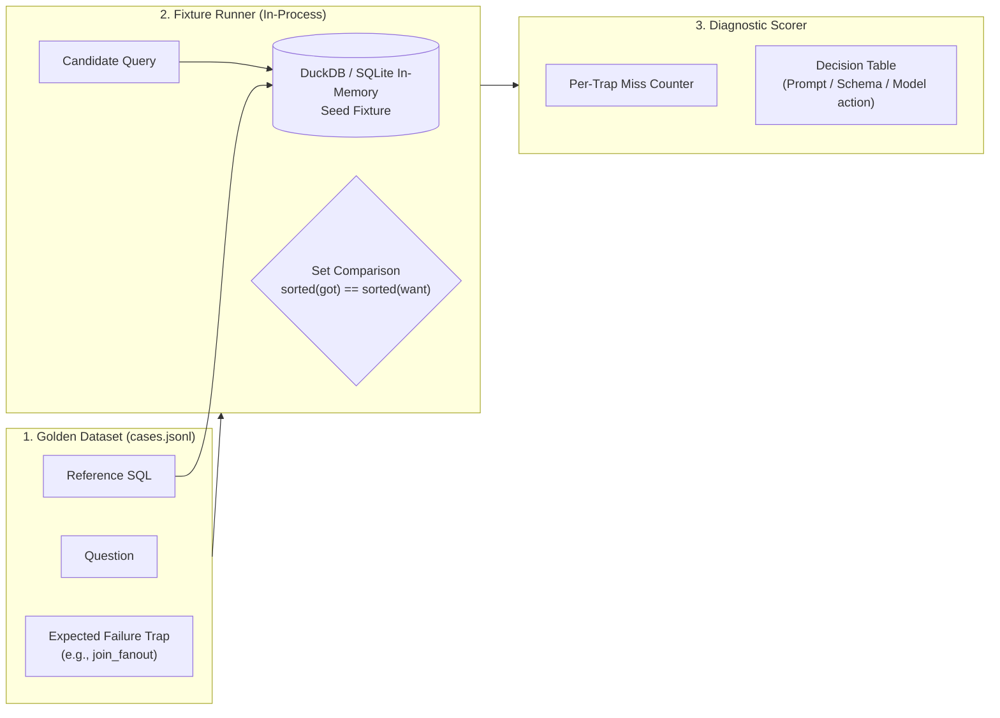
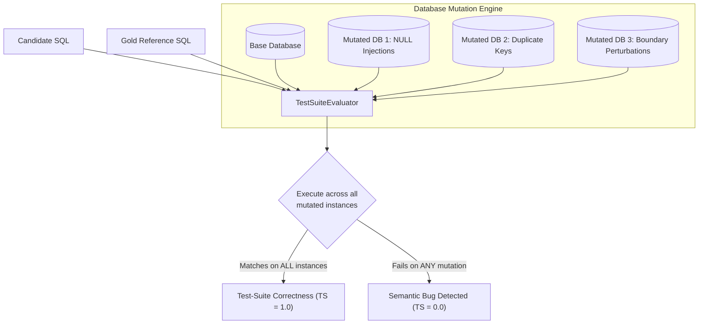

# Feasibility Study: Zero-Budget Evaluation Harness for LLM-Assisted SQL Generation
## Evaluating In-Process Fixture Testing, Error-Trap Taxonomies, and Dialect Selection for AskTheDatabase

**Date:** October 2026  
**Project:** [AskTheDatabase](https://github.com/chrisjcc/ask-the-database)  
**Target Document:** `docs/research/zero-budget-eval-harness-feasibility-study.md`  
**Primary Reference:** *Building a Zero-Budget Eval Harness for LLM-Assisted SQL Generation* (Morgan Li, DEV Community, October 2026)  
**Supporting Material:** [`Zero-budget_Eval_Harness_for_LLM-Assisted_SQL_generation.md`](Zero-budget_Eval_Harness_for_LLM-Assisted_SQL_generation.md)  

---

## 1. Executive Summary

This feasibility study evaluates the methodology presented in the technical article *"Building a Zero-Budget Eval Harness for LLM-Assisted SQL Generation"* (Li, 2026) and analyzes its technical viability, architectural trade-offs, limitations, and direct applicability to **AskTheDatabase** (`ask-the-database`).

### Core Findings & Strategic Verdict

The blog post advocates for an engineering-pragmatic, low-cost evaluation framework designed for data engineering teams adopting commercial LLMs. Its central contribution is a **three-part micro-harness** (Golden Dataset with explicit failure traps, In-Process Fixture Runner via DuckDB/SQLite, and Per-Trap Scorer with an action-oriented Decision Table).

| Dimension | Blog Post Approach | AskTheDatabase Current Architecture | Feasibility Assessment |
| :--- | :--- | :--- | :--- |
| **Primary Goal** | Model selection / regression smoke-testing for a single enterprise schema | Post-training (SFT, RLVR / GRPO, Harness Distillation) across diverse, unseen schemas | **Complementary**: High value for CI smoke-testing, but insufficient as a primary RLVR benchmark. |
| **Database Engine** | **DuckDB** (in-process OLAP, modern dialect) | **SQLite** (in-process relational, Spider benchmark standard) | **Keep SQLite as SSoT**; evaluate DuckDB as an optional OLAP extension. |
| **Verification Rigor** | Naive result-set set equality on a single static fixture | **Test-Suite Mutation Testing** (`TestSuiteEvaluator` across mutated DB instances) | **AskTheDatabase is strictly superior**; blog post's naive check suffers from false-positive risk. |
| **Diagnostic Model** | **Trap-tagged test cases** (`join_fanout`, `dialect`, `hallucinated_column`) | Aggregate performance metrics (TS%, EX%, VA%, $R_{\text{rec}}$%) | **Adopt Trap Taxonomy**: High value for granular error diagnosis and policy behavior profiling. |

### Verdict: **ADOPT WITH SELECTIVE EVOLUTION (HIGH VALUE)**

1. **Adopt the Error-Trap Taxonomy**: Augment `AskTheDatabase`'s evaluation suite with explicit `trap` metadata (`join_fanout`, `dialect_drift`, `hallucinated_column`, `aggregation_without_grouping`). This provides interpretable diagnostic telemetry during SFT and RLVR policy training.
2. **Implement a Zero-Budget Fast CI Smoke Test (`make test-smoke-eval`)**: Add a curated 30-case in-memory fixture test running in $<3$ seconds to block regressions on git push before triggering cluster-scale sweeps.
3. **Maintain Test-Suite Mutation Verification as the Primary Truth**: Retain `TestSuiteEvaluator` rather than falling back to the blog's single-fixture set equality, preserving protection against accidental false positives.
4. **Preserve SQLite as Benchmark SSoT, Pilot DuckDB for Analytics**: Retain SQLite for Spider/BIRD benchmark compliance, while introducing DuckDB as an optional dialect adapter for warehouse/analytical SQL workloads.

---

## 2. Technical Analysis of the Blog Post Approach

The article proposes a zero-cost, reproducible evaluation pattern for LLM-assisted SQL generation centered on three components:



### 2.1 The Three Core Artifacts

1. **The Golden Dataset (`cases.jsonl`)**:
   - Each case couples a question and reference SQL with schema context and an explicit **`trap`** attribute.
   - The author emphasizes: *"The trap field is the point: you're documenting the failure you expect models to make, so misses are diagnosable instead of mysterious."*
2. **In-Process Fixture Runner**:
   - Executes queries against a deterministic in-process database (DuckDB/SQLite) seeded from a deterministic script (`seed.sql`).
   - Compares result sets rather than SQL strings (`sorted(map(str, got)) == sorted(map(str, want))`) to prevent string syntax false negatives.
3. **Per-Trap Scorer & Decision Table**:
   - Calculates aggregate accuracy and breaks down misses by trap category (`misses_by_trap`).
   - Provides concrete remediation rules (e.g., if misses concentrate in `join_fanout`, add few-shot join examples; if dialect errors dominate, enforce engine prompt tags).

### 2.2 The Four Failure "Traps"

The article isolates four pervasive failure modes in LLM SQL generation:
1. **Join Fan-Out**: The model joins across one-to-many or many-to-many relationships without deduplication or grouping, multiplying row counts and artificially inflating aggregates.
2. **Dialect Drift**: The model generates non-standard functions (e.g., emitting Postgres `DATE_TRUNC` or Snowflake syntax into an incompatible engine).
3. **Hallucinated Columns**: The model predicts plausible column names (e.g., guessing `created_at`, `customer_name`, or `total_amount`) that do not exist in the actual DDL.
4. **Aggregation Without Grouping Keys**: Valid SQL grammar where aggregated values lack necessary dimensional grouping, producing a single scalar row rather than grouped series.

---

## 3. Database Engine Evaluation: DuckDB vs. SQLite

A prominent question raised in `Zero-budget_Eval_Harness_for_LLM-Assisted_SQL_generation.md` is:
> *"The article mentions DuckDB while our ask-the-database codebase makes use of SQLite, what was the motivation behind that design choice?"*

### 3.1 Architectural Comparison

| Architectural Property | DuckDB | SQLite (AskTheDatabase Choice) |
| :--- | :--- | :--- |
| **Execution Paradigm** | Vectorized columnar execution engine (OLAP) | Row-oriented b-tree execution engine (OLTP) |
| **Primary Domain** | Analytical data warehouse queries, Parquet/Arrow, large aggregations | Transactional relational queries, embedded systems, academic benchmarks |
| **Academic Benchmark Standard** | Rarely used in text-to-SQL research | **De facto global standard**: Spider, Spider 2.0, BIRD, CoSQL, WikiSQL |
| **Process Model** | In-process C++ library with Python bindings | In-process C library embedded into Python standard library (`sqlite3`) |
| **Security & Sandbox Isolation** | Limited granular mutation pragmas; requires file isolation | Native read-only pragma (`PRAGMA query_only = ON`), execution timeouts, CTE guards |
| **Multi-Database Portability** | Single monolithic database or detached files | Lightweight portable single-file databases (e.g., 200+ distinct benchmark DB files) |
| **Dialect Features** | Rich modern OLAP SQL (`DATE_TRUNC`, window frame clauses, list comprehension) | Standard ANSI SQL with core SQLite-specific scalar/aggregate functions |

### 3.2 Motivation for AskTheDatabase's Choice of SQLite

1. **Benchmark Fidelity (Spider & BIRD SSoT)**:
   - The entire text-to-SQL post-training literature—including the Spider benchmark (Yale, 2018) and the BIRD benchmark (2023)—is built on SQLite. The 200+ evaluation databases in `data/databases/` are distributed natively as `.sqlite` databases.
   - Forcing DuckDB as the primary engine would require migrating 200+ schemas and data files, altering foreign key cascades, and risking subtle semantic incompatibilities with gold evaluation queries.
2. **Zero-Dependency Hermetic Isolation**:
   - SQLite is built directly into Python's runtime (`import sqlite3`). It requires zero external binary drivers, guaranteeing that unit tests and sandbox environments run in any CI/CD or Slurm container out of the box.
3. **Defensive Sandboxing**:
   - `AskTheDatabase`'s [`SQLiteEnvironment`](file:///Users/christiancontrerascampana/Desktop/GitHub/text-to-sql/ask-the-database/src/ask_the_database/environment/sqlite_env.py) relies on strict SQLite security primitives: `PRAGMA query_only = ON`, query timeouts via `sqlite3.set_progress_handler`, and memory caps.

### 3.3 Potential Role for DuckDB in AskTheDatabase

While SQLite remains the necessary foundation for benchmark training, **DuckDB provides compelling value as an analytical extension**:
- For enterprise SQL tasks (e.g., modern data stack pipelines using dbt, BigQuery, or Snowflake), models must generate window functions and temporal date truncations that SQLite does not natively support.
- **Recommendation**: Retain SQLite as the core environment for Spider post-training, and introduce a lightweight `DuckDBEnvironment` implementing `DatabaseToolRegistry` for analytical enterprise benchmark extensions.

---

## 4. Verification Rigor: Naive Set Equality vs. Test-Suite Mutation

The blog post uses simple result-set set comparison:
```python
ok = sorted(map(str, got)) == sorted(map(str, want))
```

### 4.1 Limitations Acknowledged in the Blog Post

The author candidly notes:
> 1. *"Result-set comparison misses semantic issues. A query can return the right rows on a small fixture and still be a performance disaster at scale."*
> 2. *"Fixture realism caps value. If your seed data has no edge cases (NULLs, timezone boundaries, duplicate keys), your harness will overestimate every model."*

On a small seed fixture (e.g., 10 rows), severe semantic bugs regularly pass naive set equality:
- **Missing `DISTINCT`**: If the seed data happens to contain unique values across the join, a query missing `DISTINCT` produces the identical result as the correct query.
- **Accidental Filter Bypass**: A query filtering `WHERE age > 18` and a buggy query filtering `WHERE age >= 18` produce identical results if no test record has `age = 18`.
- **Unhandled `NULL` Values**: If no NULL values exist in the foreign key column, an `INNER JOIN` and a `LEFT JOIN` return identical tuples.

### 4.2 How AskTheDatabase Solves This: Test-Suite Mutation

`AskTheDatabase` explicitly protects against this vulnerability via [`TestSuiteEvaluator`](file:///Users/christiancontrerascampana/Desktop/GitHub/text-to-sql/ask-the-database/src/ask_the_database/environment/test_suite_evaluator.py):



Instead of testing on a single fixture, `TestSuiteEvaluator`:
1. Executes candidate SQL and gold SQL on the default database instance.
2. Clones the database in-memory and injects targeted mutations (NULL values, duplicated rows, boundary key modifications).
3. Executes both queries across all mutated instances.
4. **Only queries that match on all mutated instances receive `TS = 1.0`**.

This eliminates the exact false-positive risk identified in the blog post.

---

## 5. What AskTheDatabase Should Adopt

While `AskTheDatabase`'s execution engine is significantly more rigorous than the blog post's script, the article provides **three high-leverage concepts** that directly improve our development workflow:

### 5.1 Error-Trap Taxonomy for Fine-Grained Behavioral Telemetry

Currently, `AskTheDatabase` reports coarse aggregate metrics (TS%, EX%, VA%, $R_{\text{rec}}$%). When a model drops from 58% to 52% TS, developers must manually inspect SQL diffs to understand why.

**Adoption**: Incorporate a structured `trap` metadata field in benchmark splits and evaluation results:
- `join_fanout`: Multi-table joins with risk of Cartesian explosion.
- `hallucinated_column`: Queries referencing columns absent from the catalog.
- `dialect_drift`: Engine-incompatible functions.
- `aggregation_without_grouping`: Aggregate queries missing dimensional grouping.
- `null_boundary`: Queries sensitive to three-valued NULL logic.

By reporting `misses_by_trap` alongside TS%, developers and RLVR reward monitors can immediately detect whether policy updates are fixing specific behavioral failure modes.

### 5.2 Curated Fast-Feedback CI Smoke Test (`make test-smoke-eval`)

Running full benchmark evaluation across 1,034 Spider queries takes several minutes. 

**Adoption**: Build a 30-case in-process smoke test (`data/processed/smoke_test_cases.jsonl`) that runs in $<3$ seconds as part of `make test` or `make lint`. This gives immediate feedback on model checkpoints or prompt template adjustments before committing to multi-hour cluster runs.

### 5.3 Query Plan & Join Guard Middleware (`EXPLAIN` Checks)

The article notes that result-set comparison cannot detect queries that are *"performance disasters at scale"*. 

**Adoption**: Add an optional AST/EXPLAIN guard in `SQLSyntaxValidator` that flags unconstrained cross-joins (`CARTESIAN JOIN`) or excessive nested loops before executing candidate queries in the sandbox.

---

## 6. Actionable Implementation Recommendations

### Priority 1: Add Trap Taxonomy to Evaluation Reporting
* **Files to modify**:
  - [`src/ask_the_database/distillation/collector.py`](file:///Users/christiancontrerascampana/Desktop/GitHub/text-to-sql/ask-the-database/src/ask_the_database/distillation/collector.py): Add AST-based trap tagging (`classify_sql_trap(sql, schema)`).
  - [`scripts/evaluate_benchmark.py`](file:///Users/christiancontrerascampana/Desktop/GitHub/text-to-sql/ask-the-database/scripts/evaluate_benchmark.py): Group evaluation misses by trap category and write `misses_by_trap` to `results/evaluation_summary.json`.
* **Estimated effort**: 0.5 days.

### Priority 2: Create a 30-Case Fast Smoke Test Harness
* **Files to add**:
  - `data/fixtures/smoke_cases.jsonl`: 30 curated Spider questions covering all 5 trap categories.
  - `scripts/run_smoke_eval.py`: Fast $<3$s evaluator.
  - Add `make smoke-eval` to [`Makefile`](file:///Users/christiancontrerascampana/Desktop/GitHub/text-to-sql/ask-the-database/Makefile).
* **Estimated effort**: 0.5 days.

### Priority 3: Retain Architecture SSoT
* Retain **SQLite** as the primary execution engine for all benchmark training and test-suite mutation evaluation.
* Retain **`TestSuiteEvaluator`** as the ground-truth verifiable reward engine for RLVR and MVE gate adjudication.

---

## 7. Conclusion

The "Zero-Budget Evaluation Harness" approach highlights real, practical problems faced by practitioners. However, `AskTheDatabase` has already solved its most significant technical vulnerability—the unreliability of single-fixture result-set comparison—through test-suite mutation testing.

The true value of the blog post for `AskTheDatabase` lies in its **diagnostic discipline**: categorizing failures into explicit, understandable behavioral traps and providing ultra-fast local smoke tests. Adopting these specific elements will make `AskTheDatabase`'s post-training telemetry substantially more interpretable and accelerate developer iteration loops without compromising our rigorous post-training standards.
