# Minimum Viable Experiment (MVE) Implementation Plan: Zero-Budget Evaluation Harness
## In-Process Fixture Testing, Error-Trap Taxonomies, and Diagnostic Benchmarking for AskTheDatabase

**Date:** October 2026  
**Project:** [AskTheDatabase](https://github.com/chrisjcc/ask-the-database)  
**Feature Branch:** `feat/zero-budget-eval-harness-mve`  
**Feasibility Study:** [`docs/research/zero-budget-eval-harness/feasibility_study.md`](feasibility_study.md)  
**Primary Reference:** *Building a Zero-Budget Eval Harness for LLM-Assisted SQL Generation* (Li, DEV Community, October 2026)  

---

## 1. Executive Summary & Purpose

This document specifies the **Minimum Viable Experiment (MVE)** implementation plan for integrating an **In-Process Zero-Budget Evaluation Harness** into AskTheDatabase (`ask-the-database`). 

While AskTheDatabase possesses a rigorous ground-truth evaluation system—[`TestSuiteEvaluator`](file:///Users/christiancontrerascampana/Desktop/GitHub/text-to-sql/ask-the-database/src/ask_the_database/environment/test_suite_evaluator.py) operating across database mutations—evaluating full benchmark splits (1,034 Spider queries across 200 databases) takes several minutes and requires cluster resources. Furthermore, standard benchmark evaluations output aggregate accuracy figures (Test-Suite Correctness $\text{TS}\%$, Execution Accuracy $\text{EX}\%$) that conceal *why* models fail.

The **Zero-Budget Evaluation Harness** addresses these limitations by introducing:
1. **Curated Error-Trap Golden Suite (`smoke_cases.jsonl`)**: 35 curated test cases explicitly mapped to five pervasive relational failure modes: `join_fanout`, `dialect_drift`, `hallucinated_column`, `aggregation_without_grouping`, and `null_boundary`.
2. **In-Process Hermetic SQLite Runner**: Runs locally in $<3$ seconds on standard developer CPU with **\$0.00 cloud token cost** and zero external infrastructure dependencies.
3. **Per-Trap Diagnostic Scorer & Actionable Decision Table**: Categorizes misses into specific behavioral failure modes and prescribes concrete policy remediations.
4. **Mutation-Augmented Seed Fixtures**: Combines the ultra-fast execution of the blog post's in-process runner with AskTheDatabase's mutation testing to eliminate false positives on single fixtures.

### Key Comparative Scope
To evaluate the true value and fidelity of the Zero-Budget Evaluation Harness, the MVE establishes a direct head-to-head comparison across three primary approaches:
1. **Baseline Approach (Conventional SFT)**: Standard fine-tuned model evaluated without error-trap classification or fast in-process pre-flight testing.
2. **Harness-Zero Approach**: Procedural exploration rules internalized directly into model parameters ($58.4\%$ TS, zero runtime overhead).
3. **Proposed Zero-Budget Evaluation Harness**: The fast in-process diagnostic harness acting as an instant pre-flight regression gate (`make smoke-eval`) and behavioral diagnostic probe.

```
                          AskTheDatabase Evaluation Pyramid
                       ┌─────────────────────────────────────┐
                       │     Full Spider/BIRD Benchmarks     │  Cluster / Multi-Hour
                       │   (1,034+ Episodes, 200+ Schemas)   │  Ground-Truth Validation
                       └──────────────────┬──────────────────┘
                                          │
                       ┌──────────────────┴──────────────────┐
                       │   Targeted Split Testing (Dev/Real) │  Cluster / Minutes
                       │     (500 Episodes, 20 Schemas)      │  MVE Decision Gates
                       └──────────────────┬──────────────────┘
                                          │
  ┌───────────────────────────────────────┴───────────────────────────────────────┐
  │         Proposed Layer: In-Process Zero-Budget Trap Harness                   │  Local CPU / <3 Seconds
  │   • 35 Curated Trap Cases  • 5 Error Traps  • Per-Trap Decision Table         │  $0.00 Cloud Cost
  │   • Pre-Commit / Pre-Flight CI Smoke Gate (`make smoke-eval`)                 │  Instant Regression Block
  └───────────────────────────────────────────────────────────────────────────────┘
```

---

## 2. The 3 Comparative Experimental Configurations

The MVE directly compares three distinct evaluation and modeling workflows on identical schemas and questions:

```mermaid
flowchart TD
    subgraph Config1 ["1. Baseline Approach (Conventional SFT)"]
        M1["Qwen2.5-Coder-7B SFT"] --> E1["Standard Benchmark Eval\n(Single-Pass Greedy N=1)"]
        E1 --> Out1["Coarse Aggregate Metrics\n(TS: 51.6%, EX: 57.3%)\nMisses Uncategorized"]
    end

    subgraph Config2 ["2. Harness-Zero Approach (Internalized Exploration)"]
        M2["Qwen2.5-Coder-7B Harness-Zero"] --> E2["Standard Benchmark Eval\n(Single-Pass Greedy N=1)"]
        E2 --> Out2["High Correctness Metrics\n(TS: 58.4%, EX: 64.2%)\nDiagnostics Lack Trap Telemetry"]
    end

    subgraph Config3 ["3. Proposed Zero-Budget Evaluation Harness"]
        M3["Candidate Checkpoints\n(Baseline vs Harness-Zero)"] --> Runner["In-Process Hermetic Runner\n(<3s Execution, $0.00 Cost)"]
        Runner --> TrapScorer["Per-Trap Scorer\n(5 Error Trap Taxonomies)"]
        TrapScorer --> Decision["Actionable Remediation Table\n(Join / Column / Dialect / Agg)"]
        Runner --> MutationCheck["Mutation-Hardened Fixtures\n(Null & Duplicate Invariant)"]
    end
```



### 1. Configuration 1: Baseline Approach (Conventional SFT)
- **Model Checkpoint**: `models/mve/sft_baseline` (Condition 2 from Harness-Zero MVE).
- **Evaluation Mechanism**: Standard full-scale Spider evaluation (`scripts/evaluate_benchmark.py`).
- **Telemetry**: High-level aggregate percentages ($\text{TS}=51.6\%$, $\text{EX}=57.3\%$). When queries fail, developers receive only boolean pass/fail indicators without root-cause classification.
- **Iteration Latency**: 3–5 minutes per evaluation pass.

### 2. Configuration 2: Harness-Zero Approach
- **Model Checkpoint**: `models/sft/harness_zero` (Condition 4 from Harness-Zero MVE).
- **Evaluation Mechanism**: Standard full-scale Spider evaluation with internalized procedural exploration.
- **Telemetry**: High-level aggregate percentages ($\text{TS}=58.4\%$, $\text{EX}=64.2\%$, $+68.4\%$ error recovery gain).
- **Iteration Latency**: 3–5 minutes per evaluation pass.

### 3. Configuration 3: Zero-Budget Evaluation Harness (Proposed)
- **Harness Architecture**:
  1. `data/fixtures/smoke_cases.jsonl`: 35 curated cases with explicit `trap` tags:
     - `join_fanout` (7 cases): Multi-table relationships requiring precise deduplication.
     - `hallucinated_column` (7 cases): Schema DDLs with subtle column naming requiring precise grounding.
     - `dialect_drift` (7 cases): Temporal, string, and type casting functions testing SQLite compatibility.
     - `aggregation_without_grouping` (7 cases): Aggregate functions with dimensional group-by requirements.
     - `null_boundary` (7 cases): Three-valued logic edge cases (NULLs in foreign keys and subqueries).
  2. In-process in-memory SQLite fixture runner executing in $<3$ seconds.
  3. Per-trap diagnostic breakdown (`misses_by_trap`) and decision table output.
  4. Mutation-hardened fixture validation.

---

## 3. Comparative Architectural Analysis

| Dimension | 1. Baseline Approach | 2. Harness-Zero Approach | 3. Proposed Zero-Budget Harness |
| :--- | :--- | :--- | :--- |
| **Primary Objective** | Model training on gold SQL | Internalizing procedural exploration | Ultra-fast local regression testing & trap diagnosis |
| **Execution Engine** | Multi-file SQLite on disk | Multi-file SQLite on disk | Hermetic in-memory SQLite with seed fixtures |
| **Execution Time** | 180–300 seconds | 210–350 seconds | **$<3.0$ seconds** |
| **Financial / Token Cost** | \$0.00 local / \$N cluster GPU | \$0.00 local / \$N cluster GPU | **\$0.00 cloud tokens / runs on CPU** |
| **Diagnostic Granularity** | Coarse aggregate (TS%, EX%) | Coarse aggregate (TS%, EX%, $R_{\text{rec}}$%) | **Fine-grained per-trap attribution (`misses_by_trap`)** |
| **Actionable Guidance** | None (manual SQL diff inspection) | High-level recovery telemetry | **Rule-based Decision Table (Prompt / Schema / Reward)** |
| **Role in Development Loop**| Milestone benchmark | Production deployment model | **Git pre-commit, CI smoke gate, rapid local iteration** |

---

## 4. Evaluation Methodology & Metrics

To establish whether the Zero-Budget Evaluation Harness provides measurable, reproducible value, the experiment evaluates four core dimensions:

### 4.1 Diagnostic Discriminative Power
- **Metric**: **Per-Trap Error Attribution Accuracy ($\text{DA}\%$)**.
- **Methodology**: Manually audit 100 failure cases from Spider Dev to determine their true root-cause trap. Compare the automated trap attribution of the Zero-Budget Harness against ground-truth manual annotations.
- **Target**: $\ge 85\%$ attribution agreement.
- **Behavioral Profiling**: Measure whether the harness successfully exposes the expected behavioral differences between Baseline (Config 1) and Harness-Zero (Config 2). Specifically, Harness-Zero must show a $\ge 40\%$ relative reduction in `hallucinated_column` misses compared to Baseline.

### 4.2 Benchmark Rank Correlation ($\rho$)
- **Metric**: **Spearman Rank Correlation Coefficient ($\rho$) and Pearson $R^2$**.
- **Methodology**: Evaluate five diverse model checkpoints across both the 35-case Zero-Budget Harness and the full 1,034-case Spider Dev benchmark:
  1. Base Student Zero-Shot
  2. Conventional SFT Baseline
  3. Successful-Rollout Filtering Checkpoint
  4. Harness-Zero SFT Checkpoint
  5. Multi-Turn RLVR Checkpoint
- **Target**: Spearman rank correlation $\rho \ge 0.88$ between Zero-Budget Harness score and full Spider Dev Test-Suite score.

### 4.3 Execution Speed & Developer Iteration Latency
- **Metric**: **Wall-clock run time per evaluation pass ($T_{\text{eval}}$)**.
- **Methodology**: Measure execution duration across 20 repeated runs on an M-series Apple Silicon Mac and a standard Linux CI runner.
- **Target**: $T_{\text{eval}} \le 3.0\text{ seconds}$ (a $>60\times$ speedup over the 180s full benchmark pass).

### 4.4 False-Positive Immunity (Mutation Sensitivity)
- **Metric**: **False-Positive Escape Rate ($\text{FPR}\%$)**.
- **Methodology**: Construct 20 deliberately mutated buggy SQL queries (queries missing `DISTINCT`, queries with off-by-one boundary predicates, queries using `INNER JOIN` instead of `LEFT JOIN` on nullable keys).
  - Test them against naive single-fixture set equality (blog post approach).
  - Test them against the mutation-hardened fixture runner (AskTheDatabase approach).
- **Target**: 0% false-positive escape rate for the mutation-hardened harness (100% of injected semantic bugs caught).

---

## 5. Pre-Registered Go / No-Go Decision Criteria

The experiment establishes quantitative decision gates to govern whether the Zero-Budget Evaluation Harness is adopted into the core project:

| Decision Gate | Formal Threshold | Rationale & Stopping Criterion |
| :--- | :--- | :--- |
| **Gate 1: Execution Latency Budget** | Wall-Clock Runtime $\le 3.0\text{ seconds}$ | Must run fast enough to serve as an interactive pre-commit hook and instant local check (`make smoke-eval`). |
| **Gate 2: Benchmark Rank Correlation** | Spearman $\rho \ge 0.88$ vs. Spider Dev | The 35-case micro-harness must correctly preserve model rankings compared to the full 1,034-episode benchmark. |
| **Gate 3: Error-Trap Diagnostic Resolution** | $\ge 85\%$ trap attribution accuracy & $\ge 40\%$ reduction in `hallucinated_column` for Harness-Zero | The harness must provide genuinely actionable diagnostic insights that clearly differentiate Baseline from Harness-Zero. |
| **Gate 4: False-Positive Immunity** | Bug Detection Rate $= 100\%$ on semantic mutants | Must catch 100% of injected semantic bugs that pass naive single-fixture set equality, ensuring high verification rigor. |

### Stop Conditions (Immediate `NO-GO`)
1. **The Inconsistent Ranking Stop**: If Spearman rank correlation $\rho < 0.75$, reject the micro-harness as an unreliable proxy for full benchmark capabilities.
2. **The High-Latency Stop**: If execution time exceeds $10.0\text{ seconds}$, reject from pre-commit / local CI workflow.
3. **The False-Positive Leakage Stop**: If more than $10\%$ of semantic bug mutants pass the fixture runner, reject single-fixture execution as insufficiently rigorous.

---

## 6. Implementation Roadmap & Sub-Task Breakdown

The implementation is broken down into three manageable, testable sub-issues on feature branch `feat/zero-budget-eval-harness-mve`:

### Sub-Task 1: Curate Golden Trap Dataset & Mutation-Augmented Seed Fixtures
* **Deliverables**:
  - `data/fixtures/smoke_cases.jsonl`: 35 curated cases with balanced distribution across the 5 trap types (7 cases per trap).
  - `data/fixtures/seed_fixtures.sql`: Deterministic SQLite DDL and seed data covering complex foreign keys, nullable attributes, and boundary values.
  - Unit tests verifying dataset schema integrity and fixture loading.

### Sub-Task 2: In-Process Hermetic Runner, Trap Scorer & Decision Table Engine
* **Deliverables**:
  - `src/ask_the_database/evaluation/zero_budget_harness.py`:
    - `ZeroBudgetHarness`: In-memory SQLite fixture runner.
    - `TrapScorer`: Decomposes evaluation results into per-trap metrics (`misses_by_trap`).
    - `DecisionTable`: Prescribes concrete remediations based on trap failure concentrations.
    - `QueryPlanGuard`: Optional AST check detecting unconstrained Cartesian joins.
  - Unit tests verifying trap classification, execution speed ($<3$s), and mutation sensitivity.

### Sub-Task 3: Comparative 3-Way MVE Evaluation, Decision Gate Adjudication & Makefile Integration
* **Deliverables**:
  - `scripts/run_smoke_eval.py`: CLI entrypoint for fast local evaluation.
  - `scripts/run_zero_budget_mve.py`: Evaluates the 3 configurations (Baseline, Harness-Zero, Zero-Budget Harness), computes rank correlation, and adjudicates Gates 1–4.
  - Integrate Makefile targets: `make smoke-eval` and `make evaluate-zero-budget-mve`.
  - Export empirical reports: `docs/research/zero-budget-eval-harness/mve_results.md` and `results/zero_budget_mve_summary.json`.
  - Formulate formal merge recommendation for `feat/zero-budget-eval-harness-mve`.

---

## 7. Actionable Decision Table Specification

When models fail on the Zero-Budget Evaluation Harness, the diagnostic engine automatically consults the **Remediation Decision Table**:

| Dominant Error Trap | Empirical Signature | Prescribed Remediation | Target Pipeline Layer |
| :--- | :--- | :--- | :--- |
| **`join_fanout`** | Queries produce inflated row counts; missing `GROUP BY` or `DISTINCT` across 1:N relations. | Add few-shot demonstrations showing deduplication (`COUNT(DISTINCT ...)`) or intermediate CTE aggregation. | Prompt Formatter / SFT Dataset |
| **`hallucinated_column`** | Queries fail with `OperationalError: no such column`; guesses plausibly named columns. | Enforce explicit schema catalog inspection (`inspect_schema`) and column existence verification. | Harness-Zero Distillation / Schema Tool |
| **`dialect_drift`** | Queries use Postgres/Snowflake syntax (`DATE_TRUNC`, `ILIKE`, `::int`). | Inject strict dialect system instructions (`SQLite 3 dialect only`) and AST syntax penalty rewards. | Syntax Reward / Agent Prompt |
| **`aggregation_without_grouping`** | Aggregated columns selected alongside bare attributes without `GROUP BY`. | Inject AST validation rule rejecting bare non-aggregated columns in aggregate projections. | AST Syntax Validator / Reward Rubric |
| **`null_boundary`** | Queries fail on `NOT IN (SELECT ...)` with nullable foreign keys. | Inject rule advocating `NOT EXISTS` or explicit `IS NOT NULL` guard predicates. | Prompt Few-Shot / Curated Demonstrations |

---

## 8. Summary of Expected Outcomes

By completing this MVE, AskTheDatabase will determine whether adopting an in-process Zero-Budget Evaluation Harness delivers:
1. An **instant, zero-cost pre-flight smoke test** ($<3$s) for local pair-programming and CI regression checking.
2. An **interpretable error-trap taxonomy** that explains *why* models fail instead of merely reporting coarse accuracy.
3. A **rigorous mutation-hardened foundation** that preserves the speed of in-process testing while preventing naive set-equality false positives.
